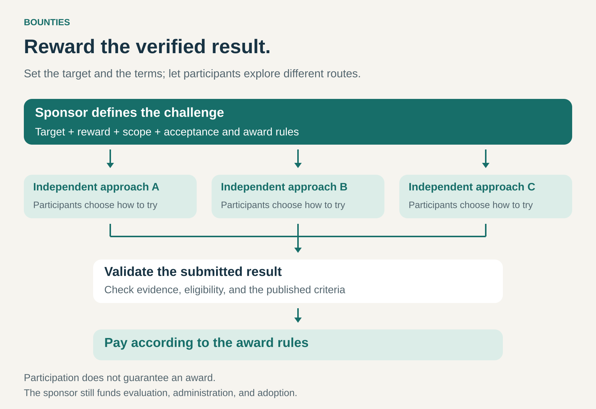

## What it is for

Bounties help an organization attract people who can deliver a specific result: discover a vulnerability, solve a technical problem, complete a useful improvement, or demonstrate a new capability.

They are useful when the desired outcome can be described and verified, but the organization does not know who can achieve it—or which approach will work.

By announcing a reward, the organization gives potential contributors a reason to investigate. Participants decide whether their knowledge, tools, or ideas give them a worthwhile chance of success.

## The core idea

**Offer a reward for a qualifying result, with clear rules for determining who earns it.**

The sponsor defines the target, eligibility, evidence requirements, and reward structure. Participants choose how to approach the challenge. Payment depends on the submitted result and the published award rules.

There are several useful forms:

- **First qualifying result:** the first participant to meet the conditions earns the reward.
- **Best qualifying result:** submissions compete against defined criteria, usually within a deadline.
- **Multiple qualifying results:** separate discoveries or completed tasks can each receive a reward.
- **Graduated rewards:** payment varies with impact, difficulty, completeness, or other stated criteria.

A bounty can be a small, repeatable mechanism or a major innovation prize. The defining feature is the connection between a reward and a verifiable achievement.

For a business, it is usually a way to obtain valuable contributions. An intermediary can also build a business around hosting challenges, recruiting participants, and managing evaluation.

## How it works

A workable bounty connects five elements.

**A meaningful target.** The requested achievement must matter to the sponsor. “Find a reproducible defect affecting this product” provides a clearer target than “send us interesting ideas.”

**A credible reward.** The potential payment needs to justify participation, considering effort, uncertainty, and the likelihood that someone else will qualify first. Recognition and learning can add value, but participants still need realistic expectations.

**Clear boundaries.** The rules establish eligible work, permitted methods, deadlines, duplicate submissions, ownership, and conditions for payment.

**Reliable verification.** The sponsor needs evidence that a result meets the criteria. This might involve reproducing a finding, testing a prototype, inspecting a completed change, or assessing performance against a benchmark.

**A route into use.** An accepted result may still need engineering, implementation, maintenance, or commercial development. The bounty obtains a contribution; the organization must be able to put it to work.

## Why it works

Bounties allow capable people to identify themselves through results.

An organization may struggle to predict which specialist can solve an unusual problem. A published challenge lets people with relevant knowledge recognize an opportunity and attempt it.

The pattern also permits parallel exploration. Different participants can pursue different approaches without requiring the sponsor to choose a single method in advance.

A defined reward can direct attention toward neglected problems. Graduated rewards can further signal which outcomes matter most—for example, discoveries with greater impact or solutions supported by stronger evidence.

Part of the uncertainty shifts to participants, who may spend time without earning a reward. That makes credible rules, fair evaluation, and an attractive opportunity central to the model’s durability.

## Famous examples

### Google Bug Hunters — rewarding qualifying security discoveries

Google’s vulnerability reward programs invite external researchers to identify and report security weaknesses. Google reported awarding more than $17 million to over 700 researchers across its programs in 2025. [Google’s 2025 program review](https://blog.google/security/vrp-2025-year-in-review/).

The reward is tied to an actionable contribution. Chrome’s program, for example, specifies eligible issues, evidence requirements, and treatment of duplicate reports. Its rules generally prioritize the first actionable report of a previously unknown issue, with reward decisions made by a review panel. [Chrome’s reward program rules](https://bughunters.google.com/about/rules/chrome-friends/chrome-vulnerability-reward-program-rules).

This illustrates an ongoing bounty system with multiple possible recipients. The sponsor benefits from independent investigation while retaining responsibility for evaluating findings and fixing accepted problems.

### Netflix Prize — rewarding a measurable improvement

Netflix offered a $1 million prize for improving its movie-rating prediction system by approximately 10% against the competition’s defined measure. In September 2009, BellKor’s Pragmatic Chaos received the grand prize.

The competition included an online leaderboard and a final competition period triggered when a team reached the improvement threshold. These features gave participants feedback and allowed further competition once the target had been demonstrated as achievable. [UC San Diego’s account, including the role of competition designer and judge Charles Elkan](https://jacobsschool.ucsd.edu/news/release/888?id=888).

The example shows how a business problem can become a challenge that external specialists can evaluate and pursue. Its broader lesson is the importance of the scoring measure: success against a benchmark still needs separate assessment for practical deployment and business value.

### Ansari XPRIZE — rewarding a demonstrated capability

The Ansari XPRIZE offered $10 million for a privately funded, reusable crewed spacecraft capable of meeting specified flight requirements, including reaching 100 kilometers above Earth twice within two weeks.

Mojave Aerospace Ventures won with SpaceShipOne in October 2004. The challenge established an observable achievement while leaving teams freedom over how to accomplish it. [XPRIZE’s competition history](https://www.xprize.org/competitions/ansari).

This illustrates a bounty aimed at demonstrating a new capability. The prize could concentrate attention and ambition around a clear milestone, while teams needed their own resources to develop and test their approaches. Winning the prize was a milestone in development; building a repeatable commercial service required further work.

## The economics

The advertised reward is only one part of the sponsor’s cost.

Consider an illustrative program that receives 200 submissions and awards ten bounties:

| Item                                           |        Cost |
| ---------------------------------------------- | ----------: |
| Ten rewards of $2,000                          |     $20,000 |
| Submission review and verification             |      $5,000 |
| Program administration and participant support |      $5,000 |
| Integrating accepted results                   |     $10,000 |
| **Total**                                      | **$40,000** |

The total cost is **$4,000 per accepted result**, assuming all ten accepted results are integrated.

That figure needs comparison with the value obtained and alternative ways to obtain it. Ten low-value results could be a poor investment; one important discovery could justify much of the expenditure.

If nothing qualifies, rewards may remain unpaid, but administration and evaluation still cost money. Participants also incur costs, including unsuccessful attempts that never appear in the sponsor’s accounts.

## Useful when

- A desired result can be described clearly and checked credibly.
- Relevant expertise exists beyond the organization’s usual network.
- Several approaches could work, and choosing one in advance is difficult.
- Contributions can be evaluated separately.
- The potential value supports an attractive reward.
- The organization can absorb uncertainty about participation, timing, and success.

Bounties are less suitable when continuous coordination, dependable delivery dates, or extensive shared context dominate the work.

## Common mistakes and limits

**Rewarding the wrong measure.** Participants respond to what earns payment. A narrow metric can encourage results that score well while creating little practical value.

**Underestimating verification.** Large submission volumes can overwhelm reviewers, especially when many entries are incomplete, repetitive, or difficult to reproduce.

**Leaving award rules ambiguous.** Unclear definitions of novelty, completion, priority, or shared credit can turn evaluation into a dispute.

**Offering an unattractive opportunity.** A large headline reward may still provide poor expected compensation when success is unlikely or development costs are substantial.

**Moving the conditions after submission.** Participants need confidence that work will be assessed under understandable, consistent terms. Unpredictable decisions discourage future contributions.

**Assuming payment settles ownership and adoption.** Rights to use the result, supporting documentation, and any continuing obligations need explicit treatment. Implementation resources remain necessary.

## Related patterns

- [[crowdsourcing|Crowdsourcing:]] organizes contributions from a distributed group; bounties provide one reward structure for attracting them.
- [[open-business-model|Open Business Model:]] brings external knowledge and capabilities into how an organization creates value.
- [[outcome-based-pricing|Outcome-Based Pricing:]] connects a customer’s payment to results; bounties apply a related logic when an organization rewards contributors.
- [[marketplace|Marketplace:]] can connect sponsors with potential contributors and support submission, evaluation, and payment.
