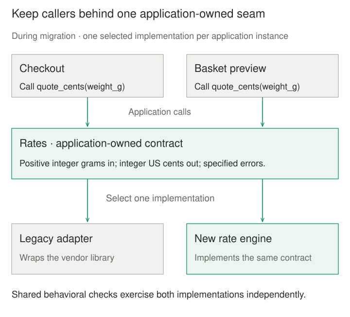
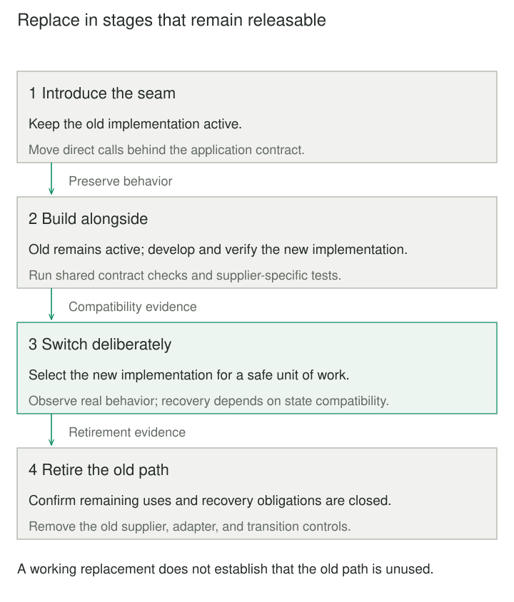

## Purpose and problem

A delivery application uses an aging shipping-rate library. Checkout, basket previews, and support tools call its vendor-specific API directly. Replacing the library will take weeks, but customers still need fixes and new features during that work. A separate, long-running source branch lets the replacement diverge from everyday development; changing every caller in one release makes the cutover difficult to review and recover from.

The competing requirements are to change a widely used implementation and keep delivering working software. The difficulty comes from coupling the migration’s completion to the application’s next usable release. Branch by Abstraction creates intermediate designs that can run correctly before the replacement is complete.

## Core idea

Introduce an application-owned abstraction around the dependency. Move callers behind it while retaining the old behavior, then build the replacement behind the same boundary. Select the new implementation when the relevant behavior is ready and remove the old path after the transition is proven.

The mental model is **change the supplier behind a stable seam, in releasable steps**. The “branch” is the temporary coexistence of implementations inside the integrated system. It does not mean creating a long-lived version-control branch. Dependency injection, adapters, or a feature flag can support the technique; none alone constitutes the migration.



## How it works

First, define the smallest useful behavior callers need. For rates, specify currency, rounding, accepted weight units, and errors, rather than exposing the old library’s entire object model. An adapter initially delegates to that library. Move callers to the boundary progressively and test that this refactoring preserves behavior. Prevent new direct dependencies from extending the old path.

Next, implement the replacement. Exercise both implementations against shared contract examples, plus tests specific to each supplier. Matching method names is insufficient: ordering, exceptions, transaction boundaries, and resource usage may differ. A passing finite suite supplies evidence about the cases it covers, not proof of universal equivalence.

Choose the active implementation at a deliberate composition point. Startup configuration is enough for some migrations. Others move one capability or cohort at a time, provided mixed operation is safe. A request or transaction should retain a coherent selection throughout its work; changing a global switch halfway through can combine incompatible state or ownership rules.

The application owns the migration policy. The component that creates connections, subscriptions, or pools must also arrange their shutdown after users drain. Keeping the old code available does not make rollback safe after the new implementation has written incompatible data. Data conversion and compatibility need an explicit plan of their own.



## Worked example

### Replacing the shipping-rate supplier

Originally, checkout and previews unpack the legacy library’s currency-and-price pair themselves. The design change gives both callers a `Rates` contract returning integer US cents. `LegacyAdapter` preserves the old calculation; `NewRates` implements it without the vendor API. Deployment can initially select the adapter while the new implementation is developed and checked.

This complete Python 3.9+ program needs no packages. Inputs are positive integer parcel weights in grams. The price is 500 cents for the first 1,000 grams, plus 200 cents for each additional started 1,000 grams. The two callers represent already-migrated application code.

```python
from typing import Protocol


class Rates(Protocol):
    def quote_cents(self, weight_g: int) -> int: ...


class LegacyLibrary:
    def calculate(self, weight_g):
        if weight_g <= 0:
            raise ValueError("weight must be positive")
        price = 500
        remaining = weight_g - 1000
        while remaining > 0:
            price += 200
            remaining -= 1000
        return "USD", price


class LegacyAdapter:
    def __init__(self, library):
        self.library = library

    def quote_cents(self, weight_g):
        currency, cents = self.library.calculate(weight_g)
        if currency != "USD":
            raise ValueError("unexpected currency")
        return cents


class NewRates:
    def quote_cents(self, weight_g):
        if weight_g <= 0:
            raise ValueError("weight must be positive")
        return 500 + 200 * ((weight_g - 1) // 1000)


def checkout(rates: Rates, weight_g: int) -> int:
    return rates.quote_cents(weight_g)


def basket_preview(rates: Rates, weight_g: int) -> str:
    return f"Shipping: {rates.quote_cents(weight_g)} US cents"


def compose(use_new: bool) -> Rates:
    return NewRates() if use_new else LegacyAdapter(LegacyLibrary())


if __name__ == "__main__":
    for use_new in (False, True):
        rates = compose(use_new)
        for grams, cents in ((1, 500), (1000, 500), (1001, 700), (2000, 700)):
            assert checkout(rates, grams) == cents
        assert basket_preview(rates, 1001) == "Shipping: 700 US cents"
        try:
            checkout(rates, 0)
        except ValueError:
            pass
        else:
            raise AssertionError("zero weight must be rejected")
        name = "new" if use_new else "legacy"
        print(f"{name}: {checkout(rates, 1001)} US cents; zero rejected")
```

It prints `legacy: 700 US cents; zero rejected`, then `new: 700 US cents; zero rejected`. The 1,000/1,001-gram boundary catches rounding mistakes; zero checks the shared error contract. An unexpected legacy currency fails rather than silently interpreting another currency as cents. Positive integer weights are a caller precondition; annotations do not perform runtime validation.

The program shows the coexistence stage, not an automated deployment controller. Its switch selects an implementation for an instance, and it never retries a failure against the other one. After representative production evidence and retirement checks, remove the legacy selection, adapter, and library. Retain `Rates` if it still expresses a useful application boundary.

### A persistence replacement

Jez Humble describes ThoughtWorks Go moving repositories from iBatis to Hibernate while feature work continued. Existing repositories already hid persistence details from services, allowing migration repository by repository. That case exposes a larger concern than this pure calculation: implementations sharing a database must preserve transaction and cache semantics as well as returned values.

## When to use it

Use this when a dependency replacement or substantial internal restructuring spans multiple releases, callers can be moved behind a meaningful boundary, and the team must keep integrating other changes. It is especially useful when one migrated operation can be verified and delivered without completing the whole replacement.

A small, local change that can be completed and checked together usually needs a direct refactoring. If no safe coexistence boundary exists, the pattern does not create one by naming an interface; a rehearsed coordinated transition may be simpler.

## Tradeoffs and common mistakes

Temporary duplication costs development time, testing effort, and operational attention. Assign an owner and retirement conditions so the transition does not become permanent support for two technologies. Track remaining direct calls and old implementation usage, including scheduled jobs and recovery tools.

Avoid designing a universal framework around a single replacement. Conversely, an abstraction that merely reproduces every vendor detail can preserve the coupling you intended to remove. Let caller behavior determine the boundary.

Shadow comparisons can expose differences for safe, side-effect-free reads. Executing both implementations for payments, notifications, or writes can duplicate effects; it requires a separately designed isolation or deduplication scheme. Automatic fallback can also hide defects or repeat a partially completed operation. Preserve failure visibility and make recovery policy explicit.

## Related patterns

[[adapter|Adapter]] translates an incompatible supplier API into the chosen boundary. Branch by Abstraction adds the staged migration and retirement around that structure.

[[dependency-injection|Dependency Injection]] supplies the selected implementation to callers. It supports composition without prescribing a replacement lifecycle.

[[data-expand-migrate-contract|Expand–Migrate–Contract]] manages compatibility while usages move between old and new interfaces or representations. Branch by Abstraction commonly keeps the caller-facing interface stable while replacing its supplier.

[[data-incremental-replacement|Strangler Fig]] incrementally replaces capabilities around an existing system, often through request routing. Branch by Abstraction typically establishes a seam around a dependency within the application; the techniques can be combined.

## Sources

- Paul Hammant, [Introducing Branch By Abstraction](https://paulhammant.com/blog/branch_by_abstraction.html) (2007): early published description of the sequence; credits Stacy Curl with the name.
- Martin Fowler, [Branch By Abstraction](https://martinfowler.com/bliki/BranchByAbstraction.html) (2014): gradual supplier replacement, variation in migration granularity, testing, and optional selection controls.
- Jez Humble, [Make Large Scale Changes Incrementally with Branch By Abstraction](https://continuousdelivery.com/2011/05/make-large-scale-changes-incrementally-with-branch-by-abstraction/) (2011): first-hand Go persistence migration and the need for an exit strategy.

The shipping-rate program and both illustrations are original teaching examples. Their bounded arithmetic model does not simulate persistence migration, concurrent cutover, or deployment automation.
