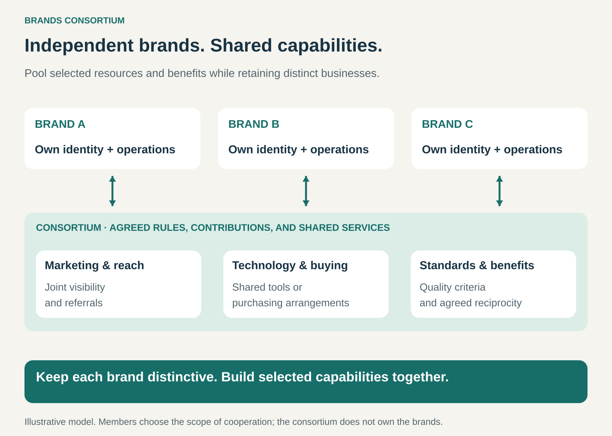

## What it is for

Give independent brands access to shared reach, resources, and customer benefits while preserving their individual identities.

A small hotel can offer a distinctive experience but struggle to reach international travelers. An independent retailer may know its local customers well but lack purchasing scale or sophisticated technology. An airline can serve many destinations while still benefiting from connections beyond its own network.

A Brands Consortium lets participating businesses build selected capabilities together.

It is useful when brands gain from belonging to a larger network while their differences remain part of what customers value.

## The core idea

**Create a continuing alliance in which independently controlled brands pool selected resources, follow agreed rules, and share defined benefits.**

The shared layer might include marketing, reservations, procurement, technology, referrals, standards, or reciprocal customer benefits.

Members retain their own businesses and identities. The consortium coordinates the activities they have chosen to share.

The arrangement can take different organizational forms, including an association, cooperative, or jointly owned organization. Shared ownership is one possibility, rather than a requirement of the pattern.

The important distinction is between a network of participating businesses and a collection of brands controlled by one parent company.

A consortium also needs more substance than a joint advertising campaign: continuing services, participation rules, and a reason for members to remain involved.

## How it works

**1. Choose a benefit worth building together.**

The consortium needs a concrete purpose.

Members might want access to customers they cannot reach efficiently alone, common booking infrastructure, purchasing arrangements, or benefits that customers can use across the network.

The collective offering should improve something customers or members actually experience.

**2. Define membership and the shared promise.**

Membership criteria establish which businesses fit the network and what participation requires.

A hospitality consortium might emphasize particular service expectations while allowing very different properties. A retail group might focus on purchasing commitments and shared systems.

If the consortium has a visible brand, customers need to understand what that name promises across otherwise different businesses.

**3. Operate the shared capabilities.**

Someone must manage campaigns, maintain systems, administer benefits, coordinate suppliers, and resolve disputes.

Members contribute through fees, usage charges, purchasing commitments, staff participation, or other agreed arrangements.

The shared organization needs sufficient resources and authority to perform its role.

**4. Balance collective decisions with member independence.**

The consortium defines which decisions belong to the group and which remain with individual businesses.

It also needs rules for admitting members, changing standards, allocating costs, handling poor performance, and leaving the network.

Members should be able to understand both what they gain and what they commit to.

## Why it works

**Shared investment can spread costs.** A booking platform, campaign, or specialist team may serve many businesses.

**A broader network can improve the customer offering.** Customers may gain more locations, connections, choices, or reciprocal benefits.

**Collective recognition can support discovery.** A customer familiar with the consortium may consider a member brand they have never encountered.

**Members can preserve differentiation.** Local knowledge, distinctive products, and individual experiences remain valuable within the network.

**Aggregated demand can improve purchasing arrangements.** Members may gain access to products, services, or terms that would be difficult to obtain individually.

These advantages depend on actual participation. A large membership list creates little value if members do not use or support the shared capabilities.

## Famous examples

### Star Alliance — distinct airline brands with connected benefits

Star Alliance connects airline brands through a broader travel network and reciprocal benefits. Singapore Airlines describes opportunities for eligible travelers to earn miles across member airlines and receive status-related benefits, subject to conditions. [Singapore Airlines: Star Alliance](https://www.singaporeair.com/en_UK/mv/plan-travel/partner-airlines/star-alliance/)

The participating airlines retain their identities. Their frequent-flyer programs also remain separate: alliance participation does not create a single pooled mileage account. [Miles & More: separate frequent-flyer programs](https://www.miles-and-more.com/pl/en/general-information/help-and-contact/help/transferring-miles-form-other-programmes.html)

The consortium pattern appears in the shared network benefits layered across the individual airline businesses.

### Relais & Châteaux — collective visibility for distinctive hospitality businesses

Relais & Châteaux is an association of independently operated hotels and restaurants. Its common identity connects properties that emphasize their individual destinations, hospitality, and culinary character. Its website provides discovery and booking routes across the collection. [About Relais & Châteaux](https://www.relaischateaux.com/us/about/)

The shared association gives customers a recognizable way to discover otherwise separate businesses.

The properties’ differences remain central to the offering. Membership creates a collective presence around that diversity rather than requiring every property to deliver an identical experience.

### Euronics — shared retail resources across national brands

Euronics brings together national retail organizations operating under both the Euronics name and established national brands. Its structure preserves the independence of those organizations while providing group governance and coordinated international operations. [Euronics group structure](https://www.euronics.com/the-group)

Its UK membership offering illustrates practical shared capabilities: access to supplier ranges, warehousing and deliveries, an e-commerce platform, promotions, and optional Euronics storefront branding. [Euronics UK membership offering](https://euronics.a.bigcontent.io/v1/static/JOIN%20OUR%20MEMBERSHIP_2026)

The example combines collective scale with independently operated retail businesses. The particular services and arrangements vary across the network.

## The economics

A consortium can fund its shared organization through membership fees, transaction charges, service fees, or other agreed contributions.

Its members usually continue earning revenue through their own businesses. Their combined sales should not automatically be treated as revenue belonging to the consortium.

Consider a hypothetical member’s annual participation:

| Item                                                     | Annual value |
| -------------------------------------------------------- | -----------: |
| Marketing and technology costs genuinely avoided         |      $18,000 |
| Additional contribution from new network-generated sales |      $12,000 |
| Membership and service fees                              |     −$10,000 |
| Integration and participation costs                      |      −$5,000 |
| Estimated net benefit                                    |  **$15,000** |

The additional sales contribution is measured after associated delivery and transaction costs. It also assumes those sales would not otherwise have occurred.

The shared organization needs its own viable budget. Fifty members paying $10,000 each provide $500,000 to fund collective services, regardless of how large their combined businesses are.

Benefits may differ substantially between members. A sustainable arrangement needs a defensible way to allocate costs and recognize contributions.

## Useful when

- **Distinctive brands face common needs.** Their differences matter, but some capabilities can be shared.
- **Scale improves the offering.** Broader reach, purchasing volume, or shared investment creates practical value.
- **Customers benefit from network membership.** The collective identity represents something useful.
- **Members can accept common rules.** Standards and participation commitments are compatible with their businesses.
- **Shared services can be operated effectively.** The network has resources and decision-making capacity.

## Common mistakes and limits

**Building a shared logo without shared value.** Membership needs to deliver more than permission to display a badge.

**Making the customer promise unclear.** Customers may assume that every benefit, standard, or service applies everywhere when participation actually varies.

**Allowing members to benefit without contributing.** Uneven participation can weaken both finances and trust.

**Ignoring reputational spillovers.** Poor performance by one member can damage confidence in the collective name.

**Letting large members dominate.** Smaller members may leave if decisions consistently favor businesses with different needs.

**Standardizing away the appeal.** Excessive uniformity can remove the distinctiveness that made the member brands attractive.

**Overextending cooperation.** Collaboration between competitors has legal boundaries. The European Commission’s guidance distinguishes genuine joint purchasing from cartels and addresses risks involving commercial coordination and information exchange. [European Commission horizontal-cooperation guidelines](https://eur-lex.europa.eu/legal-content/EN/TXT/?uri=CELEX%3A52023XC0721%2801%29)

The pattern is harder to sustain when members want incompatible benefits, cannot uphold the shared promise, or gain too little to justify continuing participation.

## Related patterns

- [[open-business-model|Open Business Model:]] makes collaboration across organizational boundaries central to value creation. A consortium provides a continuing network for selected activities.
- [[joint-venture|Joint Venture:]] can provide an ownership structure for a consortium’s shared organization, although consortium membership need not involve equity ownership.
- [[membership|Membership:]] defines access, obligations, and benefits. Here, the members are participating businesses or brands.
- [[demand-aggregation|Demand Aggregation / Group Buying:]] can form one component of the consortium by combining members’ purchasing requirements.
