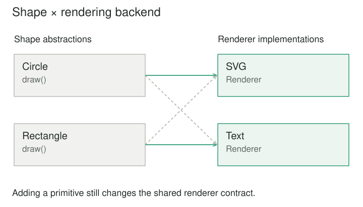

## Purpose and problem

A drawing tool supports circles and rectangles on two rendering backends. Its classes are SvgCircle, RasterCircle, SvgRectangle, and RasterRectangle. Add a third shape and both backend variants need new classes. Add a third backend and every shape needs another variant. The hierarchy grows around combinations rather than concepts.

## Core idea

Bridge separates those dimensions. A shape represents the high-level abstraction and holds a renderer representing the implementation dimension. A Circle can use an SVG renderer or a raster renderer. Adding a shape changes the shape side; adding a renderer changes the implementation side.



## How it works

The abstraction offers the operations clients care about. A Shape might support move and draw. The implementor exposes lower-level capabilities the abstraction uses, such as draw_circle and draw_polygon. The two interfaces do not need to look alike.

That distinction matters. The abstraction can compose several implementation operations to provide one high-level operation. It might apply positioning rules, visibility, or domain-specific behavior before delegating rendering. The bridge is the stored relationship between these layers.

If there are m shape variants and n rendering variants, inheritance around every combination can push the design toward m times n concrete classes. Separating the dimensions can allow roughly m plus n variants, although adapters or compatibility-specific components may still be needed. The arithmetic illustrates the pressure; it does not prove that every dimension should be split.

## Worked example

### A drawing example with independent changes

Consider a Circle abstraction that stores its center and radius. Its draw operation asks its renderer to render a circle using those values. An SvgRenderer creates vector output; a RasterRenderer paints pixels. The caller selects the renderer when it creates or configures the shape.

Adding Ellipse requires a new abstraction variant and a suitable operation in the renderer contract if none exists. Adding PdfRenderer requires implementing the established rendering operations. There is no need for PdfCircle, PdfRectangle, and PdfEllipse classes whose main distinction is the backend.

The implementor interface must be designed carefully. If it includes a separate method for every possible shape, new shape types may still force changes to all renderers. A lower-level vocabulary of paths and fills may offer better independence, at the cost of making shape construction more involved.

This is the practical heart of Bridge: finding a boundary where the low-level vocabulary is stable enough to support the high-level variation. Splitting classes without such a vocabulary moves the coupling into method additions rather than resolving it.

### A small implementation

The drawing abstraction delegates to a rendering implementation. Circle and Rectangle vary independently from SvgRenderer and TextRenderer. The example returns descriptions rather than drawing pixels, making both dimensions easy to inspect.

```python
class SvgRenderer:
    def circle(self, radius):
        return f'<circle r="{radius}"/>'

    def rectangle(self, width, height):
        return f'<rect width="{width}" height="{height}"/>'


class TextRenderer:
    def circle(self, radius):
        return f"circle radius={radius}"

    def rectangle(self, width, height):
        return f"rectangle {width}x{height}"


class Circle:
    def __init__(self, renderer, radius):
        self.renderer, self.radius = renderer, radius

    def draw(self):
        return self.renderer.circle(self.radius)


class Rectangle:
    def __init__(self, renderer, width, height):
        self.renderer = renderer
        self.width, self.height = width, height

    def draw(self):
        return self.renderer.rectangle(self.width, self.height)


print(Circle(SvgRenderer(), 4).draw())
print(Rectangle(TextRenderer(), 3, 5).draw())
# <circle r="4"/>
# rectangle 3x5
```

The two shape abstractions work with either renderer; there is no SvgCircle or TextRectangle subclass for every pairing. This does not make extension free. A new drawing primitive in the renderer contract still requires support from each renderer.

### Notifications across different delivery systems

A monitoring product sends ordinary alerts and emergency alerts through email or an internal message channel. A subclass hierarchy might create EmailAlert, ChannelAlert, EmergencyEmailAlert, and EmergencyChannelAlert. Bridge can separate alert policy from delivery mechanics.

An Alert abstraction chooses a title and normal urgency. EmergencyAlert adds an escalation marker and additional domain rules. Each uses a Delivery implementation that accepts a structured message. EmailDelivery and ChannelDelivery handle formatting and transport details appropriate to their systems.

Now an alert-policy change need not be copied into every transport variant. A new delivery system can support the existing alert abstractions by implementing the agreed contract.

But independence must be real. If emergency delivery requires acknowledgment and ordinary email cannot provide it, treating every combination as interchangeable is misleading. The implementor contract may need an acknowledgment capability, or the composition boundary must reject unsuitable combinations. Bridge makes variation explicit; it does not make all pairings valid.

## When to use it

- Two independent design dimensions are multiplying subclasses.
- High-level operations should work with interchangeable lower-level implementations.

Consider a simpler design when there is only one actual dimension of variation, or when most combinations are invalid and the separation would imply false independence.

## Tradeoffs and common mistakes

Bridge helps when both sides have meaningful independent variation, particularly across platforms, representations, storage backends, or communication mechanisms. It can keep high-level domain behavior from becoming entangled with infrastructure details.

It adds interfaces, delegation, and construction choices. For a tiny application with one renderer and no likely second abstraction variant, those layers may make reading harder. Future flexibility is a weak justification unless there is a credible axis of change or an existing combinatorial problem.

A common mistake is calling any interface with two implementations a Bridge. That may be ordinary polymorphism or Strategy. Bridge emphasizes the deliberate separation of two related dimensions, usually a high-level abstraction and a lower-level implementation with their own extension paths.

## Related patterns

[[adapter|Adapter]] connects an existing incompatible interface to an expected one. Bridge establishes independent dimensions in the design itself. An adapter may supply a renderer that fits the bridge interface when a third-party rendering library exposes another API.

[[strategy|Strategy]] replaces an algorithm or policy used by a context. Bridge often has a wider architectural scope: a family of abstractions delegates to a family of implementations. Their object structures can resemble one another, so intent and change direction are better guides than counting classes.

[[abstract-factory|Abstract Factory]] can create valid abstraction–implementation combinations. It manages construction compatibility, while Bridge manages how the assembled objects collaborate.

## Sources

Bridge is one of the 23 patterns in Gamma, Helm, Johnson, and Vlissides, [*Design Patterns: Elements of Reusable Object-Oriented Software*](https://www.informit.com/store/design-patterns-elements-of-reusable-object-oriented-9780201633610). The examples, code, and illustrations here are original educational explanations.
