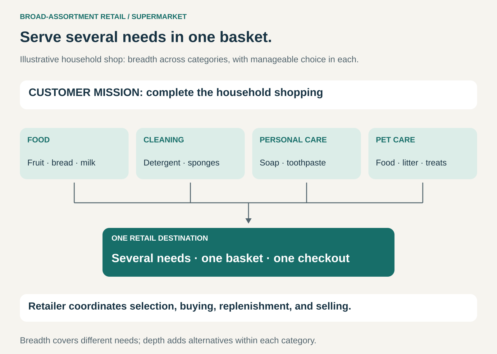

## What it is for

A household needs food, cleaning supplies, toiletries, and pet products. Buying each category from a separate specialist takes time. A customer furnishing a room faces a similar problem: furniture, lighting, textiles, and accessories all need to come together.

Broad-Assortment Retail brings several purchasing needs into one retail destination.

It is useful when customers value completing a substantial part of their shopping in one visit or order, and the retailer can coordinate the assortment economically.

## The core idea

**Offer enough relevant categories to make a combined shopping basket convenient and worthwhile.**

The retailer assembles products, makes them easy to find and compare, and provides a common purchasing experience.

“Supermarket” names the familiar food-retailing version, but the pattern extends to general merchandise, home furnishing, and other substantial shopping missions.

The important distinction is between **breadth** and **depth**.

Breadth covers different needs: food, cleaning, personal care, and pet care. Depth provides alternatives within a category: more brands, sizes, flavours, or specifications.

A retailer can cover many needs while offering relatively few alternatives for each. Its aim is a useful assortment that customers can navigate and the business can replenish.

Many versions combine this convenience with competitive pricing and high sales volume. The range still needs boundaries: serving a recognizable shopping mission gives customers a reason to choose the destination.

## How it works

The pattern connects several retail decisions.

**Define the shopping mission.** The assortment might support a weekly household shop, furnishing a home, or buying supplies for a business. The mission helps determine which categories belong together.

**Cover the important needs.** Customers need confidence that the destination can provide the essentials. Missing one critical category can make a second shopping trip necessary and weaken the convenience proposition.

**Choose manageable depth.** Each additional alternative needs justification. More options can improve fit, but they also consume space, purchasing attention, inventory, and the customer’s time.

**Make the range navigable.** Layout, signage, categories, search, and product information help people turn a large assortment into a practical basket.

**Coordinate buying and replenishment.** Products differ in demand, shelf life, handling requirements, and supplier lead times. The retailer needs appropriate availability across the range.

**Provide a coherent transaction.** Customers can combine individually selected items into one purchase, with understandable prices, payment, fulfilment, and service.

The format can operate through physical stores, electronic ordering, or connected channels. The underlying value is the combined assortment and purchasing experience.

## Why it works

The pattern reduces the effort of assembling a basket across separate destinations.

Customers can share the time and cost of a shopping trip across several needs. In online purchasing, a common account, basket, and delivery arrangement can provide similar convenience.

The retailer can also share resources across categories: premises, customer acquisition, checkout, distribution, and administration.

Different categories can support different shopping occasions. Regularly purchased essentials may bring customers back, while less frequent needs make the destination useful for additional purchases.

These advantages depend on execution. A broad range that is difficult to navigate or frequently unavailable creates less convenience than its catalogue suggests.

Additional assortment also creates additional complexity. The retailer earns value by coordinating that complexity effectively.

## Famous examples

### Walmart: combining everyday shopping with general merchandise

Walmart’s U.S. business spans grocery, general merchandise, and health and wellness. Its reported categories include food and household consumables alongside clothing, electronics, home products, and other goods. [Walmart fiscal 2026 annual report](https://www.sec.gov/Archives/edgar/data/104169/000010416926000055/wmt-20260131.htm)

This gives customers the possibility of combining routine household purchases with less frequent needs.

The pattern is particularly visible in the supercenter format: a grocery trip can also include clothing, household equipment, or seasonal products.

Walmart combines that breadth with its stated everyday-low-price strategy. The example demonstrates how assortment convenience and a value position can form one retail proposition.

### IKEA: breadth within a defined customer mission

IKEA’s product range spans furniture, mattresses, lighting, textiles, kitchenware, storage, decoration, and other home-related categories. [IKEA product range](https://www.ikea.com/us/en/cat/products-products/)

A customer furnishing a bedroom can consider a bed, mattress, bedding, lighting, and storage within the same retail offer.

This illustrates how breadth can remain focused. The assortment covers many needs within home furnishing, giving customers a substantial range without requiring the retailer to enter every possible merchandise category.

Customers can choose the individual products that make up their own solution. The combined destination makes those choices easier to assemble.

### Costco: broad categories with deliberately limited depth

Costco combines food, household products, appliances, electronics, clothing, furniture, and other categories with paid membership.

Its 2025 annual report describes a strategy of limiting most items to fast-selling models, sizes, and colours. It reported fewer than 4,000 active stock-keeping units per warehouse in its core warehouse business. [Costco 2025 annual report](https://www.sec.gov/Archives/edgar/data/909832/000090983225000157/costannualreport2025.pdf)

The example makes the breadth–depth distinction concrete. Customers can address many purchasing needs while encountering a selected range within each category.

It also shows how Broad-Assortment Retail can combine with another pattern: membership provides an additional part of the commercial relationship.

## The economics

The retailer commonly earns a margin between merchandise costs and selling prices. That margin must cover the operation required to present, maintain, and sell the assortment.

A hypothetical $100 basket might produce:

| Item                                      |  Amount |
| ----------------------------------------- | ------: |
| Sales revenue                             |    $100 |
| Merchandise costs                         |    −$75 |
| Gross profit                              | **$25** |
| Allocated operating expenses              |    −$22 |
| Operating profit before financing and tax |  **$3** |

These figures are illustrative.

With those costs unchanged, an additional $1 discount reduces the remaining profit from $3 to $2. Small changes in price, waste, handling, or staffing can therefore matter considerably.

Inventory is another major consideration. A slow-selling item can occupy space and tie up funds even when its apparent margin is attractive. A frequently purchased item may contribute through repeat visits and basket completion as well as its own margin.

The retailer needs to assess the assortment as a system while still understanding individual product and category economics.

High volume helps only when the margin and operating model support it.

## Useful when

- **Customers have several related purchasing needs.** Combining them reduces effort.
- **Convenience influences destination choice.** A dependable assortment can become a regular shopping habit.
- **Categories can share operating resources.** Purchasing, premises, checkout, and distribution benefit from coordination.
- **The retailer can maintain availability.** Customers can rely on finding the important parts of their basket.
- **Assortment boundaries are clear.** The business understands which needs it will serve and how much choice each requires.

## Common mistakes and limits

**Treating more products as automatically better.** Additional items need to improve fit, availability, or basket completion enough to justify their costs.

**Confusing breadth with unlimited depth.** Covering another important need can be more useful than adding another near-identical option.

**Ignoring availability of essential items.** A single missing product can send the customer elsewhere for the rest of the basket.

**Measuring categories entirely in isolation.** Some products support visits or complete shopping missions. Those effects matter, although they need evidence rather than assumption.

**Assuming buying scale guarantees profitability.** Purchasing terms can improve while handling, waste, occupancy, and service costs absorb the benefit.

**Making the range hard to navigate.** Customers need a clear route through the assortment, especially when products have unfamiliar specifications.

**Expanding beyond the retailer’s capability.** Fresh food, bulky furniture, technical equipment, and regulated products create different operating requirements. Adding a category adds those requirements too.

## Related patterns

[[one-stop-shop|One-Stop Shop]] is the broader idea of meeting several needs in one destination. Broad-Assortment Retail applies it specifically through a coordinated range of individually purchasable products.

[[curation|Curation]] determines which products deserve inclusion and how customers navigate the choices.

[[long-tail|Long Tail]] emphasizes the collective value of many individually infrequent purchases. A broad-assortment retailer can instead concentrate on popular items across many categories.

[[omnichannel|Omnichannel]] connects the assortment with different ways to research, order, collect, receive, and service purchases.
