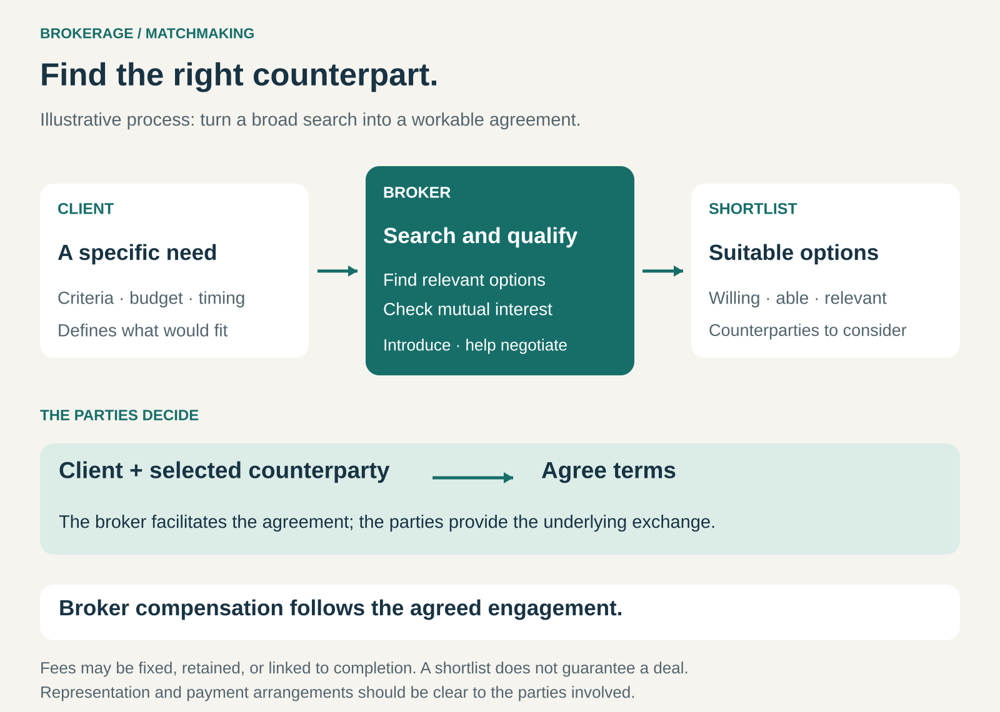

## What it is for

A company needs a new headquarters, but the right property is difficult to find. A board needs a chief executive, but suitable candidates are already employed elsewhere. A business needs insurance, but comparing policies requires more than comparing prices.

In each case, the problem is finding a suitable counterpart—and reaching an agreement both parties can accept.

Brokerage / Matchmaking creates a business around solving that problem. The intermediary contributes access, judgment, and coordination that help people or organizations find one another and transact.

## The core idea

**Earn revenue by bringing suitable parties together and helping an exchange become possible.**

The intermediary might connect buyers with sellers, employers with candidates, tenants with landlords, or businesses with specialist providers.

Its contribution can begin before either party knows exactly what they need. A broker may clarify requirements, identify possibilities, approach people privately, assess suitability, arrange introductions, and help negotiate terms.

“Matchmaking” emphasizes compatibility. “Brokerage” often includes further work toward an agreement. The two overlap, and businesses combine them in different ways.

The intermediary does not have to operate a public marketplace. A specialist with a small network and deep knowledge can create considerable value through a handful of carefully chosen introductions.

Nor is the intermediary necessarily neutral. A broker may represent a buyer, seller, employer, or another client. Whose interests it serves—and who pays it—are central features of the model.

## How it works

The work usually follows a recognizable sequence.

**Clarify the need.** “Find us an office” is an incomplete brief. The real requirements might include access to particular employees, room for expansion, a deadline, and limits on the cost of adapting the space. Better matching begins with understanding what would make an agreement useful.

**Find plausible counterparties.** The intermediary draws on relationships, research, databases, market knowledge, or direct outreach. Some possibilities are publicly visible; others become available only through a discreet approach.

**Qualify mutual fit.** An attractive option may be unavailable, unaffordable, unwilling, or unable to meet the timetable. Qualification checks whether a potential match can realistically proceed.

**Arrange the introduction.** The intermediary presents suitable options and gives each party enough context to evaluate the opportunity. A useful introduction includes reasons for considering the match.

**Help reach an agreement.** Depending on the engagement, the broker may coordinate discussions, clarify differences, support negotiation, and follow up on outstanding decisions.

These stages need not all involve personal service. Software can automate search and qualification, while people handle ambiguous requirements or sensitive negotiations.

## Why it works

Brokerage becomes valuable when finding and evaluating a counterpart is costly.

An occasional buyer may know little about a market that a broker encounters every day. A company hires a chief executive infrequently; an executive search firm repeatedly studies leadership needs and candidate availability.

Repeated participation can build useful knowledge: who is credible, which requirements are realistic, what terms are workable, and where negotiations tend to fail.

Relationships also create access. Someone who ignores a general advertisement may respond to a trusted intermediary with a relevant opportunity.

Finally, brokerage can reduce wasted effort. A smaller set of suitable, interested options may be more valuable than hundreds of unfiltered possibilities.

That advantage depends on judgment. Introductions alone become less valuable when people can easily find and assess one another. The business remains useful when it improves the quality or feasibility of the match.

## Famous examples

### CBRE: matching occupiers with suitable premises

CBRE’s tenant representation services help organizations evaluate property options and navigate leasing decisions. Its work includes developing a real estate strategy, assessing alternatives, and negotiating on the tenant’s behalf. [CBRE transaction services](https://www.cbre.com/services/plan-lease-and-occupy/transaction-services), [CBRE tenant representation](https://www.cbre.co.uk/services/plan-lease-and-occupy/transaction-services/tenant-representation)

The brokerage contribution extends beyond identifying an available building. A property must fit the organization’s operational needs and be obtainable on acceptable terms.

This also illustrates why representation matters. In a tenant representation engagement, the intermediary supports the occupier’s objectives. CBRE separately offers landlord representation services; those are different client engagements.

### Korn Ferry: matching leadership needs with candidates

Korn Ferry’s executive search process begins with understanding the role and organization. It develops a profile of the required capabilities, identifies potential candidates, assesses their suitability and interest, and presents a shortlist. It can also help construct an offer and support the transition. [Korn Ferry executive search](https://www.kornferry.com/capabilities/talent-acquisition/executive-search)

A candidate’s willingness to consider a move is part of the match. An impressive résumé has limited practical value if the person is unavailable or wants conditions the employer cannot provide.

The example also shows that brokerage need not be paid exclusively on completion. Korn Ferry describes executive search engagements beginning with an agreed retainer.

### Marsh: matching insurance needs with market capacity

Marsh’s insurance broking services help clients understand their requirements, engage insurance markets, and consider options suited to their risks. Its international placement services draw on specialist knowledge and relationships with underwriting organizations. [Marsh international placement services](https://www.marsh.com/en/services/international-placement-services.html)

The matching problem includes coverage, conditions, available capacity, and cost. A low premium alone does not establish that an option fits the client’s needs.

Marsh’s compensation disclosures also demonstrate the variety of brokerage revenue arrangements: compensation can include insurer-paid commissions and client-paid fees, sometimes in combination. The exact arrangement matters when assessing incentives. [Marsh compensation guide](https://www.marsh.com/en-gb/about/about-marsh/our-compensation-guide-to-how-we-are-paid.html)

## The economics

Brokerage / Matchmaking can support several payment structures:

- **Introduction fees:** payment for a qualifying connection.
- **Success fees or commissions:** payment when a specified transaction or milestone occurs.
- **Retainers:** payment for undertaking or maintaining the search and representation work.
- **Hybrid arrangements:** an initial fee combined with a completion payment.

A percentage commission needs a defined basis. A fee calculated on a property’s sale price, a lease commitment, or a candidate’s compensation represents a different economic arrangement in each case.

The cost of unsuccessful work is equally important.

Consider a hypothetical brokerage with ten assignments:

- Each assignment costs $3,000 to carry out.
- Four reach completion and generate a $10,000 fee each.
- The other six generate no revenue.

Revenue is $40,000, and assignment costs total $30,000. That leaves $10,000 before customer acquisition, fixed overhead, and taxes.

Looking only at completed deals would conceal most of the workload. Retainers can help fund the search, but the business still needs clients to see value in the work performed.

Long negotiations also affect cash flow. A promising pipeline can contain substantial work without producing near-term receipts.

## Useful when

- **Counterparties are difficult to identify or approach.** Valuable opportunities sit outside public listings.
- **Fit depends on several interacting requirements.** Price alone cannot determine a good match.
- **Transactions are important but infrequent.** Clients benefit from an intermediary’s repeated market experience.
- **Confidentiality matters.** Parties need to explore possibilities without announcing their intentions publicly.
- **Negotiation and coordination create friction.** Suitable parties need help turning interest into an agreement.

## Common mistakes and limits

**Confusing contact volume with matching quality.** A long list transfers the evaluation burden back to the client. Qualification is part of the value.

**Optimizing for closure at the expense of fit.** A completion fee can encourage pressure to accept an unsuitable agreement. Incentives should be understood alongside the intermediary’s responsibilities.

**Leaving representation unclear.** Participants need to understand whose interests the intermediary serves and how compensation may influence recommendations.

**Presenting a limited network as the whole market.** A broker’s relationships can create access while also limiting the options considered. The scope of the search matters.

**Assuming an introduction guarantees performance.** Suitability assessments reduce uncertainty; they do not ensure that a candidate will succeed, a tenant will remain solvent, or a provider will fulfil every promise.

**Underestimating the cost of stalled transactions.** Research, meetings, and negotiation can accumulate even when no deal closes.

## Related patterns

[[marketplace|Marketplace]] provides a setting for buyers and sellers to discover and transact with one another. Brokerage adds focused work to identify suitable counterparties and help particular agreements happen; the two can coexist.

[[curation|Curation]] reduces the options people must consider. Matchmaking additionally evaluates compatibility between particular parties.

[[retainer|Retainer]] funds ongoing access to expertise or search effort, including work that may not immediately produce a transaction.

[[managed-marketplace|Managed Marketplace]] combines matching with responsibility for significant transaction tasks, such as inspection, delivery coordination, or dispute handling.
