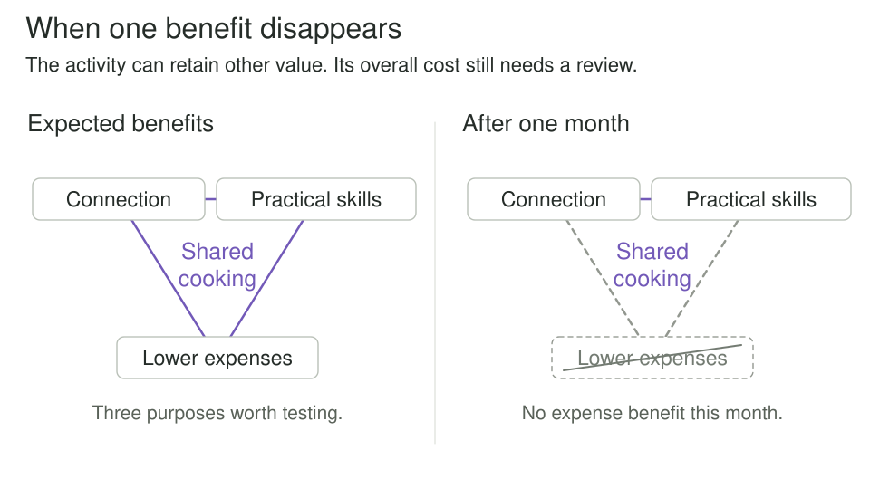

You want more movement, closer friendships, practical skills, and some breathing room in your budget. Each purpose seems to require its own commitment: an exercise program, more social outings, another course, a stricter spending plan. Soon the projects compete for the evenings they were supposed to improve.

There is another possibility. A regular walk with a friend could serve movement, connection, and enjoyment. Cooking together could support connection, practical skills, and affordable meals. A local repair circle could contribute to skills, independence, and keeping useful possessions in service. Their benefits overlap, so the activities form something more coherent than a crowded list.

**Build a Web of Goals** asks how recurring activities can support several worthwhile purposes and fit together with less friction. Jacob Lund Fisker develops the idea in *Early Retirement Extreme*, connecting attention to side effects with an adaptable overall strategy. The examples here apply that structure to everyday life; early retirement need not be your aim.

## Read the web

Start at **connection**. It belongs to both the walking and cooking activities. Now follow cooking to **practical skills**, which it shares with the repair circle. Skills used in each setting differ, but both may contribute to learning how to handle everyday tasks. **Lower expenses** is another possible shared benefit of cooking and repair.

Each shape collects several purposes. Shared points join those shapes into a web. The lines do not mean that one goal causes another, and their lengths do not measure benefit. They show which purposes an activity is intended to serve. Whether those contributions occur needs to be checked through experience.

The drawing is selective. Cooking might also be enjoyable; a repair group might offer friendship. Including every possible connection would make the picture harder to read. Begin with a few contributions that matter enough to influence a decision, then revise the map as you learn.

## Look beyond the stated purpose

Fisker's starting point is that an action has consequences beyond the goal used to justify it. A demanding new responsibility may improve income while consuming time formerly spent with friends. Buying equipment for a hobby may create enjoyment and a need for storage. Those effects belong in the picture even when they were never intended.

An original example begins with someone who wants both movement and friendship. Their existing plan includes a distant exercise class and separate restaurant outings. The travel and expense make both harder to maintain. They try a regular walk with a friend who also wants to spend time outdoors. One arrangement now contributes to several purposes.

It still has costs. Their schedules must overlap, the route must suit both people, and the weather sometimes changes the plan. The class may offer instruction or intensity the walk cannot provide. The person retains it occasionally if that contribution remains important. A good web respects those differences rather than pretending that every combined activity is an adequate replacement.

This is a change in the arrangement of life. There is no need to conduct a meeting, listen to a lesson, and exercise simultaneously. A walk can receive full attention while serving more than one purpose.

## Build connections through shared activity

Consider the cooking shape more closely. Two friends already meet for dinner. They decide to prepare some of those meals together, choosing inexpensive ingredients and sharing the work. Connection remains central. Over several evenings, they also learn techniques and develop meals they can repeat on their own.

The skill contribution has consequences elsewhere. Someone who becomes comfortable with basic repairs and everyday cooking may have more options when a household task arises. They can attempt a suitable task, recognize when help is needed, or explain the difficulty more clearly. These are possible connections between activities, not a promise that every learned skill will transfer everywhere.

The repair circle adds another setting for practical learning. Its expense benefit depends on what is repaired, the necessary parts and tools, and the alternatives. The group may occasionally repair something that would be cheap to replace because the learning or enjoyment is worthwhile. An activity can justify its place through several purposes without maximizing all of them.

| Recurring activity | Purposes represented in the web | What the example needs to check |
| --- | --- | --- |
| Walk with a friend | Movement, connection, enjoyment | A workable route, compatible schedules, and an experience both people want to repeat |
| Shared cooking | Connection, practical skills, lower expenses | Actual ingredient costs, preparation and cleanup, and a fair division of work |
| Repair circle | Practical skills, lower expenses, independence | Access to help and tools, suitable tasks, and whether participation remains worth its cost |

## Let the arrangement adapt

Suppose a month of shared cooking costs as much as the friends' previous dinners. Ingredients are more expensive than expected, and some food goes unused. The lower-expense benefit has not materialized.

They can examine smaller portions, simpler menus, or fewer cooking evenings. They may also accept that cooking together is an enjoyable social activity with a cost. The activity has not automatically become worthless because one expected contribution disappeared. Equally, the existence of other benefits does not settle whether the total commitment is worthwhile.

This is the adaptive part of the web. Experience can change which purposes matter most and which arrangements deserve a place. Fisker uses tensegrity as a metaphor for this capacity to adjust. A drawing of overlapping goals does not establish that a person's life will absorb every disruption. Several activities can share the same dependency, such as one location or one available evening, and become unavailable together.

## Reduce friction without making everything useful

This pattern is especially useful when worthwhile commitments compete for the same resources, when progress in one area repeatedly creates repairs in another, or when a single hoped-for payoff carries the whole value of an activity. It asks whether changing the combination could serve the purposes better.

It can also become another source of pressure. Trying to give every hobby three practical benefits would make leisure into a demanding design exercise. Enjoyment, beauty, rest, and companionship can justify an activity. A quiet hour listening to music needs no additional claim about income or transferable skills.

The aim is a life whose parts fit together well enough. Some tradeoffs remain. Some activities serve one cherished purpose. Other activities need to be reduced or stopped because the costs outweigh the contributions. A small, honest map is more useful than a dense diagram filled with benefits that exist only in the plan.

## Related patterns

[[second-order-thinking]] helps examine effects beyond an activity's immediate purpose. [[make-trade-offs-explicit]] keeps the remaining costs and conflicts visible when several benefits overlap.

[[obliquity]] explores how larger purposes can develop through meaningful involvement. A web supplies concrete activities and connections through which that development might occur.

[[connection-circles]] maps hypotheses about changes influencing other changes. Its arrows have a causal meaning; the shared points in this article instead record purposes associated with activities.

## Source and adaptation

Jacob Lund Fisker, *Early Retirement Extreme*, particularly the sections **Contingency goal-setting**, **Effect-mapping**, **A web of goals**, and **Tensegrity**, supplied in excerpts for this article. Those passages are the primary basis for the pattern. Fisker also describes mutually supportive skills and adaptive contingency planning in his [About ERE](https://earlyretirementextreme.com/about-the-blog) overview.

The walking, shared-cooking, and repair-circle scenarios and all accompanying diagrams are original Patternverse examples. The visuals preserve the distinction between goals and activities while using new content and geometry. They make no numerical claim about savings, health, or resilience.
