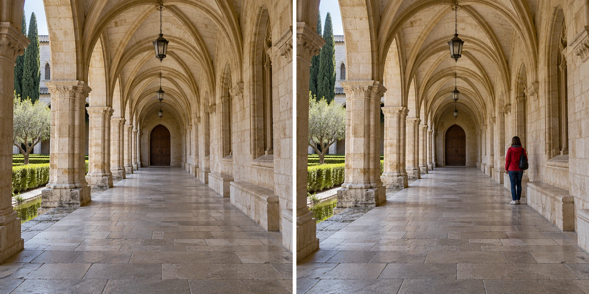

A stone corridor looks deep when you stand inside it. In one photograph it becomes a collection
of similar arches. In another, a nearby column frames a person farther along the floor, with
a doorway beyond. Now there are distinct places for the viewer to understand: here, there,
and farther away. The photograph begins to describe the space you experienced.

Compose with meaningful elements at different distances. Foreground, middle ground, and background
are useful names for those regions, not three mandatory objects. The near element can establish
where the camera is; the middle can hold an activity; the far element can provide destination,
setting, or contrast. Keep their relationships readable rather than simply adding more things.

## Describe space through relationships

Think of layers as a conversation between distances. A foreground is useful when it relates
to what follows it. A doorway around a distant courtyard tells us we are looking from
inside to outside. A nearby rock beside a wide valley offers a foothold for understanding
the view. A random branch across the same valley may contribute nothing except obstruction.

Several visual cues can communicate depth: overlap, changes in apparent size, receding edges,
and differences in atmospheric clarity. These cues work together. Not all layers need equal
sharpness, and not every photograph needs a dramatic foreground. The point is to preserve the
relationships that help the scene become understandable or expressive.

[[use-leading-lines|Use Leading Lines]] can connect near and far regions. [[show-the-scale|Show the Scale]] can give a familiar object a particular role within them. Layering is broader:
it can describe a social relationship across a room, even when physical size is unimportant.

## A landscape with a reason for its foreground

At a rocky coast, you notice a tide pool reflecting the same cloudy sky that appears above
a headland. Lowering the camera brings the pool into the foreground. The sea occupies the
middle, and the headland remains beyond. The pool is useful because it repeats light and
connects the near ground with the larger landscape.

Move too close and the pool becomes enormous while the headland shrinks to a minor detail.
That may be right if the pool is the subject. If your intention concerns the relationship
between landforms, back away or raise the camera until their apparent sizes feel appropriate.
[[change-your-position|Change Your Position]] explains this perspective choice. A wider lens
from the same position includes more scene but does not independently restore the relative sizes.

A foreground can also hide what it was meant to support. Check whether a rock blocks the
shoreline or a flower merges with the horizon. A small sideways movement may open a gap
and make all three regions more readable without removing their overlap entirely.

## Show a place being used

At a street café, an empty cup near the camera, two friends at the next table, and a
busy pavement beyond can place the viewer inside the scene. The cup gives a sense of
position; the friends supply activity; the pavement establishes the wider setting. A tight
portrait would tell a different story, concentrating on one person instead.

Be careful about clutter and privacy. If the near cup covers a hand gesture that matters,
it is not helping. If a stranger's face becomes an unintended prominent subject, consider
a different position or moment. Layers are not a license to include every person in sight.
[[choose-your-subject|Choose Your Subject]] still supplies the reason for the frame.

Timing can determine whether the layers remain separate. A passerby moving into a gap may
add a relationship; the same person directly behind your friend's head may create a confusing
merged outline. [[find-the-frame-then-wait|Find the Frame, Then Wait]] is useful when the fixed
parts already work and you are waiting for one moving element.

## Sharpness is another decision

On a phone, much of a layered scene may appear reasonably sharp in ordinary Photo mode.
On a camera with a longer lens or closer subject, the range of acceptable sharpness may
be narrower. Choose whether the foreground needs detail or only a recognizable shape. A
soft doorway can frame a sharp courtyard effectively; a soft face in an important social
relationship may be a problem.

Do not assume that selecting a tiny aperture makes every distance equally sharp. Focus placement,
subject distance, available light, movement, and viewing size matter too. A smaller opening
may require a longer exposure or a higher ISO setting, and very small apertures can reduce
fine detail through diffraction. [[choose-your-depth-of-field|Choose Your Depth of Field]] handles
those tradeoffs; [[photography-foundations|the foundations reference]] explains the terms.

## Avoid the three-object recipe

This pattern helps when a place feels flattened in a photograph, when you want to show
activities in context, or when near and far elements form a meaningful connection. It can
also fail by becoming a formula: add a rock, add a person, add a mountain. If the three
parts do not belong together visually or conceptually, the result may simply be busy.

A flat, graphic photograph of a wall can be complete without depth. A close portrait can
exclude the environment on purpose. Build layers when spatial relationships are part of what
you want to communicate, and keep enough simplicity that those relationships can actually be seen.
