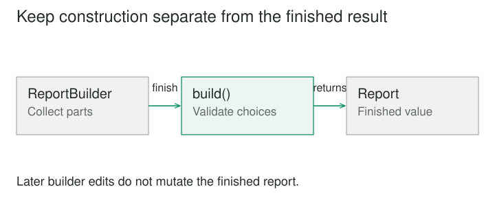

## Purpose and problem

A report constructor accepts a title, date range, grouping rule, output format, twelve optional sections, and several layout settings. Call sites contain long argument lists that are difficult to review. Elsewhere, callers construct an empty report and mutate it until it is ready. Between those stages, the report exists in states that should never be published.

## Core idea

Builder treats construction as its own process. A builder receives parts or construction steps, accumulates the information it needs, and produces a finished result. The result can remain focused on what a report is, while the builder handles how a report is assembled.



## How it works

In the classic form, a director coordinates a sequence of construction steps and a builder decides how those steps contribute to a representation. The same report assembly process might create a printable document or a structured export. The director does not need to know the internal representation of either result.

A common contemporary variant is a fluent builder: methods such as with_title and add_section return the builder so calls can be chained. This can be useful, but chaining is an interface style, not the core pattern. A chain that merely renames constructor parameters may add little beyond named arguments.

The deeper benefit appears when construction has validation, ordering, defaults, derived values, or alternative representations. Builder gives these concerns a separate home and makes the moment of completion explicit.

## Worked example

### A report with a real completion boundary

Suppose an analytics report requires a date range, at least one chart, and a consistent currency. A ReportBuilder collects these choices. Its build operation rejects an inverted date range, verifies that all monetary charts use the same currency, calculates section ordering, and returns an immutable Report.

The report no longer needs setters for every field. A caller can keep working with a partially configured builder, but cannot accidentally send that builder to the publishing service, which accepts only a completed Report. The separation expresses a useful distinction between work in progress and a valid domain object.

Validation timing requires judgment. An impossible date value can be rejected immediately. A rule involving multiple sections may need to wait until build. Rejecting every incomplete state too early can make assembly awkward; accepting everything until the end can make errors difficult to locate.

Reusing a builder also needs a defined policy. Does build clear its state, return a snapshot, or leave configuration available for another result? Hidden leftover sections can be surprisingly hard to diagnose. A builder that is cheap to construct may be safest as a single-use object.

### A small implementation

ReportBuilder keeps incomplete construction state separate from the immutable Report. Its build method is the completion boundary. This example uses a title and sections; a production report can add its date and currency rules at the same boundary.

```python
from dataclasses import dataclass


@dataclass(frozen=True)
class Report:
    title: str
    sections: tuple[str, ...]


class ReportBuilder:
    def __init__(self):
        self.title = ""
        self.sections = []

    def with_title(self, title):
        self.title = title.strip()
        return self

    def add_section(self, text):
        self.sections.append(text)
        return self

    def build(self):
        if not self.title or not self.sections:
            raise ValueError("A report needs a title and sections")
        return Report(self.title, tuple(self.sections))


builder = ReportBuilder().with_title("Quarterly review")
report = builder.add_section("Revenue increased").build()
builder.add_section("Draft note")
print(report.sections)
# ('Revenue increased',)
```

The finished report stores a tuple copied from the builder, so adding another section to the builder does not alter the existing result. Chaining makes this interface convenient; the separate construction state and explicit completion check provide the actual design benefit.

### One assembly process and two representations

Consider a documentation generator that reads a structured chapter. It visits a title, paragraphs, code examples, and references in a consistent order. An HtmlChapterBuilder turns those steps into HTML elements. A PlainTextChapterBuilder creates text with indentation and readable reference markers.

The director describes the chapter's assembly without performing string escaping or choosing markup. Each builder owns representation-specific rules. HTML escaping belongs to the HTML builder, while line wrapping belongs to the text builder.

This separation is worthwhile only if the construction vocabulary is genuinely shared. If one output needs interactive controls and another requires a radically different document structure, forcing them through an identical series of steps can erase important differences. A builder interface should represent meaningful shared construction, not an arbitrary least common denominator.

It also cannot make all outputs equally capable. A plain-text result may deliberately lose layout or interactivity. Those differences should be documented as representation choices rather than hidden as surprising failures.

## When to use it

- An object needs several meaningful construction steps.
- Different representations share a construction process.

Consider a simpler design when a small immutable value can be constructed clearly with named arguments, or when the staged API permits invalid intermediate objects to escape.

## Tradeoffs and common mistakes

Builder helps when call sites should communicate decisions in readable stages, or when construction logic changes independently from finished-object behavior. It can centralize defaults and protect invariants. It is often useful for complex queries, documents, configurations, and composite structures.

For a small value such as Point(x, y), a builder is usually excessive. For a configuration with six independent optional values, named arguments and an immutable data structure may already be clear. The presence of many parameters is a clue to investigate, not proof that Builder is required.

An especially common mistake is returning the builder's own mutable internal collections directly. The supposedly finished result then changes when somebody edits or reuses the builder. Copying the relevant state or transferring ownership deliberately is necessary if the result promises stability.

Another is allowing arbitrary method order while relying on undocumented ordering constraints. If add_chart must follow set_currency, the interface should make that requirement clear or defer the dependency resolution until completion. A pleasant-looking fluent API is not a substitute for a coherent construction model.

## Related patterns

[[abstract-factory|Abstract Factory]] supplies compatible products. Builder coordinates assembly of a result; it can use an abstract factory for individual parts. [[prototype|Prototype]] starts with an existing configured object and copies it, which may be simpler when a useful template already exists.

[[facade|Facade]] simplifies access to a subsystem. A builder may feel like a facade over complex construction machinery, but its distinctive responsibility is managing the transition from construction steps to a finished product.

## Sources

Builder is one of the 23 patterns in Gamma, Helm, Johnson, and Vlissides, [*Design Patterns: Elements of Reusable Object-Oriented Software*](https://www.informit.com/store/design-patterns-elements-of-reusable-object-oriented-9780201633610). The examples, code, and illustrations here are original educational explanations.
