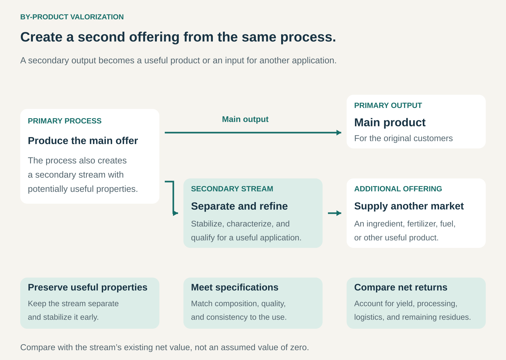

## What it is for

By-product Valorization helps a business earn more from the materials passing through its production process.

It is useful when making the main product also generates a secondary stream with useful properties: whey from cheesemaking, nutrient-rich liquids from fermentation, grain remaining after brewing, or other process residues.

That stream may already have a low-value outlet, require costly handling, or remain largely unused. Valorization develops a worthwhile application for it, creating an additional product, ingredient, or supply relationship.

## The core idea

**Develop a useful offering from a secondary output of an existing production process.**

The business begins with something its operations already generate. It identifies the stream’s useful properties, preserves them, and connects them with a customer requirement.

Possible routes include:

- **Direct use:** supply a suitable by-product with limited preparation.
- **Ingredient recovery:** separate valuable components such as proteins, fibers, oils, or minerals.
- **Conversion:** transform the stream into another material, fertilizer, fuel, or product.
- **Cascading uses:** recover one useful component, then find applications for the remaining fractions.

This is a specialized form of Waste-to-Value. Its starting point is a secondary production output, which may never have been discarded and may already earn revenue.

As its value grows, a stream once treated as incidental can become a deliberate co-product or a substantial business line.

## How it works

The pattern connects five elements.

**A characterized stream.** The business needs to understand composition, volume, variability, condition, and current use. A large flow of liquid may contain only a small recoverable fraction.

**Preservation of useful properties.** Early separation, controlled storage, or stabilization can preserve options that disappear once materials are mixed, contaminated, or degraded.

**A suitable application.** Buyers need a defined function: nutrition, texture, chemical composition, material performance, energy, or another useful property. The application determines the required specifications.

**A workable processing route.** Separation, concentration, drying, purification, fermentation, or formulation may be necessary. Each step affects yield, cost, and the remaining material.

**A commercial arrangement.** The producer can process and sell the output itself, supply a specialist processor, or collaborate with a customer. Agreements connect volume, quality, pricing, logistics, and responsibilities.

The producer does not need to build every capability internally. A specialist partner may be better equipped to develop the secondary market.

## Why it works

The original production process has already assembled, separated, or transformed material in ways that can make a secondary stream useful.

Cheesemaking separates liquid whey from curds. Fermentation leaves streams containing nutrients or biomass. These outputs may be easier to characterize and collect than mixed material recovered after consumer use.

A recurring process can also provide a relatively predictable supply. That makes it possible to design equipment, specifications, and customer relationships around the stream.

The opportunity is to obtain more useful output from the existing material flow. However, the additional offering must justify its own processing and commercial requirements. A valuable component does not automatically make its extraction profitable.

## Famous examples

### Arla Foods Ingredients — whey becomes a portfolio of ingredients

Whey is a secondary output of cheesemaking. Arla Foods Ingredients develops whey-based ingredients, including protein concentrates and isolates produced from sweet whey. These products serve manufacturers with particular formulation and quality requirements. [Arla’s whey ingredient portfolio](https://www.arlafoodsingredients.com/early-life-nutrition/our-ingredients/whey-protein-concentrate/).

The company also describes the controls needed to manage quality and food safety across a supply chain originating in cheese production. [Arla’s explanation of its whey processing standards](https://www.arlafoodsingredients.com/about/press-releases/press-release-221024/).

This illustrates how a secondary stream can support a specialized ingredient business. The commercial offering includes separation, processing, consistent specifications, and application knowledge. Customers purchase an ingredient suited to their products rather than an undifferentiated production residue.

### Ajinomoto — fermentation outputs become agricultural products

Ajinomoto produces amino acids through fermentation. After amino acid extraction, remaining liquids contain organic matter and nutrients that can support other applications.

The company describes commercializing these streams as products including liquid fertilizers and animal feed. Its “bio-cycle” approach connects fermentation production with agricultural uses in markets where the group operates. [Ajinomoto’s account of its co-product business](https://www.ajinomoto.com/stories/completing-the-bio-cycle-aji-no-moto-co-products-help-to-boost-agricultural-output).

The example shows that valorization includes product development and market development. A nutrient-rich stream needs an appropriate formulation, application, distribution route, and customer base. The useful chemistry provides the starting point; the agricultural offering makes it commercially accessible.

### Kalundborg Bioenergy — industrial biomass supports energy and fertilizer production

Within Denmark’s Kalundborg Symbiosis, residual biomass from Novonesis and Novo Nordisk supplies a local biogas operation.

Kalundborg Bioenergy converts these streams into biogas, which is upgraded to biomethane and supplied to local companies and the gas network. The system also produces fertilizer products from the processed biomass. [Kalundborg Symbiosis’s description](https://www.symbiosis.dk/en/kalundborg-bioenergi/).

This illustrates valorization through a specialist operator serving several producers. The organizations generating the secondary streams do not each need their own conversion facility. Local coordination connects suitable feedstocks, processing capacity, and outlets for the resulting products.

## The economics

The relevant comparison is the stream’s **existing net value versus its net value under the proposed route**.

Consider an illustrative producer generating 200 tonnes of a wet by-product each month. Selling it through an established animal-feed outlet currently provides **$8,000 after route-specific handling costs**.

An alternative process could produce 20 tonnes of a qualifying ingredient:

| Alternative route, per month                          |      Amount |
| ----------------------------------------------------- | ----------: |
| Ingredient sales: 20 tonnes at $1,400                 |     $28,000 |
| Conditioning and drying                               |    −$10,000 |
| Quality control, packaging, and logistics             |     −$6,000 |
| Remaining water and residue management                |     −$2,000 |
| **Contribution before equipment and shared overhead** | **$10,000** |

The improvement over the existing outlet is **$2,000 per month**, before additional equipment costs and shared overhead.

These figures are hypothetical. The higher selling price per tonne creates a much smaller improvement than the headline revenue suggests, because saleable weight falls and processing costs increase.

The comparison also assumes primary production remains unchanged. Any effect on its throughput, quality, or costs belongs in the business case.

## Useful when

- An existing process generates a recurring secondary stream.
- Its composition and condition can be understood and controlled.
- Useful properties can be preserved before degradation or contamination.
- A customer values those properties sufficiently to support processing costs.
- Supply volume matches practical processing and delivery requirements.
- The proposed route improves on the stream’s current use.

The pattern is particularly attractive when a modest change in separation or handling preserves access to a more valuable application.

## Common mistakes and limits

**Assuming the starting value is zero.** Animal feed, energy recovery, and other established outlets may already provide revenue or avoid costs. Replacing them has an opportunity cost.

**Confusing wet volume with recoverable yield.** Water removal and separation losses can substantially reduce the quantity available for sale.

**Targeting the highest price without comparing net returns.** A premium application may require expensive purification, qualification, storage, or support.

**Damaging the primary process.** Extra recovery steps can introduce bottlenecks or compromise the main product. Both outputs need to be evaluated together.

**Underestimating qualification.** A stream suitable for one application may need different controls and evidence for another. Composition, consistency, safety, and traceability matter.

**Overlooking changes in supply.** Recipes, production schedules, cleaning processes, or raw materials can alter the secondary stream and its suitability.

**Assuming every fraction has a profitable outlet.** Additional extraction stages create costs and further residues. Cascading uses need separate business cases.

**Equating commercialization with environmental improvement.** Processing energy, transport, displaced materials, and the previous use all influence the environmental result.

## Related patterns

- [[waste-to-value|Waste-to-Value / Trash-to-Cash:]] the broader pattern of finding useful applications for discarded or underused resources.
- [[industrial-symbiosis|Industrial Symbiosis:]] connects organizations so secondary outputs from one operation become inputs to another.
- [[ingredient-branding|Ingredient Branding:]] can make a valorized ingredient recognizable within customers’ finished products.
- [[monetize-existing-capabilities|Monetize Existing Capabilities / Make More of It:]] develops additional revenue from resources the business already possesses; valorization applies that logic to secondary material streams.
