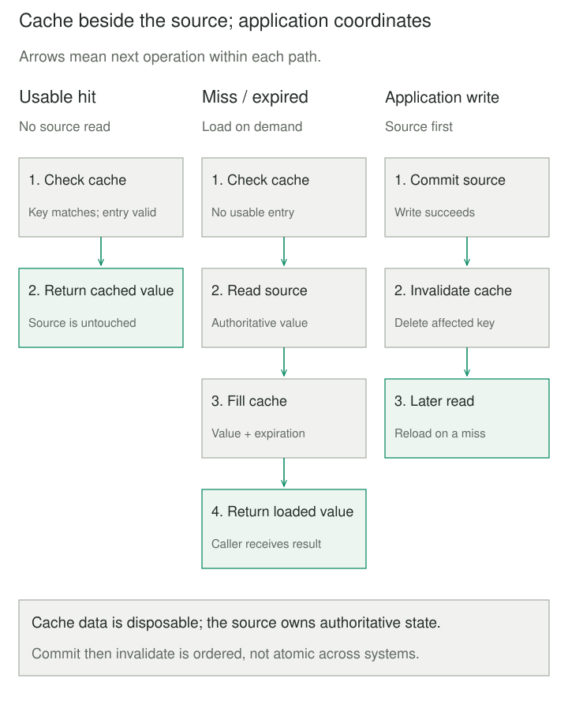
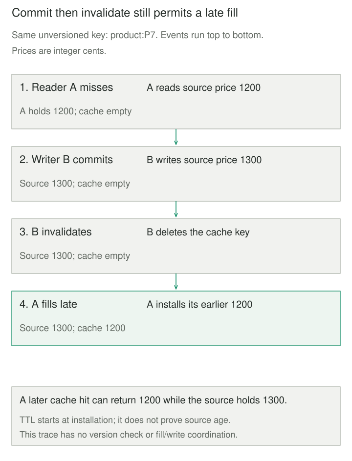

## Purpose and problem

A product page repeatedly reads the same description and displayed price. The database spends time returning identical records while shoppers wait for each round trip. Keeping a copy nearby would help, but products change, memory is finite, and the cache can disappear independently of the database.

The team needs fast repeated reads without making the cache the only place an authoritative value exists. It also needs to say which stale values are acceptable. A displayed catalog price can tolerate a short delay; charging a customer must use the checkout's authoritative pricing rules.

## Core idea

**Cache-Aside puts cache management in the application’s read and write paths.** Check the cache. Return a usable hit. On a miss, read the source, populate the cache, and return the value. Changes go to the source; the application then invalidates affected copies.

Think of the cache as a disposable shortcut beside the source. Losing it changes cost and latency, not ownership of the data.

AWS calls this strategy **lazy loading** because requests trigger population. That phrase also describes deferred object construction elsewhere. Read-through caching moves miss loading behind a cache/provider interface; Cache-Aside leaves the application responsible for accessing both systems. Write-through populates on writes. These names describe different responsibilities and can be combined deliberately.



## How it works

### Define what makes a hit usable

A key must distinguish answers that differ: product, locale, currency, tenant, and any relevant representation or access scope. Authorize the current caller before returning cached data. Possessing a key is not permission to read its value.

Choose expiration, capacity, and eviction separately. A fixed time-to-live limits residence after a fill; eviction may remove an entry sooner. Neither proves source freshness: replica lag, slow reads, or a late fill can make a newly cached value old already. A private cache also needs a policy for copies held by other application instances.

### Keep the source and failure policy explicit

Commit a source update before invalidating its cache entry. Deleting first lets a reader refill from the unchanged source. This ordering avoids that particular window but is not a complete concurrency protocol.

An unavailable cache is a failure, not simply an empty answer. Decide whether reads bypass it, fail, or serve explicitly permitted stale data. Bound cache calls and fallback concurrency: a cold cache or outage can send the entire workload to the source. A source-read failure must not become a cached zero. A successful source write followed by failed invalidation needs recovery; retrying the business write blindly can repeat its effect.

## Worked example

### A small catalog cache

Before the change, two reads of product P7 require two source reads. Afterward, the second request reuses the first value. An update evicts that copy; the next read reloads the new price.

Save this complete Python 3.11+ program as `cache_aside.py` and run `python3 cache_aside.py`. Prices are integer cents. The injected clock advances in seconds without sleeping. A real caller can use the default monotonic clock. Configuration is trusted: TTL must be positive and finite, capacity a positive integer, and values immutable. This example uses one thread and one process.

```python
from collections import OrderedDict
from time import monotonic


class CacheAside:
    def __init__(self, load, save, ttl=10, capacity=2, clock=monotonic):
        self.load, self.save, self.clock = load, save, clock
        self.ttl, self.capacity = ttl, capacity
        self.entries = OrderedDict()

    def read(self, key):
        entry = self.entries.get(key)
        if entry is not None:
            value, expires = entry
            if self.clock() < expires:
                self.entries.move_to_end(key)
                return value
            del self.entries[key]
        value = self.load(key)  # Failure propagates; no failed fill.
        self.entries[key] = (value, self.clock() + self.ttl)
        self.entries.move_to_end(key)
        while len(self.entries) > self.capacity:
            self.entries.popitem(last=False)
        return value

    def write(self, key, value):
        self.save(key, value)  # Commit source before invalidation.
        self.entries.pop(key, None)


db = {"P7": 1200}
loads = []
now = [0.0]


def load(key):
    loads.append(key)
    return db[key]


def save(key, value):
    db[key] = value


catalog = CacheAside(load, save, clock=lambda: now[0])
print(catalog.read("P7"), catalog.read("P7"), len(loads))
catalog.write("P7", 1300)
print(catalog.read("P7"), len(loads))
db["P7"] = 1400  # External writer bypasses invalidation.
now[0] = 9.0
print(catalog.read("P7"), len(loads))
now[0] = 10.0  # Equality with expiry is a miss.
print(catalog.read("P7"), len(loads))
try:
    catalog.read("missing")
except KeyError:
    print("missing not cached", "missing" not in catalog.entries)
```

Output is `1200 1200 1`, `1300 2`, `1300 2`, `1400 3`, and `missing not cached True`. Counts are cumulative source-read attempts, not latency measurements. The third line deliberately demonstrates staleness. Hits do not extend expiration. Missing products raise; zero cents would remain a valid cached value.

The cache retains at most two entries, evicting the least recently used. Expired entries are removed on access or by capacity eviction; no background cleanup runs. There is no network, persistence, authorization implementation, negative caching, distributed invalidation, or synchronization.

### The late-fill race

Even source-first invalidation can lose a race. Reader A misses and reads 1200. Writer B commits 1300 and deletes the key. A then fills the now-empty cache with its earlier 1200. This is an interleaving analysis, not behavior the sequential demo prevents.



A stronger freshness contract needs more machinery: versioned keys tied to actual source versions, coordinated fills and writes, or bypassing this cache on sensitive reads. A lock within one process does not coordinate another instance. Do not label two independent writes an atomic update.

## When to use it

Use Cache-Aside when requests repeatedly read a subset of expensive source data and the application can define acceptable staleness. Demand loading avoids filling the cache with records nobody requests. Misses still pay for cache lookup plus source access and fill.

Keep direct reads when indexed queries already meet the budget, reuse is low, or current authoritative state is required. For a pure local calculation, a bounded memoization decorator may suffice; Python’s `lru_cache` does not itself track changes in an external database.

## Tradeoffs and common mistakes

Measure hit ratio, hit/miss latency, evictions, source load, and invalidation failures. Test cold operation and cache loss rather than sizing the source from warm-hit traffic alone.

Concurrent misses can duplicate work and overload the source. Request coalescing can share one in-flight load per key within its coordination scope; it needs bounded waits and failure cleanup. Staggered TTLs spread different keys’ expirations but do not coordinate callers for one hot key.

Avoid caching mutable objects that callers can silently alter, sensitive responses under incomplete keys, and source errors as absence. A shared cache reduces per-instance duplication but adds its own capacity, serialization, access-control, and availability responsibilities.

## Related patterns

[[data-result-caching|Result Caching]] focuses on which computed answers are equivalent and valid for reuse. Cache-Aside specifies who performs miss loading and invalidation.

[[proxy|Proxy]] can hide access mediation behind a subject’s interface; a caching proxy may implement this strategy internally.

[[cqrs|CQRS]] separates write and read models. Its query model can be durable and independently maintained; this disposable cache is not automatically a CQRS projection.

[[load-shedding|Load Shedding]] bounds admitted work when misses or cache outages would overwhelm the source.

## Sources

- [Microsoft: Cache-Aside](https://learn.microsoft.com/en-us/azure/architecture/patterns/cache-aside) — application-managed loading, source-first invalidation, and consistency limitations.
- [AWS: Caching patterns](https://docs.aws.amazon.com/whitepapers/latest/database-caching-strategies-using-redis/caching-patterns.html) — lazy-loading name, hit/miss path, and write-through comparison.
- [Jas Chhabra, AWS: Caching challenges and strategies](https://aws.amazon.com/builders-library/caching-challenges-and-strategies/) — cold-cache risk, local/shared caches, coalescing, expiration, and failure handling.
- [Python: time.monotonic](https://docs.python.org/3/library/time.html#time.monotonic) — elapsed-time clock unaffected by system-clock updates.
- [Python: functools.lru_cache](https://docs.python.org/3/library/functools.html#functools.lru_cache) — bounded memoization and possible duplicate concurrent calls.

The catalog scenario, Python program, interleaving analysis, and native figures are original teaching material.
