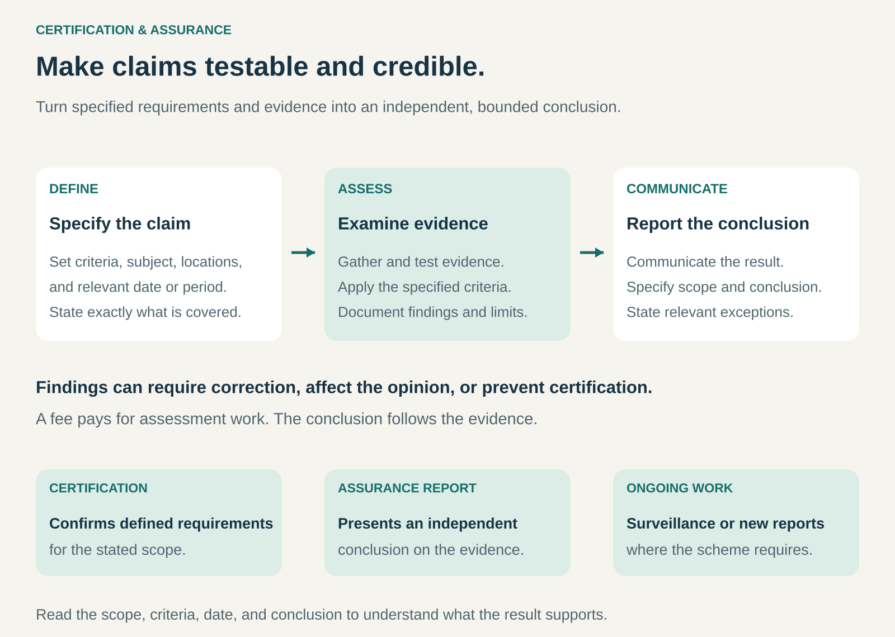

## What it is for

A supplier says its products meet safety requirements. A manufacturer claims its materials come through a controlled supply chain. A software company says it protects customer information.

The buyer needs evidence, but investigating every claim independently would be expensive and difficult.

Certification & Assurance provides a structured way to assess those claims. A qualified, independent organization examines evidence against defined criteria and communicates its conclusion.

It is useful when important qualities are difficult for customers to observe, and when credible evidence can help people choose suppliers, approve purchases, or enter business relationships.

## The core idea

**Earn revenue by producing credible evidence that other people can rely on within a defined scope.**

The customer pays for assessment expertise, testing, review, and reporting. The provider’s value depends on the quality of that work and the credibility of its independent judgment.

Two related outputs sit within this pattern:

- **Certification:** confirmation that a specified product, process, service, or system meets defined requirements.
- **Assurance reporting:** an independent conclusion about specified information, controls, or other subject matter, based on an agreed assessment framework.

The output might be a certificate, authorization to use a mark, or a detailed report. These forms communicate different things.

ISO distinguishes certification from accreditation: certification assesses conformity, while accreditation recognizes the competence of an assessment body. ISO develops standards but does not itself certify organizations. [ISO: certification and accreditation](https://committee.iso.org/certification.html)

The essential business asset is credibility. Payment funds the assessment; the evidence must determine the conclusion.

## How it works

**Define the claim and criteria.** The engagement identifies what will be assessed and which requirements apply. A product’s electrical safety, a factory’s management system, and a service provider’s information controls require different assessments.

**Set the scope.** Relevant products, sites, activities, systems, and dates or reporting periods are specified. The boundaries determine what the result can support.

**Collect and evaluate evidence.** Work may include laboratory testing, document review, interviews, site inspections, traceability checks, or testing samples of transactions and controls.

**Reach an independent conclusion.** Evidence is reviewed using the applicable decision process. Findings may require corrective action, affect the opinion, or prevent certification.

**Communicate the result accurately.** The certificate, mark, or report identifies its subject and scope. Users need to understand what was assessed and any relevant qualifications.

**Maintain relevance.** Some schemes require surveillance inspections, periodic reassessment, or renewal. Assurance reporting may cover successive periods through fresh examinations.

Several organizations can participate. A scheme owner may define the requirements, an assessment body performs the work, and an accreditation or oversight organization evaluates the assessor.

These roles should be understandable to the people relying on the result.

## Why it works

The first mechanism is specialist expertise. Buyers may lack the equipment, technical knowledge, or access needed to examine a claim properly.

The second is reusable evidence. A recognized assessment can support conversations with many customers, reducing repeated investigation. Buyers still decide whether the evidence meets their needs.

The third is comparability. Shared criteria give organizations a common reference point. They help turn a broad promise into something that can be examined.

Independent judgment adds another layer. The provider must be able to report problems even when the organization paying for the work would prefer a favorable result.

For providers, revenue can come from initial assessments, testing, inspections, recurring examinations, and ongoing certification services. Scheme owners may also receive program or trademark-licensing fees.

Repeat income reflects continuing work and oversight. A familiar badge without a dependable process behind it loses its value.

## Famous examples

### UL Solutions — product certification with continuing oversight

UL Solutions evaluates products against specified requirements and authorizes relevant certification marks when those requirements are met.

Its Follow-Up Services extend beyond the initial evaluation. Factory inspections and audits check whether products bearing the mark continue to meet the original certification requirements, including relevant construction and component requirements.

For a manufacturer, the service supplies recognized evidence that can support customer and market acceptance. For buyers, the mark provides a recognizable entry point into that evidence.

The meaning remains bounded by the particular certification. A mark does not establish that every characteristic of a product has been assessed or that failure is impossible.

This example shows how initial testing and continuing oversight can form an ongoing service relationship. [UL Solutions: certification marks](https://www.ul.com/look-ul-safety-mark-you-buy), [UL Solutions: Follow-Up Services](https://www.ul.com/resources/follow-up-services)

### FSC — evidence supporting forest-product supply-chain claims

FSC chain-of-custody certification assesses the controls organizations use to support eligible FSC claims through the forest-product supply chain.

The work includes assessment against applicable requirements, followed by annual audits. It helps establish how certified materials and claims are identified and managed as products move between businesses.

FSC sets the scheme’s standards. Independent, accredited certification bodies conduct assessments and issue certificates; FSC does not issue them itself.

That separation reveals the business structure clearly: the scheme defines a recognizable claim, assessment bodies provide the verification work, and certificate holders use the resulting evidence and authorized claims in their markets. [FSC: chain-of-custody certification](https://fsc.org/en/chain-of-custody), [FSC: roles and oversight](https://connect.fsc.org/certification/certification-system)

### PwC — SOC 2 assurance reporting for service organizations

PwC provides SOC 2 assurance reporting concerning service organizations’ systems and controls against relevant Trust Services Criteria.

Its explanation distinguishes a Type 1 report, addressing matters at a specified date, from a Type 2 report, which also addresses operating effectiveness over a defined period.

A customer considering a service provider can use the report to understand the system, the assessment’s scope, and the auditor’s conclusion.

The output is an assurance report. Its usefulness comes from the detail behind the conclusion, rather than simply displaying a logo.

This illustrates a different delivery format within the pattern: paid independent examination produces information that supports another organization’s evaluation of a supplier. [PwC: SOC 2 assurance reports](https://www.pwc.ch/en/insights/accounting/soc-2-assurance-reports-greater-trust-through-greater-transparency.html)

## The economics

Consider a hypothetical assessment provider completing 100 engagements at an average fee of €2,000.

| Annual item                                                           |      Amount |
| --------------------------------------------------------------------- | ----------: |
| Assessment fees                                                       |    €200,000 |
| Assessment and technical staff delivery costs                         |   −€100,000 |
| Independent technical review                                          |    −€20,000 |
| Testing, travel, and external specialist costs                        |    −€30,000 |
| Quality systems, records, and credential maintenance                  |    −€20,000 |
| **Contribution before other overhead, equipment investment, and tax** | **€30,000** |

These figures are illustrative, not an industry pricing benchmark.

The apparent margin can disappear if engagements require more evidence gathering than expected. An additional €300 of delivery cost per engagement would consume the entire contribution.

Quality review and oversight are essential costs. Removing them may improve short-term figures while weakening the credibility customers are buying.

The assessed organization has a separate calculation. Its total cost includes the provider’s fee, internal preparation, staff time, and any improvements needed to meet requirements.

Benefits might include access to a procurement process, fewer duplicated assessments, or stronger customer confidence. Certification alone does not guarantee additional sales or a price premium.

## Useful when

- **Important qualities are difficult to observe.** Customers cannot easily inspect safety, traceability, or operating controls themselves.
- **Clear criteria exist.** The claim can be assessed against meaningful requirements.
- **Evidence matters to a buying decision.** Customers or procurement teams recognize the assessment.
- **Expert investigation is expensive.** Specialist testing and review provide practical value.
- **Claims need periodic reassessment.** Products, processes, and operating conditions change.
- **Independent judgment can be protected.** Commercial incentives do not determine the assessment result.

## Common mistakes and limits

**Making the claim broader than the assessment.** A certificate for one site or management system does not automatically cover every product or business activity.

**Confusing different outputs.** Testing, inspection, certification, accreditation, and assurance reporting have related but distinct purposes.

**Treating assessment as a guarantee.** Sampling, scope, timing, and the applicable assurance approach limit what a conclusion establishes.

**Assuming a recognized logo answers every question.** Buyers still need to check scope, criteria, validity, and the actual conclusion.

**Allowing payment to influence the result.** Independence, competent review, complaints processes, and oversight protect the value of the service.

**Letting evidence become stale.** A product redesign, supplier change, new system, or expired certification can change what an earlier result supports.

## Related patterns

- [[licensing|Licensing:]] Certification schemes may authorize controlled use of marks, with continuing conditions.
- [[subscription|Subscription:]] Recurring fees can support surveillance or reporting, although assessment outcomes remain evidence-based.
- [[ingredient-branding|Ingredient Branding:]] Both create recognizable signals across a value chain; assurance depends on assessed claims and criteria.
- [[managed-marketplace|Managed Marketplace:]] Certification and verification services can support trust between marketplace participants.
