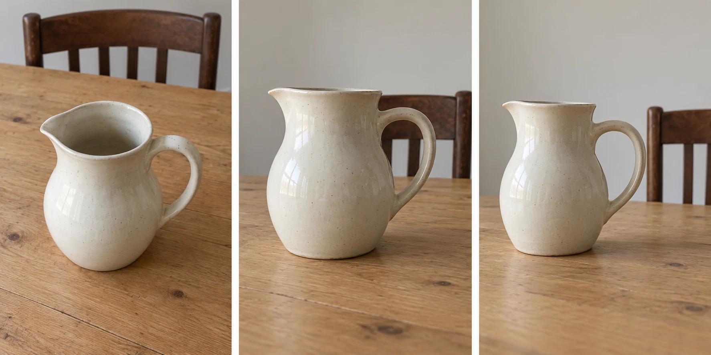

A jug on a kitchen table looks attractive in front of you. On the screen, its handle merges
with a chair, and the table edge cuts through its middle. You try zooming in. The objects
get larger, but the awkward relationships remain. Lowering the camera and moving slightly
left changes the picture much more: the handle opens against the wall and the tabletop
becomes a surface beneath the jug rather than a line through it.

Move the camera before assuming the scene needs different equipment. Height, sideways position,
and distance change which surfaces are visible, how objects overlap, and how large near elements
appear relative to distant ones. A small movement can reorganize a photograph while leaving
everything in the world exactly where it was.

## The camera is a viewpoint

Think of the camera as an eye you can place somewhere. Your usual standing height is only
one option. From above, a plate reveals its contents; from table height, it becomes a thin
ellipse. A low position may turn grass into foreground architecture. A high position can
separate people in a crowd who overlap when viewed horizontally.

Perspective follows camera position. If you remain in one spot and zoom, the lens includes
more or less of the view, but the relative geometry of the scene stays essentially the same,
apart from lens distortion and other optical differences. If you move closer, a nearby object
grows more relative to a distant one. The distinction matters because a new focal length cannot
solve every unwanted overlap. [[photography-foundations|The foundations reference]] explains
focal length, angle of view, and perspective separately.

[[choose-your-subject|Choose Your Subject]] asks what deserves attention. This pattern asks where
the camera should be to express that choice. It is not a requirement to choose an unusual
angle. Often the most useful movement makes the photograph feel simple and unforced.

## A portrait with a cleaner relationship

You photograph a friend in a park. A branch appears to grow from their head. Rather than
asking them to move repeatedly, take a small step sideways while watching the outline of
their head against the background. The branch shifts away. A slight bend of your knees might
place their face against foliage rather than a bright patch of sky.

These changes concern geometry before they concern blur. They work on a phone even when its
lens keeps much of the background recognizable. They also preserve the setting if you want
an environmental portrait. [[separate-subject-and-background|Separate Subject and Background]]
describes the attention benefit; changing position is one way to produce it.

Moving extremely close has other consequences. A face photographed from very near can show
stronger differences between the apparent sizes of nearer and farther features. Backing away
and using a narrower field of view can give different proportions, because the camera moved.
Neither distance is universally correct. Discuss the person's preferences, especially when
experimenting with a viewpoint that feels intimate or conspicuous.

## Make a foreground earn its space

At a coast, a wide standing view gives half the frame to uninteresting pebbles. Lowering the
camera near one textured rock makes that rock prominent and creates a relationship with the
headland beyond it. The result may communicate depth more clearly, but it can also make the
rock seem more important than the distant coast. Look for a reason to include it.

A higher position offers another answer. It can reveal the curve of the beach without an
oversized foreground. If your interest is the pattern of water and sand, the higher view may
serve it better. Low angles are not inherently more artistic. Compare what each position
reveals and hides. [[build-layers|Build Layers]] helps when the purpose is depth; [[use-leading-lines|Use Leading Lines]] helps when a shoreline's direction connects the picture.

## Change one relationship at a time

When photographing everyday objects, notice a specific problem before moving. Perhaps the jug's
handle is closed by a chair leg, or a bright window occupies the corner. Moving sideways
changes overlaps. Moving up or down changes how surfaces meet. Moving closer changes the
relative sizes of near and far objects. This way you can understand the effect instead of
collecting random angles.

You can then make deliberate variations in [[work-the-scene|Work the Scene]]. That neighboring
pattern concerns the broader process of developing alternatives while shooting; position is
one variable within it. Keep a useful position when you find one rather than continuing to
move out of habit.

This pattern is especially helpful when a scene looks flat, cluttered, or distant in the
photograph. It has limits: walls, access rules, mobility, time, and other people may restrict
where you can go. A seated viewpoint or a small movement of the phone can still be meaningful.
Do not lean over hazards or obstruct a path to obtain a particular arrangement. If you cannot
move, framing and timing remain available choices. The central skill is recognizing that your
current viewpoint is a choice with consequences, even when it is the only practical one.
