You make a quiet harbor photograph with a red beacon and pale water. Later, a dark sliver
of railing at the lower edge catches your attention every time. You barely noticed it while
shooting because you were looking at the beacon. The railing is small, but its abrupt entry
and strong contrast keep competing with the picture's quiet center.

Before releasing the shutter, briefly inspect the frame boundaries. Look for fragments entering
from outside, important shapes cut awkwardly, bright areas near corners, and lines that meet
the edge in distracting ways. Reframe, move, wait, or deliberately retain them. The purpose
is to make the boundary part of the composition instead of an accidental consequence of aiming.

## The boundary makes a statement

Think of the frame as a decision about inclusion. An object fully inside it can be understood
as part of the scene. A small disconnected fragment at the edge may make the viewer wonder
what has been omitted. That uncertainty can be useful, but it can also interrupt the relationship
you wanted to show.

Attention tends to concentrate on the subject while you are photographing. The edges therefore
benefit from a separate glance. You are not trying to inspect every pixel or eliminate all
irregularity. You are checking whether the frame includes something conspicuous that you did
not intend to include, or excludes something necessary to make an important shape readable.

[[choose-your-subject|Choose Your Subject]] establishes what matters. Edge checking protects that
choice against overlooked competition. It differs from [[crop-with-a-purpose|Crop with a Purpose]],
which revises an existing image. While shooting, you can change camera position and timing as
well as the rectangular crop.

## A small fragment with a large effect

In the harbor example, moving the camera slightly above the railing might remove it without
tightening the frame. That preserves the generous sea and sky. A crop also removes it, but
makes the beacon larger relative to the remaining image. These are different solutions with
different consequences. Choose the one that retains the photograph's intention.

A bright boat fragment in an upper corner poses another problem. Darkening the whole exposure
may reduce the beacon's detail without making the fragment less conspicuous relative to its
surroundings. A small reframing can be a more direct answer. If the boat belongs to the
story of a working harbor, include enough of it to make that relationship clear instead
of leaving an unexplained sliver.

[[change-your-position|Change Your Position]] is especially useful when a tiny movement clears
a foreground obstruction. [[use-negative-space|Use Negative Space]] helps assess whether the
space you would lose through cropping is doing valuable work.

## Make cuts look intentional

In a portrait, a hand clipped just at the fingertips can feel different from a deliberate
crop through the forearm. One leaves almost the whole hand while interrupting a small recognizable
part; the other creates a more decisive boundary. There is no universal list of forbidden
cuts. Evaluate whether the remaining gesture is understandable and whether the cut attracts
attention away from the expression.

A close face portrait can crop the top of the head intentionally while preserving eyes
and expression. A photograph of someone demonstrating a craft may need both hands, even if
that means giving the face less space. The same cut can be appropriate for one purpose
and damaging for another. Do not sacrifice a fleeting, meaningful expression merely to satisfy
a general cropping convention.

Give people room to express preferences about how they appear. A frame that feels dynamic
to you may feel uncomfortable or unflattering to the person photographed. Especially in a
collaborative portrait, their response is part of the decision.

## Watch lines and near-touches

At a building, a roof corner almost touching the frame can create an awkward narrow gap.
Including more sky makes the separation clear; cropping firmly through the building makes the
cut explicit. Either can be more deliberate than leaving the near-touch by accident.

A tree branch entering from one corner may frame a distant house well. Another branch
that stops directly against the house's roof can confuse their outlines. You may need to
move rather than crop, because removing the branch would also remove the house. Edge checking
often reveals a geometry problem rather than a setting problem.

In a busy street scene, partial figures at the edges can communicate continuity beyond the
frame. Removing all of them may make the image feel artificially sealed off. Keep them when
they support that sense of an ongoing world, while checking that a small bright shirt or
isolated face does not unintentionally become the main point of interest.

## Keep the check brief

This pattern helps most with carefully framed landscapes, objects, architecture, and portraits,
where a short inspection is practical. On a phone, interface controls can distract from the
actual boundary, so distinguish the captured frame from the surrounding preview area. On any
camera, allow for movement after your check.

During fast action, there may be no time for a complete inspection. Anticipate a useful
frame, leave a modest margin if needed, and accept that gesture or timing may matter more.
[[select-the-strongest-frame|Select the Strongest Frame]] helps evaluate that tradeoff afterward.
The aim is fewer unnoticed accidents, not immaculate borders at the expense of everything
alive inside them.
