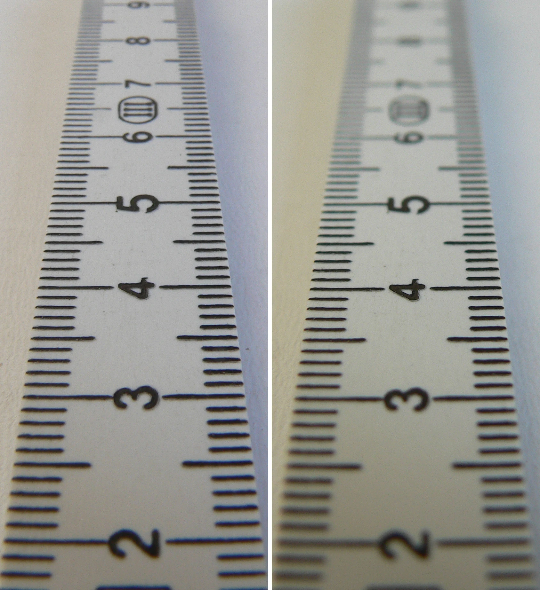
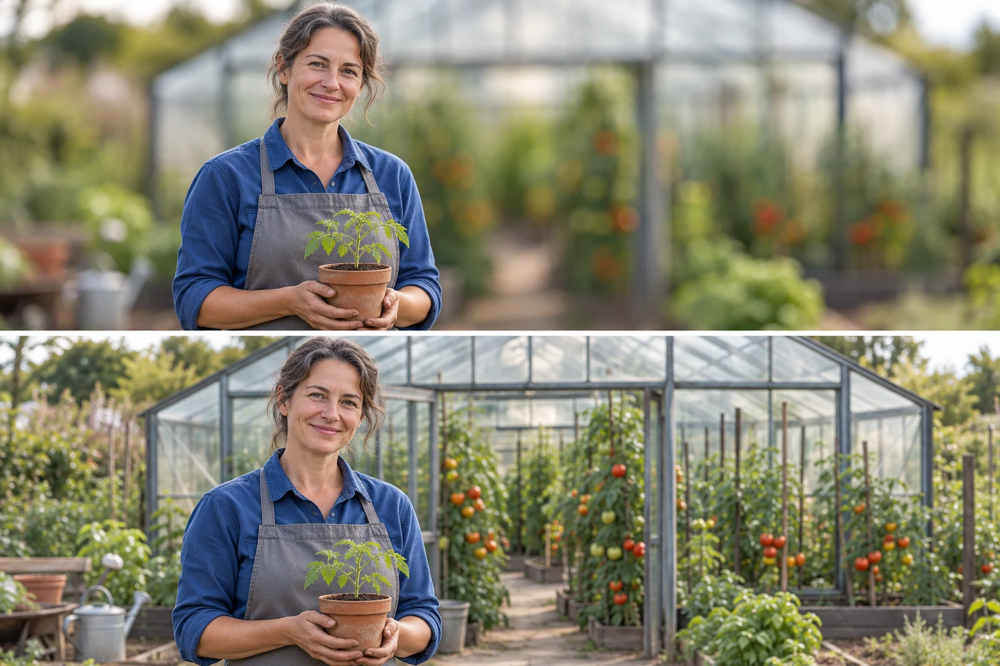

You focus on a mug at the front of a breakfast table. Its lettering is clear, but the
person behind it is soft. That may be ideal if the mug is the subject. If the photograph
is about a conversation across the table, you may need their expression to remain readable
as well. The question is how much depth the photograph needs, not how much blur you can produce.

Choose a useful range of acceptable sharpness around the distance you focus on. Depth of
field names that range. It has no abrupt physical boundary: detail becomes progressively
less sharp away from the focus distance, and whether it looks acceptable depends on the
image's size and how it is viewed.

[Original and capture notes](https://commons.wikimedia.org/wiki/File:Blenden_links_8.0_rechts_2.8_(fcm).jpg)
· [CC BY-SA 4.0](https://creativecommons.org/licenses/by-sa/4.0/). WebP conversion; comparison preserved.

## Place the range before changing its width

First decide where focus belongs. A deeper range centered on the wrong subject may still
leave the important detail inadequate. [[focus-on-what-matters|Focus on What Matters]] covers
that selection. Then decide how much detail in front of and behind it should remain readable.
The sharp range is not always split equally around the focus distance, and “focus one third
into the scene” is not a reliable universal method.

For the same camera, lens, focus distance, and viewing conditions, a smaller aperture opening
usually increases depth of field. Its f-number is larger: f/8 is a smaller opening than
f/2.8. That is what the ruler comparison illustrates. The labels come from the photographer's
description; they are not invented from the image's appearance.

Aperture is only one control. Focusing closer generally narrows the range, all else equal.
Using a longer focal length from the same position also narrows it while changing framing.
If you move back to keep the subject the same size with that longer lens, much of the
depth-of-field difference can diminish. Background appearance may still change. Keep these
conditions explicit instead of assuming a longer lens always produces one fixed effect.

## Distinguish sharp range from background blur

Moving a background farther behind a subject can make it more blurred without changing the
focus distance or the near subject's depth-of-field range. A person standing against a wall
may remain visually connected to its detail; the same person farther from it may stand
out more clearly. The wall's distance matters to its appearance.

That does not mean a distant background automatically becomes featureless. Lens characteristics,
focal length, aperture, subject distance, and the background's own contrast matter. Bright
spots can remain conspicuous as large blurred shapes. [[separate-subject-and-background|Separate Subject and Background]] explains why blur alone cannot solve every competing background.

## A portrait that keeps its setting

A gardener stands in front of a greenhouse. At a wide aperture, the face may be clear
while the greenhouse becomes a broad pattern. That can emphasize the person, but if the
greenhouse explains their work, excessive loss of detail may weaken the portrait. A smaller
opening or a more distant camera position can preserve more context.

Check the consequence for exposure. A smaller opening admits less light per unit time. The
camera may lengthen the exposure or raise ISO to maintain rendered brightness. Movement can
then blur, or the result may become noisier because less light was captured. The settings
are choices with linked consequences, not a competition to achieve the highest f-number.

At very small apertures, diffraction can reduce fine detail even as the acceptable depth
range increases. A photograph may benefit from a moderate aperture, a better focus distance,
and a carefully chosen viewpoint rather than the smallest available opening. [[photography-foundations|Photography Foundations]] explains the exposure terms without requiring manual mode.

## A close object and a landscape

A small object photographed very close can have a surprisingly narrow sharp region. If the
front marking and rear edge both matter, stepping back and cropping modestly may be practical.
Positioning a flat label more nearly parallel to the camera's sensor can also reduce the
range of distances that needs to be sharp. For a formal object record, a specialist may
combine multiple focus positions, but that is a separate method rather than ordinary single-frame
depth of field.

In a landscape, a rock very near the camera and distant hills may exceed the useful sharp
range of one setup. Raising the camera or excluding the rock can simplify the problem.
[[build-layers|Build Layers]] does not require every layer to have microscopic detail. Decide
which regions need texture and which only need recognizable form.

## Phones offer different controls

Many phones and compact cameras use short actual focal lengths for their usual wide views,
so a broad range often looks sharp at ordinary distances. Most phone apertures are fixed;
an f-number slider in Portrait mode commonly changes simulated blur rather than a physical
opening. Some models have real variable apertures, so check your device rather than assuming.

Optical close-up blur and computational blur can both be useful, but they behave differently
around complex edges and movement. Inspect hair, glass, and gaps. More sharpness or more blur
is useful only when it preserves the relationships you intended. Choose the range your
photograph needs, and accept the exposure and context tradeoffs that accompany it.
