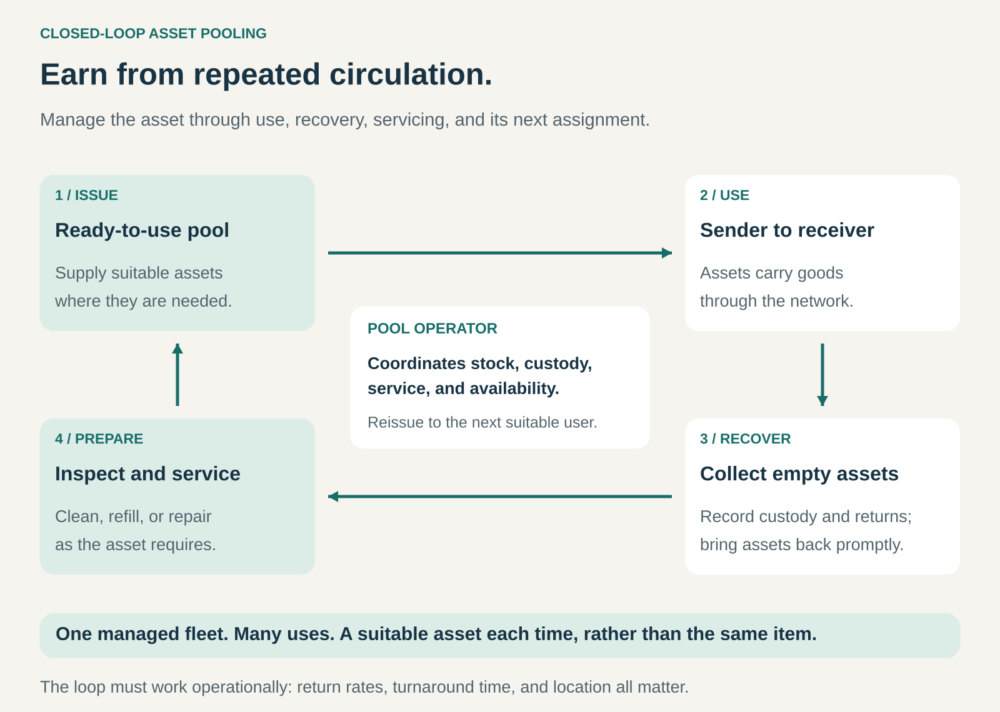

## What it is for

A manufacturer needs crates to ship its products. A retailer needs those crates only until the products reach the shelf. After unloading, the crates become someone’s collection, storage, cleaning, and return problem.

When each business manages its own assets, shortages can exist alongside piles of unused equipment elsewhere.

Closed-Loop Asset Pooling turns this fragmented activity into a managed service. An operator maintains a shared fleet, supplies assets where they are needed, recovers them after use, prepares them for another assignment, and keeps them circulating.

It is useful when durable assets can serve many successive users, but coordinating their movement is difficult for individual customers.

## The core idea

**Sell access to a dependable circulation system, supported by a reusable fleet.**

The customer needs a suitable pallet, crate, cylinder, or container at the right place and time. The operator manages the infrastructure that makes this possible.

Three elements define the pattern:

- **A pool:** compatible assets can serve successive customers or locations.
- **A recovery loop:** assets have an established route back into managed circulation.
- **An accountable operator:** someone coordinates availability, condition, custody, and redistribution.

Customers usually receive an equivalent asset from the pool. They do not necessarily receive the same physical item on their next order.

Ownership commonly remains with the operator, although a cooperative or customer-owned fleet can also be centrally managed. The commercial model may use charges per trip, time in possession, service contracts, or a combination.

Here, _closed loop_ means that recovery and reissue form part of the service. Industry terminology varies: providers sometimes distinguish narrow supplier-to-factory “closed loops” from wider retail “open loops,” even when both have managed asset recovery. The underlying mechanism is controlled circulation. [Tosca: pooling models](https://www.toscaltd.com/supply-chain-pooling/)

## How it works

**Issue suitable assets.** The operator supplies equipment from available stock, using agreed specifications and demand forecasts. Compatibility matters: a crate must fit the handling system, and a cylinder must fit its intended equipment.

**Support use and transfers.** Assets move through participating businesses. Accounts, shipment records, scans, or other controls establish where they are and who is responsible for them. Continuous tracking of every individual item is not always necessary; dependable custody records are.

**Recover after use.** Empty assets are collected, exchanged, or returned through designated locations. Convenient returns and clear responsibilities prevent equipment from accumulating outside the usable pool.

**Prepare for reissue.** Depending on the asset, preparation may involve inspection, washing, sanitizing, refilling, testing, or repair. Unserviceable units leave circulation.

**Redistribute to demand.** The operator sends ready assets to the next suitable user. They may remain near their last destination rather than travel back to their original sender.

The difficult work lies between these steps. A pool can have enough assets overall while still failing to supply the right size, condition, or quantity in a particular location.

## Why it works

The first advantage is repeated earning capacity. A durable asset can support many paid uses, spreading its acquisition cost across multiple service cycles.

The second is coordination. Individual businesses often have limited visibility beyond their own operations. A pool operator can combine demand and return flows across customers, arrange collections, and reposition stock.

The third is specialization. Washing facilities, repair processes, inventory systems, and collection routes can serve a larger fleet than any one customer could economically support.

Customers buy relief from this operating burden. They gain access to ready equipment while the operator takes responsibility for much of the work surrounding it.

The economics depend on circulation. Assets waiting in a customer’s yard still tie up capital. Faster returns can increase the number of uses supported by the same fleet, provided inspection and service standards are maintained.

## Famous examples

### CHEP — pallets circulating across supply chains

CHEP supplies pallets and other transport platforms on a rental basis. Manufacturers load them with goods and ship them to customers; CHEP coordinates recovery, inspection, and repair before the platforms return to use.

The customer’s requirement is dependable equipment for moving goods. CHEP’s service extends across the outbound shipment and the recovery process, relieving customers of much of the work involved in managing their own pallet fleet.

Its automotive container service illustrates the loop particularly clearly: containers go to suppliers, carry components to a manufacturing facility, and return through CHEP’s network for preparation and reuse.

This shows why pooling is more than renting an object. The collection and service network makes repeated availability possible. [CHEP: how the system works](https://www.chep.com/us/en/why-chep/how-chep-works)

### IFCO — reusable containers for fresh food

IFCO’s SmartCycle supplies reusable packaging containers that circulate among growers, producers, distributors, and retailers.

After use, folded containers are collected and transported to wash centers. They are inspected, sanitized, repaired where necessary, and prepared for another cycle. IFCO retains ownership and restricts the equipment to use within its network.

The folding design reduces the space required for empty returns, while centralized servicing supports consistent preparation between uses.

The important mechanism is the combination: reusable container design, customer participation, return logistics, and servicing work as one system. A durable crate alone would not provide the same service. [IFCO: SmartCycle recollection](https://www.ifco.com/food-supply-chain-innovation/smartcycle/recollection/)

### SodaStream — exchanging cylinders instead of waiting for an individual refill

SodaStream customers can exchange an empty CO₂ cylinder for a full one through participating retail locations. Stores return the empties for cleaning, inspection, and refilling.

The customer receives a ready cylinder from available stock. Their returned cylinder enters the preparation process and can later serve another customer.

This separates the customer’s replenishment moment from the servicing of their particular container. Retailers provide convenient exchange points, while centralized facilities prepare cylinders for further use.

The reusable asset supports recurring purchases of its contents. The cylinder circulates; the gas is consumed. Return arrangements and compatible cylinder types depend on the market and service channel. [SodaStream: retail exchange](https://support-us.sodastream.com/hc/en-us/articles/4420077071515-How-does-a-retail-CO2-exchange-work), [SodaStream: preparation for another customer](https://support-uk.sodastream.com/hc/en-gb/articles/4418334032027-Where-can-I-exchange-my-empty-CO2-cylinder)

## The economics

Consider a hypothetical pool of 5,000 reusable crates costing €25 each: an initial fleet investment of €125,000.

Suppose the fleet supports 50,000 chargeable trips annually, averaging ten trips per crate.

| Annual item                                                     |      Amount |
| --------------------------------------------------------------- | ----------: |
| Trip fees: 50,000 × €3                                          |    €150,000 |
| Asset delivery, recovery, and repositioning                     |    −€40,000 |
| Cleaning and inspection                                         |    −€25,000 |
| Repairs                                                         |     −€5,000 |
| Normal asset depreciation, excluding losses                     |    −€25,000 |
| Lost assets: 200 × €25                                          |     −€5,000 |
| Pool coordination and administration                            |    −€20,000 |
| **Operating surplus before other overhead, financing, and tax** | **€30,000** |

These figures are illustrative. They exclude transporting the customers’ goods.

Losses are only 0.4% of the annual trip count, yet they consume €5,000. If losses rose to 3%, replacing 1,500 crates would cost €37,500. With the other assumptions unchanged, the surplus would become a €2,500 loss.

Turnaround also matters. At 100 asset issues per day and a 20-day average cycle, roughly 2,000 assets are occupied in the cycle before allowing for buffers. A 30-day cycle requires roughly 3,000.

A refundable deposit can encourage returns and provide cash temporarily, but it also creates a repayment obligation. It is not automatically operating margin.

## Useful when

- **Uses repeat frequently.** Assets can complete enough cycles to recover their purchase and servicing costs.
- **Specifications are compatible.** Customers can accept suitable units from a common pool.
- **Return routes are practical.** Retail locations, depots, regular deliveries, or backhauls support collection.
- **Customers value operational simplicity.** Managing equipment is necessary but distracts from their main business.
- **Demand and returns can be coordinated.** The network has enough density and predictable activity to support redistribution.
- **Condition can be restored economically.** Inspection, cleaning, refilling, and repair cost less than the value of continued use.

## Common mistakes and limits

**Buying reusable assets without organizing returns.** Durability creates potential. Collection, accountability, and convenient handoffs turn that potential into repeated use.

**Measuring fleet size instead of serviceable availability.** Equipment may be stranded, dirty, damaged, or in the wrong location. Total stock can conceal operational shortages.

**Ignoring customer handling costs.** Sorting, folding, scanning, storage, and returns require effort. The service must make participation worthwhile for senders and receivers.

**Assuming scale guarantees efficiency.** More participants can improve coverage, but incompatible assets, dispersed destinations, and seasonal peaks can increase complexity.

**Relying on penalties to solve poor service design.** Loss charges help establish responsibility. They cannot compensate for confusing return rules or unreliable collections.

**Assuming reuse guarantees environmental savings.** Actual results depend on achieved reuse, losses, washing requirements, transport distances, and the alternative being replaced.

## Related patterns

- [[shared-access|Shared Access:]] The broader principle of successive users drawing on shared assets; pooling adds coordinated recovery and preparation.
- [[product-as-a-service|Product as a Service:]] Provides asset capabilities as an ongoing service. Pooling emphasizes interchangeable units circulating through a network.
- [[pay-per-use|Pay per Use:]] A common charging mechanism for completed trips or cycles, although pooling can use other pricing structures.
- [[repair-and-maintenance|Repair and Maintenance:]] Keeps pooled assets serviceable and helps preserve the fleet’s earning capacity.
