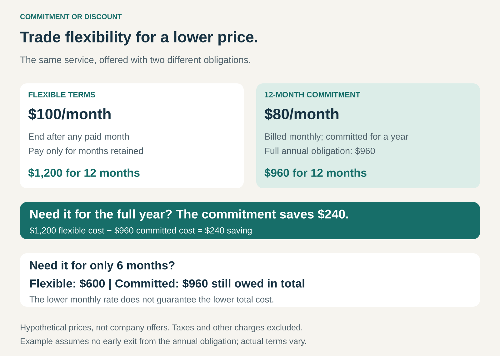

## What it is for

Some customers know they will need your offering for a long time. Others need the freedom to stop, change plans, or buy only when demand appears.

Charging both groups the same price leaves an opportunity unexplored.

Commitment or Discount offers a trade: customers receive a lower price when they accept an obligation that makes the relationship more predictable or less costly to serve.

The proposition is: **keep your flexibility at the standard price, or make a defined commitment in exchange for a discount.**

## The core idea

Make the discount conditional on something valuable to the provider.

That commitment might be:

- **Duration:** remain subscribed for an agreed term.
- **Volume or spending:** purchase a minimum quantity or spend.
- **Advance payment:** pay earlier instead of retaining the money.
- **Reduced cancellation rights:** accept a less flexible booking or order.

These commitments create different benefits. A longer term can improve revenue visibility. A minimum volume can support production planning. Prepayment provides cash earlier. Restricted cancellation can reduce uncertainty about future demand.

The commitment does not have to involve paying everything upfront. A customer can be billed monthly while remaining committed for a year.

Nor is every discount an example of this pattern. A temporary promotion or membership offer may reduce the price without securing a meaningful purchasing obligation.

## How it works

Consider the same service offered under two hypothetical arrangements.

The flexible option costs **$100 per month** and can end after any paid month.

The committed option costs **$80 per month**, billed monthly, with a full **12-month obligation of $960**. For this illustration, there is no early exit from that obligation.

A customer who needs the service for a year saves **$240** by committing: $960 instead of $1,200.

A customer who needs it for only six months pays **$600** under flexible terms. The annual commitment still costs $960 in total.

The lower monthly rate is therefore valuable only in relation to the obligation attached to it.

A clear offer places the service, total commitment, payment schedule, cancellation consequences, and renewal terms together. Customers should be able to understand the exchange before selecting it.

## Why it works

Flexibility has value to both sides.

A customer who can stop purchasing at short notice retains options. The provider carries more uncertainty about future revenue and may need to replace that customer.

A commitment reduces some of that uncertainty. The provider can share part of the resulting value through a lower price.

The choice also lets customers select terms that fit their circumstances. A business with a stable operating requirement may accept a longer commitment. A team running a short experiment may reasonably pay more per month to avoid a longer obligation.

This can improve conversion without requiring a universal price reduction. However, the discount must earn its place economically. If customers would have stayed anyway, the provider may simply be giving away margin.

## Famous examples

### Adobe: annual commitment with monthly billing

Adobe distinguishes between annual plans paid monthly, annual prepaid plans, and month-to-month plans. Its US subscription guidance explicitly connects annual commitments with discounted pricing and describes early cancellation charges or refund restrictions for annual arrangements. Specific terms depend on the plan and location. [Adobe subscription guidance](https://helpx.adobe.com/account/individual/terms-policies-and-regulations/adobe-subscription-terms.html)

The important mechanism is the separation between **billing frequency** and **commitment length**.

Monthly collection makes payment easier to spread, but it does not necessarily provide the right to leave after each month without further cost.

The transferable lesson is that the commitment should be as visible as the monthly price. Otherwise, a commercially understandable exchange can become a source of surprise and dissatisfaction.

### Amazon Web Services: discounted rates for committed spending

AWS Savings Plans offer lower prices on eligible usage in exchange for a defined hourly spending commitment over an agreed term.

Depending on the plan, customers can choose among upfront and recurring payment arrangements. Usage beyond the commitment can be charged at ordinary On-Demand rates. [AWS Savings Plans FAQ](https://aws.amazon.com/savingsplans/faqs/)

Here the customer commits to spending rather than purchasing a conventional annual subscription.

The discount can be useful when eligible demand remains sufficiently consistent. If demand falls, the commitment can reduce or eliminate the expected benefit.

AWS also states that Savings Plans do not themselves reserve capacity. The customer is exchanging a spending obligation for pricing benefits; capacity assurance is a separate feature.

### Hilton: a lower hotel rate for reduced booking flexibility

Hilton’s published Advance Purchase offer provides discounted rates in exchange for booking ahead and making full, non-refundable prepayment.

The offer generally restricts modifications, while describing limited rebooking provisions for certain reservations and regions. The applicable rate and booking conditions determine the actual exchange. [Hilton Advance Purchase offer](https://www.hilton.com/en/offers/curio-collection/advance-purchase-discount-2000001074/)

The commitment is to particular travel dates and payment terms, rather than a year of service.

The guest accepts more risk if plans change. In return, the hotel receives earlier payment and a firmer booking.

This shows that the pattern applies to individual transactions as well as continuing customer relationships.

## The economics

For the customer, the comparison should use total cost across realistic scenarios.

In the graphic’s example, the committed annual price is $960. At $100 per flexible month, the flexible option reaches that amount after 9.6 months. For whole months of continuous need, the annual commitment becomes cheaper from the tenth month.

That calculation changes if the service differs, cancellation is permitted, fees apply, or payment occurs at different times.

For the provider, the discount must be supported by benefits such as reduced customer replacement costs, more dependable demand, better scheduling, or earlier cash.

Those benefits are not interchangeable. An annual agreement billed monthly improves contractual visibility without providing a full year’s cash upfront. Prepayment provides cash but may create continuing delivery obligations.

The provider must also account for customers moving from higher-priced flexible terms into discounted commitments. More contracted revenue does not automatically mean more profit.

## Useful when

- Customers differ meaningfully in how much flexibility they need.
- Some demand is stable enough to support credible commitments.
- Predictability or earlier payment creates measurable value for the provider.
- The discount can be offered without undermining delivery economics.
- Customers can compare obligations and total costs easily.
- The business can administer changes, cancellations, and renewals clearly.

## Common mistakes and limits

**Presenting monthly billing as monthly freedom.** A monthly payment amount says little about the remaining obligation. Both need to be visible.

**Comparing only advertised rates.** A discount can disappear economically when the customer pays for periods or quantities it no longer needs.

**Offering discounts without securing useful commitments.** If customers can leave immediately with no meaningful consequence, the provider may receive little in exchange for the lower price.

**Making flexibility artificially unattractive.** An inflated comparison price can weaken trust. The flexible option should make commercial sense for customers who need it.

**Ignoring implementation and switching costs.** Customers may already face substantial costs to change providers. Additional contractual restrictions can make an apparently modest discount a poor exchange.

**Relying on difficult cancellation.** Predictability should come from an understood agreement. Friction, ambiguity, and unexpected charges can damage retention and reputation.

**Treating the initial term as the whole relationship.** Renewal pricing, changes in requirements, and the next commitment period can determine whether the arrangement remains valuable.

## Related patterns

[[take-or-pay|Take-or-Pay]] establishes a minimum payment even when consumption falls. It can serve as the commitment behind a discount, although it may instead support investment or supply arrangements without a flexible-price alternative.

[[subscription|Subscription]] provides continuing access through recurring payments. Commitment or Discount can create different term options within that subscription.

[[customer-funded-working-capital|Customer-Funded Working Capital / Cash Machine]] benefits from receiving money before paying related costs. A prepaid discount can contribute to that mechanism; a commitment billed over time may not.

[[reserved-capacity|Reserved Capacity]] secures an access entitlement. A commitment discount secures pricing benefits, which may or may not include protected capacity.
