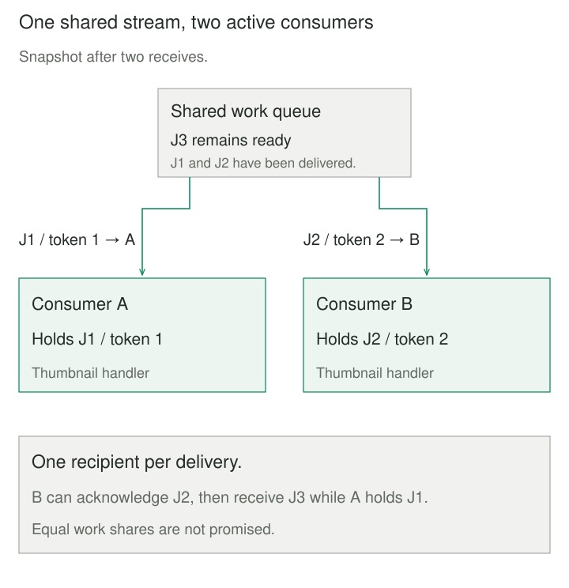

## Purpose and problem

An image service accepts uploads quickly, then queues thumbnail jobs. One worker processes them in sequence. A large image delays every smaller job behind it, and an upload burst makes the backlog grow faster than that worker can drain it.

The service needs more processing capacity without teaching uploaders which worker is free. It also needs a clear answer when a worker disappears: has its job finished, should another worker try it, and could both attempts change the same output?

## Core idea

**Competing Consumers lets multiple interchangeable consumers receive work from one logical point-to-point channel.** Each delivery is assigned to one consumer, allowing different messages to be processed concurrently. The channel chooses recipients according to its implementation and configuration.

Think **one shared work stream, several workers, one recipient per delivery**. The workers perform the same role. Billing and thumbnail generation are different interests, not interchangeable competitors for one upload event.

Hohpe and Woolf’s established pattern name is Competing Consumers. A shared subscription or consumer group can implement this arrangement; those product terms also carry additional semantics. A thread pool can host consumers, but the pattern does not prescribe threads, processes, or machines.



## How it works

### Separate assignment from completion

The producer publishes a complete message to a channel. Consumers register or poll against the same logical work stream. Delivery reserves or removes an item according to the channel’s contract; the worker then processes it outside the channel’s coordination.

With recoverable delivery, the channel retains unacknowledged work or tracks a visibility deadline. The consumer acknowledges after the required processing outcome is safely recorded. RabbitMQ, for example, requeues unacknowledged deliveries when their channel closes. Failure detection takes time; another worker may receive the same logical message later.

An acknowledgment of delivery processing is separate from a producer’s confirmation that publication reached the broker. Neither alone proves that a business effect happened exactly once. A crash after storing a thumbnail but before acknowledging leaves uncertainty. Stable job identity and an idempotent output contract can make another attempt safe.

### Bound ownership and preserve necessary ordering

Limit each worker’s outstanding deliveries using appropriate prefetch, credit, or polling limits. Excessive reservations can strand work behind a slow consumer while others wait. Worker count and prefetch also multiply memory use, database connections, and downstream load.

FIFO delivery does not imply FIFO completion across workers. Idempotency does not make arbitrary reordering safe: “replace address” followed by “ship order” can still require ordered processing. Route related messages into an ordered key or session, or choose a different coordination model.

Consumers own their connections and active work. On shutdown, stop taking new deliveries, finish and acknowledge owned work where possible, then close or release according to the broker contract. Define bounded retries and a dead-letter policy for repeatedly failing jobs. Restrict consumers to authorized queues and validate payloads before processing; a job ID is not proof of permission.

## Worked example

### Three thumbnails, two consumers

Before the change, J1 blocks J2 and J3 behind one worker. Afterward, A holds J1 while B completes J2 and takes J3. When A’s delivery is abandoned, B can later receive J1 again.

This Python 3.10+ program is a **bounded, sequential delivery simulation**, not a broker or a speed benchmark. Calls represent an explicitly scheduled interleaving. The finite input is a tuple of unique, nonempty job IDs. A and B are trusted registered consumers, with at most one outstanding delivery each. Tokens identify delivery attempts; job IDs identify logical work.

Save as `competing_consumers.py` and run `python3 competing_consumers.py`. The program models assignment, acknowledgment, and explicit connection loss. It does not render images or decide whether an abandoned attempt already produced an output.

```python
from collections import deque
from dataclasses import dataclass


@dataclass(frozen=True)
class Delivery:
    token: int
    job: str
    worker: str


class WorkQueue:
    def __init__(self, jobs):
        if type(jobs) is not tuple or any(
            type(job) is not str or not job.strip() for job in jobs
        ) or len(set(jobs)) != len(jobs):
            raise ValueError("unique nonempty job IDs required")
        self.ready = deque(jobs)
        self.inflight = {}
        self.sequence = 0

    def receive(self, worker):
        if worker not in ("A", "B") or worker in self.inflight:
            raise ValueError("unknown or busy consumer")
        if not self.ready:
            return None
        self.sequence += 1
        delivery = Delivery(self.sequence, self.ready.popleft(), worker)
        self.inflight[worker] = delivery
        return delivery

    def ack(self, delivery):
        if type(delivery) is not Delivery or (
            self.inflight.get(delivery.worker) != delivery
        ):
            raise ValueError("delivery is no longer current")
        del self.inflight[delivery.worker]

    def disconnect(self, worker):
        if worker not in ("A", "B"):
            raise ValueError("unknown consumer")
        delivery = self.inflight.pop(worker, None)
        if delivery is not None:
            self.ready.appendleft(delivery.job)


if __name__ == "__main__":
    queue = WorkQueue(("J1", "J2", "J3"))
    first = queue.receive("A")
    second = queue.receive("B")
    print("in flight", first.job, second.job)
    queue.ack(second)
    third = queue.receive("B")
    print("next", third.job)
    queue.ack(third)
    queue.disconnect("A")
    retry = queue.receive("B")
    print("redelivered", retry.job, retry.token)
    try:
        queue.ack(first)
    except ValueError:
        print("stale ack rejected")
    queue.ack(retry)
    print("drained", not queue.ready and not queue.inflight)
```

The five lines are `in flight J1 J2`, `next J3`, `redelivered J1 4`, `stale ack rejected`, and `drained True`. J1’s logical identity survives, but its new delivery token is 4. J2 and J3 complete their delivery lifecycle before J1. “Drained” means no ready or outstanding deliveries in this model, not independently verified business success.

The model immediately retires A’s delivery on `disconnect`; real failure detection is neither immediate nor infallible. Rejecting an old acknowledgment does not stop an old process from writing to an external system. There is no network, real parallel execution, persistence, automatic retry limit, visibility timer, or transactional effect store here.


### Partitioned logs change the scheduling unit

Kafka’s consumer group divides topic partitions among members. With conventional group subscription, one member owns each assigned partition, potentially processing many records from it. Adding more consumers than partitions cannot add active partition readers within that group. A hot partition can therefore limit throughput despite idle consumers elsewhere.

Separate groups maintain independent consumption positions. Adding a group creates another interest; adding a member within a group shares that group’s work. Record offsets and committed progress replace the simulation’s per-delivery acknowledgment mechanism.

## When to use it

Use this pattern when independent jobs accumulate behind one consumer, workers can perform the same role, and the channel supports the required ownership and recovery behavior. Monitor oldest-message age, throughput, active work, and downstream saturation when deciding how many workers to run.

Keep one consumer when it meets demand or required global ordering dominates. Keep direct local calls when asynchronous handoff and its operational cost offer no useful benefit.

## Tradeoffs and common mistakes

More consumers add coordination, connections, resource contention, and recovery work. Scaling workers cannot repair a saturated database or a single ordered hot key. A large queue delays overload symptoms without creating capacity.

Common mistakes are giving every worker its own independent subscription, acknowledging before durable completion, retrying indefinitely, assuming equal work shares, and treating queue emptiness as proof that all jobs finished. A queue can be empty while consumers hold unacknowledged work. Delivery recovery and safe business retries must be designed together.

## Related patterns

[[data-publish-subscribe-distribution|Publish-Subscribe]] gives independent interests their own delivery paths. Workers sharing one subscription can compete within that interest.

[[producer-consumer|Producer-Consumer]] separates work creation from execution through a buffer. Competing Consumers focuses on multiple interchangeable receivers sharing that work.

[[queue-based-load-leveling|Queue-Based Load Leveling]] absorbs rate differences over time. Competing Consumers increases concurrent processing capacity; they often appear together.

[[idempotent-receiver|Idempotent Receiver]] protects business effects from redelivery. One assigned recipient does not remove the need for it.

## Sources

- [Gregor Hohpe and Bobby Woolf: Competing Consumers](https://www.enterpriseintegrationpatterns.com/patterns/messaging/CompetingConsumers.html) — original catalog collaboration and distinction from independent subscriptions.
- [Microsoft: Competing Consumers](https://learn.microsoft.com/en-us/azure/architecture/patterns/competing-consumers) — queue-based distribution, scaling, result handling, and operational considerations.
- [RabbitMQ: Consumer acknowledgments and publisher confirms](https://www.rabbitmq.com/docs/confirms) — distinct acknowledgment directions, unacknowledged delivery limits, and requeue after connection loss.
- [Apache Kafka: KafkaConsumer](https://kafka.apache.org/42/javadoc/org/apache/kafka/clients/consumer/KafkaConsumer.html) — conventional group partition assignment, rebalancing, positions, and committed offsets.

The thumbnail scenario, executable delivery simulation, controlled failure sequence, and diagrams are original teaching material.
