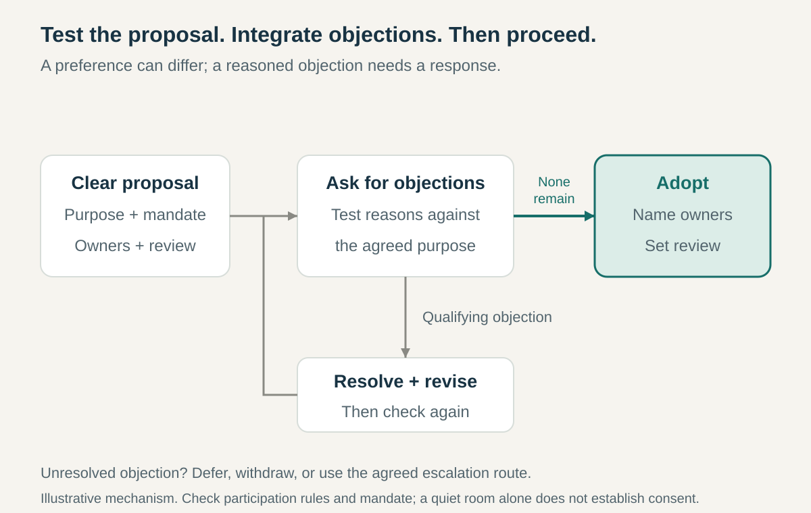

**Core question:** How can a group decide together without requiring everyone’s preferred option or dismissing serious objections?

## What it is for

Imagine a hypothetical community workshop considering evening opening hours. Most members welcome the idea. One prefers quieter evenings; another points out that nobody has committed to locking the building. A popularity vote could pass the proposal while leaving the practical problem unresolved. Seeking everyone’s favorite schedule could prolong the discussion indefinitely.

Consent Decision-Making gives the group another test: is there a reason this proposal would undermine its shared purpose or ability to carry out the work?

It applies to authorized teams, committees, and cross-unit bodies making policies or other collective commitments. Operational choices can remain delegated to individuals within those policies.

## The core idea

**Adopt a proposal only when no qualifying objection remains, and use objections to improve its fit with the group’s purpose.**

Consent concerns whether a proposal is workable within an agreed mandate. Members can prefer something else and still consent. Ted Rau’s account of sociocratic consent ties objections to potential harm to a group’s aim, rather than personal preference. [Rau, _Consent Decision Making_, 2022](https://www.sociocracyforall.org/consent-decision-making/)

The criteria must be clear. Sociocracy 3.0 uses a broader definition that can also include worthwhile improvements; methods differ in how they qualify objections. This article focuses on reasoned risks to purpose, responsibilities, or implementation. [Sociocracy 3.0, _Consent Decision-Making_](https://patterns.sociocracy30.org/consent-decision-making.html)

An objection is information the group must address, not a command to adopt the objector’s favorite solution. Unlike majority voting, counting supporters does not resolve it. Unlike Advice Process, a designated owner cannot simply weigh a qualifying objection and proceed unchanged. Consent authorizes a collective commitment under the group’s agreed rules.

## How it works

**Establish the decision space.** Identify the group’s purpose, authority, participating members, and constraints. Agree quorum, representation, and how absent members participate. Consent in one committee cannot authorize spending or commitments outside its mandate. Define an escalation route before a difficult disagreement arrives.

**Make the proposal understandable.** State the intended result, practical arrangement, responsibilities, and proposed review. Allow clarifying questions before debating merits. For the workshop, specify evenings, access arrangements, staffing, and who closes the building. A vague ambition cannot be meaningfully checked for objections.

**Hear reactions, then ask explicitly.** Give members room to express preferences and concerns without treating every negative reaction as a blocking objection. Then ask each eligible participant whether they consent or have an objection. Follow the agreed participation rules; do not infer consent from an unexpectedly quiet meeting.

**Examine the reason.** Ask how the proposal could obstruct the shared aim or the work required. A missing closing arrangement is different from preferring another evening. The facilitator helps make the argument understandable; the group tests it against the agreed criteria. Difficulty explaining a concern is a reason to investigate, not an excuse to dismiss the speaker. Reasonable risk assessment does not require certainty about future harm.

**Integrate what the objection reveals.** Revise the arrangement, reduce its scope, add resources, or obtain missing information. The workshop might begin with one staffed evening and a named keyholder. A limited trial can help only when its risks, stopping conditions, and consequences are acceptable. Short duration alone does not make a harmful commitment suitable.

**Check the revised proposal again.** Ensure members understand what changed and whether any qualifying objection remains. If one cannot be resolved, defer, withdraw, or use the previously agreed escalation process. A deadline or majority preference does not turn unresolved opposition into consent. Disputes about whether an objection qualifies also need an agreed route, rather than a facilitator’s unilateral dismissal.

**Record adoption and review.** Name implementation owners, review timing, and what the group will examine. Record concerns that do not block adoption so they can inform observation. A later material objection can justify reconsideration; an earlier consent is not a promise never to learn or change course.

## Why it works

The method separates preference from the conditions needed to work together. Members can allow an acceptable proposal to proceed without claiming it is their ideal solution.

Objections can reveal missing capacity, incompatible obligations, or risks before implementation. Resolving them changes the proposal instead of merely recording the losing side of a vote. Review then tests whether the arrangement performs as expected.

This depends on a meaningful shared purpose, usable information, and people being able to object without retaliation. Poor facilitation can turn the process into either endless bargaining or pressure to remain silent. The method makes reasoning discussable; it does not guarantee sound judgment.

## Examples

### Sociocracy For All’s password decision, recounted in 2020

Ted Rau describes a three-person support-circle meeting about consolidating organizational passwords. He disliked changing from his familiar system and anticipated disruption. After expressing those reactions, he nevertheless consented: he judged that unifying the arrangement served the circle’s administrative purpose and that he could implement it without harm. [Rau, _The Day I Consented to a Proposal I Hated_, March 2020](https://www.sociocracyforall.org/the-day-i-consented-to-a-proposal-i-hated/)

The facilitator’s separate reaction and consent rounds made room for both statements. Rau did not have to pretend enthusiasm, and his dislike did not automatically become an objection. The group could accept a proposal that was outside one member’s preferences but within his assessment of workable action.

This is a participant’s retrospective account, without a precise meeting date. It illustrates the distinction between reaction and consent; it does not establish the security quality of the arrangement or a measured improvement in organizational performance.

### Equal Care’s published circle rules, consulted October 2026

Equal Care’s playbook uses consent for most circle decisions, including selecting people for time-limited roles. It requires circles to establish quorum and a process for gathering consent from absent members. Its guidance offers practical responses to concerns: monitoring them, shortening the proposed term, or amending the proposal. [Equal Care, _Consent_](https://play.equal.care/equal-cares-model/circles/consent)

The arrangement also supplies boundaries. An unresolved decision can pass to a broader circle. Certain employment-related decisions follow separate processes, and a broader circle can restructure another circle after involving its members without requiring their consent.

These provisions show how a collective decision rule fits into a wider distribution of authority. Consent belongs to a defined forum and scope, rather than granting every participant a veto over the entire organization. The source documents stated governance arrangements, not proof that every dispute is resolved well or that its exceptions suit other organizations.

## Useful when

- **A group must authorize shared policy.** Members need a workable commitment rather than one person’s recommendation.
- **Voting leaves important risks unresolved.** A minority can explain consequences that popularity does not answer.
- **Preference-seeking stalls progress.** Several acceptable arrangements exist, but the group keeps pursuing everyone’s ideal.
- **Policies can be reviewed.** Named owners and meaningful feedback make revision practical.

## Common mistakes and limits

**Treating every dislike as a veto.** Help members connect an objection to the purpose or implementation, while still hearing concerns respectfully.

**Demanding polished proof.** People can perceive a real problem before articulating it clearly. Make space to develop the argument.

**Pressuring people to consent.** Speed achieved through silence conceals unresolved risk and weakens the agreement.

**Calling an unsafe proposal a trial.** Check reversibility and consequences before relying on later review.

**Using the whole group for everything.** Consent can establish policies and delegation without requiring a meeting for every operational choice.

Deep conflicts over purpose, urgent situations without an agreed emergency procedure, or commitments outside the group’s authority may require another arrangement. Consent cannot manufacture a mandate or settle incompatible aims through meeting technique alone.

## Related patterns

- [[advice-process|Advice Process]] requires consultation while retaining a designated owner’s final choice; consent requires qualifying objections to be resolved before collective adoption.
- [[delegated-domains|Delegated Domains]] defines the continuing area within which a group can govern and delegate work.
- [[teamwork-make-it-safe-to-speak-up|Make It Safe to Speak Up]] supports the candid objections that give consent its practical value.
