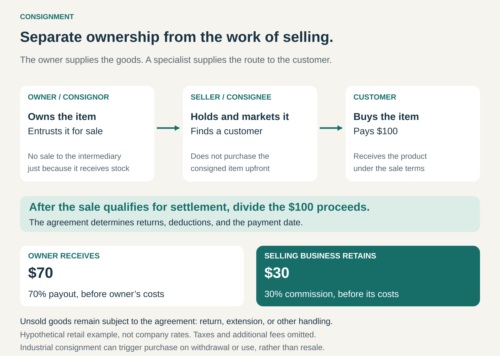

## What it is for

A retailer wants to offer more products without buying every item upfront. A maker or owner wants access to customers but lacks the audience, premises, expertise, or time to sell directly.

Consignment connects them by separating ownership of the goods from the work of selling them.

The owner places goods with a selling partner while generally retaining ownership until an agreed sale or purchase event. The partner markets the goods and receives compensation when they sell.

The proposition is: **you supply the goods; we provide the route to the customer.**

## The core idea

Putting a product on someone else’s shelf does not have to mean selling it to them.

In a conventional wholesale arrangement, the retailer buys inventory and then tries to resell it. In consignment, the owner—called the **consignor**—entrusts goods to the selling partner, or **consignee**, without that partner purchasing them upfront.

The selling partner typically earns a commission or retains an agreed portion of the sale proceeds. The owner receives the remaining amount after applicable deductions.

Unsold goods are handled according to the agreement: they might be returned, remain available for another period, or follow another agreed process.

The same ownership principle also appears in industrial supply. A supplier can place stock at a customer’s premises while retaining ownership until withdrawal or use triggers a purchase. That version earns revenue from supplying goods rather than necessarily charging a sales commission.

## How it works

The owner and selling partner first agree which goods will be accepted and how they will be sold.

The agreement establishes pricing authority, permitted discounts, compensation, payment timing, responsibility for damage, and what happens if the goods remain unsold.

The selling partner then receives or arranges access to the goods, prepares them for sale, and presents them to customers. That work may include inspection, authentication, photography, storage, merchandising, marketing, and fulfilment.

After a qualifying sale, the proceeds are divided.

For example, suppose an item sells for **$100**, with an illustrative **30% commission**:

- The selling business retains **$30** before its operating costs.
- The owner receives **$70** before their own costs and any additional agreed charges.

Payment may follow buyer settlement or the expiry of a return period. A sale appearing on a dashboard does not necessarily mean the owner can immediately withdraw the money.

## Why it works

Consignment allows goods and selling capabilities to come from different parties.

An owner may have valuable inventory but little ability to reach buyers. A specialist may have trusted presentation, customer traffic, and selling expertise but limited appetite for purchasing stock.

The arrangement lets each contribute what they have.

For the selling business, it reduces the cash required to assemble an assortment. For the owner, it provides distribution and services without requiring a wholesale buyer to commit first.

It can be especially useful for distinctive goods whose demand or value is difficult to predict: artwork, collectibles, luxury resale, handmade products, or specialist equipment.

However, inventory funding has shifted rather than disappeared. The owner still has capital tied up in goods while waiting for a sale. The selling partner still incurs costs even when nothing sells.

## Famous examples

### The RealReal: selling luxury goods on an owner’s behalf

The RealReal’s consignment agreement states that consignors retain ownership after delivering their goods, subject to the agreement’s sale and consignment-period provisions. The company evaluates accepted items, lists them, and manages their sale.

Its terms also provide separate purchase and trade-in options. Those are different transactions: accepting an immediate purchase offer is not the same as waiting for a consigned item to sell. [The RealReal consignment and sales agreement](https://www.therealreal.com/consignor_terms)

The model combines access to luxury goods with authentication, pricing, presentation, and a customer audience.

The transferable lesson is that a consignor pays for a substantial selling service. The retained share must support that work, while the owner accepts uncertainty about timing and final proceeds.

### Sotheby’s: specialist selling without purchasing every object

Sotheby’s describes a process in which specialists assess an object, propose an estimate, and agree consignment terms with its owner. The object is researched, catalogued, marketed, and offered for sale.

For an auction, an agreed reserve can establish a minimum acceptable price. If bidding does not reach it, the object can remain unsold. Seller commissions, costs, and payment terms are established through the consignment arrangement. [Sotheby’s selling guide](https://www.sothebys.com/en/articles/editorial-how-to-sell-with-sothebys-a-step-by-step-guide), [consignment roadmap](https://www.sothebys.com/en/articles/roadmap-for-consigning-property-at-auction)

The owner contributes the object; the auction house contributes specialist knowledge, presentation, and access to bidders.

This example also separates a price expectation from a purchase commitment. An estimate or reserve does not itself guarantee that someone will buy the object.

### Fastenal: supplier-owned stock close to the point of use

Fastenal offers consignment arrangements within its industrial supply services. Its vending materials describe an optional model in which customers pay for items when they are dispensed.

A customer case involving mechanical contractor UMC describes consigned inventory held in an onsite Fastenal operation, supported by staff and replenishment services. [Fastenal consignment vending example](https://www.fastenal.com/content/documents/web/solutions/Generic_DC_Vending_Case_Study.pdf), [Fastenal’s UMC case](https://blueprint.fastenal.com/umc.html)

Here the customer is generally using supplies rather than reselling them. The purchase trigger is withdrawal under the arrangement.

The lesson is broader than retail: physical availability and ownership can be separated. Stock can be close to the customer’s work without requiring the customer to purchase the entire stockholding in advance.

## The economics

For a retail consignee, commission income must cover the cost of handling both successful and unsuccessful listings.

An item may require inspection, photography, storage, customer support, and eventual return even if it never sells. A generous commission percentage is therefore insufficient on its own.

The important measures include sale probability, realized price, time to sell, handling cost, return rates, and space occupied.

For the consignor, the relevant comparison is the expected net payout and waiting time against alternatives such as selling directly or accepting an immediate wholesale offer.

The two parties can also disagree about pricing. The selling partner may prefer a discount that produces a faster sale. The owner may prefer to wait for a higher price. Clear markdown authority and consignment periods help manage that tension.

Industrial consignment has a different revenue structure, but the funding issue remains: the supplier carries stock until the agreed purchase trigger and must recover financing, replenishment, and service costs through the overall relationship.

## Useful when

- Owners have goods but lack effective distribution or selling expertise.
- A selling partner can reach buyers more efficiently.
- Purchasing inventory upfront would constrain assortment or growth.
- Items retain enough value to justify inspection and handling.
- Both parties can track stock, sales, returns, and payouts reliably.
- The owner can tolerate uncertain sales and delayed payment.
- Industrial customers need local availability without buying all stock immediately.

## Common mistakes and limits

**Treating consignment as risk-free inventory.** Avoiding an upfront purchase does not eliminate storage, labour, damage, fraud, or customer-service costs.

**Ignoring the owner’s working capital.** Slow-moving goods can create a serious funding burden for a maker or supplier, even while helping the selling partner conserve cash.

**Assuming ownership answers every liability question.** Responsibility for theft, damage, insurance, customer returns, and missing stock needs explicit treatment.

**Confusing deferred payment with consignment.** A retailer can own purchased stock while paying the supplier later. Payment timing alone does not establish consignment.

**Accepting too much unsuitable stock.** Easy access to inventory can fill shelves and warehouses with goods unlikely to sell. Selection remains a commercial discipline.

**Leaving pricing and withdrawal ambiguous.** Disputes arise when owners expect approval of discounts or immediate return of goods while the selling partner expects wider authority.

**Mistaking sale proceeds for earnings.** Much of the money collected belongs to the consignor. Payout obligations must remain visible and accurately reconciled.

## Related patterns

[[outright-sale|Outright Sale]] transfers goods through a purchase. Consignment delays the intermediary’s purchase—or avoids it entirely when the intermediary sells on the owner’s behalf.

[[guaranteed-buyback|Guaranteed Buyback]] begins with a purchase and adds a future repurchase promise. Consignment generally leaves ownership with the original owner while the goods await sale.

**Two-Sided Marketplace** connects sellers and buyers. Consignment can add custody, preparation, and selling responsibility beyond providing a place to list goods.

[[curation|Curation]] selects what deserves customers’ attention. Strong selection can improve consignment economics by reducing handling of unsuitable goods and helping buyers trust the assortment.
