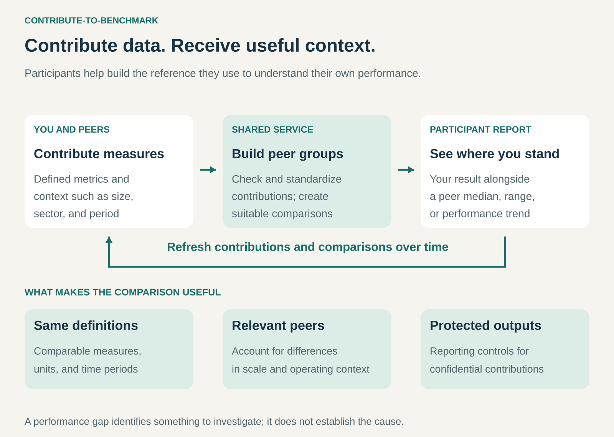

## What it is for

Helping participants understand their performance by exchanging their own measurements for useful comparisons with peers.

A company knows its cost per invoice, employee turnover, or website engagement. What it may not know is whether that result is unusual for an organization like its own.

Other organizations face the same uncertainty.

Contribute-to-Benchmark brings their measurements together through a shared service. Each participant contributes part of the evidence and receives context that would be difficult to assemble independently.

## The core idea

**Contribute your data to help build a reference group, and receive a comparison in return.**

The participant supplies defined measures and relevant context. The service checks and organizes contributions, constructs suitable peer groups, and returns benchmarks.

The output might show a participant’s result alongside a median, percentile range, trend, or distribution.

The exchange need not be entirely free. Participation can involve both data contribution and a financial payment. Other models provide a basic comparison for contributors and charge for additional analysis or services.

The distinctive bargain is reciprocal: participants help create the reference that makes the comparison useful.

This differs from simply purchasing an existing industry report. Contribution is part of how the service obtains its evidence and rewards participation.

## How it works

The pattern connects four activities.

**Define comparable measures.** Participants need shared definitions, units, and reporting periods.

“Cost per transaction” becomes misleading if one organization includes support costs while another reports only processing costs.

**Collect performance and context.** Useful comparisons may require information about size, sector, location, complexity, or operating model.

Context helps distinguish a meaningful performance difference from a difference in the work being performed.

**Build suitable peer groups.** The service selects or constructs comparisons using relevant characteristics. Depending on the measure, it may normalize results for differences in scale.

A broad group provides more observations. A narrow group may be more relevant but contain too little information for dependable or confidential reporting.

**Return interpretable results.** Participants receive their position relative to the group, together with enough explanation to understand what the comparison means.

Repeated contributions can refresh the benchmark and support comparisons over time. Changes in group membership also need consideration: a shifting benchmark does not always mean existing participants changed their performance.

## Why it works

Each organization holds information that is difficult for others to observe.

Sharing through a trusted service can create a reference that no participant could build as easily alone.

The comparison gives meaning to an internal result. A rising cost may reflect a problem within one business, an industry-wide change, or a shift in the work being measured.

The service helps participants distinguish those possibilities and identify questions worth investigating.

For the operator, contributions supply the foundation for reports, memberships, analysis, or a more useful software offering.

More participation can improve coverage and support more relevant peer groups. It does not automatically remove selection bias or inconsistent reporting.

A benchmark identifies a difference. Further investigation is needed to explain it.

## Famous examples

### Google Analytics: contributing to industry comparisons

Google Analytics offers benchmarks showing a property’s performance alongside peer-group medians and percentile ranges.

Its documentation states that eligibility requires enabling the **Modeling contributions & business insights** setting. It also describes minimum participation and activity thresholds for benchmark groups. [Google Analytics benchmarking](https://support.google.com/analytics/answer/16388466?hl=en)

The exchange is direct: participation in data sharing supports access to comparative information.

Google also distinguishes normalized measures from absolute measures, adjusting certain comparisons for differences in traffic volume.

This shows why the service needs more than a pool of numbers. It needs rules for deciding what constitutes a meaningful comparison.

### PwC Saratoga Impact: organizational data exchanged for a dashboard

PwC’s Saratoga Impact asks participants to submit organizational data using defined modules and a data dictionary. Participants receive access to a dashboard comparing their results with a benchmarking peer. PwC states that this dashboard access is free when participants submit their data. [PwC Saratoga Impact](https://www.pwc.co.uk/services/human-resource-services/human-resource-management/saratoga/saratoga-impact.html)

The service collects aggregate organizational information rather than individual employee-level records.

The contribution earns a defined comparative output. Common definitions and submission support help make the exchange workable.

This is a clear example of data serving as part of the participant’s contribution, alongside the time required to prepare it.

### STR Benchmark: hotels contributing operating data

STR’s hotel benchmarking service uses submitted performance information to provide comparisons with competitive sets and market groups. Its reporting guidelines specify how measures such as room revenue and rooms sold should be reported. [STR’s reporting guidelines](https://www.costar.com/en-gb/gbr/products/str-benchmark/resources/guidelines/historical-benchmarking-data-reporting-guidelines)

Its documentation describes aggregate reporting and limits access to individual property information. [STR Benchmark FAQ](https://www.costar.com/products/str-benchmark/resources/faqs)

Participating hotels contribute information that helps establish market context, then use comparisons to understand their own performance.

The example demonstrates two essential operating capabilities: consistent reporting rules and controls around confidential contributions.

## The economics

Consider a hypothetical company processing **10,000 invoices annually** at **$8 per invoice**.

A suitable peer comparison shows a median of **$6**.

The apparent gap is:

**10,000 × ($8 − $6) = $20,000.**

That is not automatically an achievable saving. Differences in complexity, service quality, or accounting could explain part of it.

Suppose investigation leads to a process change that reduces the company’s verified cost to **$7.50 per invoice**.

Annual savings become:

**10,000 × $0.50 = $5,000.**

If participation fees and data preparation cost **$3,000**, and implementation costs **$1,000**, the first-year net benefit is:

**$5,000 − $3,000 − $1,000 = $1,000.**

These figures are illustrative. They show that the economic value comes from useful decisions and implemented improvements, rather than discovering a gap alone.

For the service operator, collecting contributions does not eliminate costs. Validation, methodology, software, reporting controls, and participant support still require funding.

## Useful when

- Organizations hold comparable information that is difficult to obtain publicly.
- Participants need external context for internal performance measures.
- Shared definitions can make contributions sufficiently consistent.
- Enough suitable participants can form useful peer groups.
- The service can protect contributions while returning meaningful comparisons.
- Participants have practical ways to investigate and act on the findings.

It is less useful when measures are fundamentally incomparable, the sample is too narrow or biased, or participants cannot translate comparisons into decisions.

## Common mistakes and limits

**Comparing unlike organizations.** Similar industry labels can conceal major differences in scale, complexity, customer mix, or service expectations.

**Treating the median as the right target.** Typical performance is not necessarily desirable performance. A deliberate investment in quality may increase a cost measure.

**Confusing a gap with its cause.** A benchmark can show where results differ without explaining why.

**Ignoring participation bias.** Contributors may differ systematically from organizations that do not participate.

**Rewarding submissions without checking them.** Weak validation can encourage inconsistent, incomplete, or selectively reported data.

**Assuming aggregation guarantees confidentiality.** Small groups, unusual participants, or repeated comparisons can reveal more than intended. Reporting controls need to address the actual dataset.

**Overlooking competition constraints.** Sharing commercially sensitive information can create competition concerns. Aggregated historical information is generally less strategic than detailed information about planned conduct, but context matters. [European Commission guidance on information exchange](https://competition-policy.ec.europa.eu/document/download/fd641c1e-7415-4e60-ac21-7ab3e72045d2_en?filename=2023_revised_horizontal_guidelines_en.pdf)

**Measuring participation instead of usefulness.** Submission counts matter less than whether the resulting comparisons help participants make better decisions.

## Related patterns

- [[leverage-customer-data|Leverage Customer Data:]] Uses contributed information to improve the service offered back to participants.
- [[data-as-a-service|Data as a Service:]] Supplies maintained information; contribution-based benchmarking provides a particular way to acquire inputs and reward participation.
- [[brands-consortium|Brands Consortium:]] Can organize shared benchmarking across otherwise independent businesses.
- [[curation|Curation:]] Makes comparisons useful through selection, definitions, and context.
