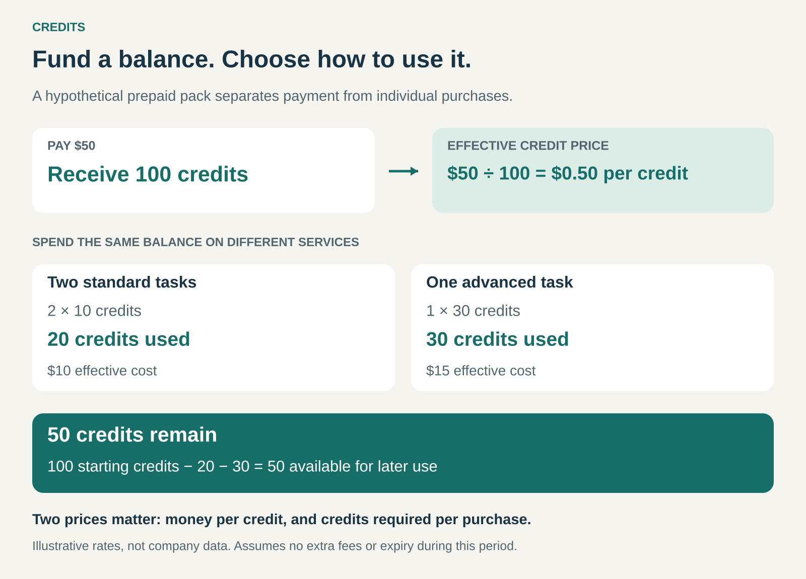

## What it is for

Give customers a balance they can spend across future purchases or activities. Credits help businesses combine flexible consumption with advance payment, recurring plans, or a shared pricing system for different services.

A customer wants access to several services but does not yet know which ones they will use. Paying separately each time creates repeated purchasing decisions. Buying a fixed bundle forces them to choose the mix in advance.

Credits offer another arrangement: acquire a balance now, then decide how to spend it later.

An audiobook might require one credit. A fitness class might require several. A demanding AI generation might consume more credits than a simpler operation.

The customer commits to a budget while retaining some choice over its use.

## The core idea

Insert a spendable unit between payment and consumption:

> Money buys credits; credits buy eligible products, services, or usage.

Credits can be sold in one-time packs, supplied through a subscription, or issued as promotional allowances. The essential mechanism is a balance that decreases as the customer redeems it.

Three common forms serve different purposes:

- **Fixed entitlements:** one credit buys one eligible item or session.
- **A shared spending balance:** different purchases require different numbers of credits.
- **A usage allowance:** activities consume credits according to their scale, duration, or resource requirements.

These forms can coexist. A subscription might provide monthly credits, allow additional purchases, and charge different credit amounts for different activities.

Credits here mean redemption units. Borrowing money and paying later is a different business model.

## How the mechanism works

In this hypothetical example, $50 buys 100 credits. Each purchased credit therefore costs $0.50.

A standard task requires 10 credits, equivalent to $5. An advanced task requires 30 credits, equivalent to $15. After two standard tasks and one advanced task, 50 credits remain.

Two prices determine the customer’s effective purchase cost:

**Money paid per credit × credits required per purchase.**

Changing either changes what the customer receives for their money. A pack can keep the same cash price while becoming less useful if activities start requiring more credits.

The remaining balance also needs clear terms: where it works, whether it expires, and what happens after cancellation.

## Why it works

Credits separate the decision to fund an account from the decision to make an individual purchase.

For customers, this can simplify budgeting and preserve flexibility. Someone can reserve a monthly amount for learning, fitness, or creative work without choosing every purchase in advance.

For businesses, credits can bring payment forward and reduce repeated checkout friction. A customer with an existing balance can try another eligible service without entering payment details again.

A common credit system can also make a varied catalog easier to navigate. Different services become comparable within one interface, even when their underlying costs differ.

That convenience depends on understandable conversion rates. If customers must repeatedly calculate unfamiliar exchange rates, the credit layer can add work instead of removing it.

## Famous examples

### Audible: one credit for an eligible audiobook

Audible’s US help documentation describes credits as a benefit of its Premium membership plans. Members receive credits according to their plan and can redeem them for titles carrying a “1 credit” badge. Eligible members can also purchase additional credits. [Audible’s credit guide](https://help.audible.com/s/article/learn-about-credits?language=en_US).

This creates a simple selection rule across eligible titles with different cash prices. The customer can choose a longer or more expensive eligible audiobook without spending additional credits.

The redeemed purchase and the unused credit have different terms. Audible says audiobooks purchased with credits remain accessible after cancellation. Credit expiration varies by how credits were issued, including exceptions for App Store and Google Play credits. [Audible’s cancellation guidance](https://help.audible.com/s/article/before-you-cancel-your-audible-membership?language=en_US).

The pattern combines recurring membership with a choice of individual purchases.

### ClassPass: one balance across many providers

ClassPass uses credits to book fitness classes and wellness appointments across participating businesses. Credit requirements vary with factors such as the studio, class interest, time, location, and equipment. They can also change over time. Partners receive compensation according to their agreements with ClassPass. [ClassPass’s explanation of its credit system](https://blog.classpass.com/how-classpass-credits-work/).

A member can allocate the same balance across different experiences rather than committing to a separate membership at every studio.

This also illustrates how Credits and Dynamic Pricing can work together. A quieter appointment may require fewer credits than a popular session.

The balance provides flexibility, but it does not promise a fixed number of visits. What it buys depends on the selections available and their credit requirements.

### Adobe Firefly: metering different creative activities

Adobe uses generative credits across eligible AI features. Consumption depends on the feature and, for some activities, the model, output, or file size. Plans differ: some include unlimited standard generations while metering premium features. Monthly generative credits do not roll over. [Adobe’s generative credits FAQ](https://helpx.adobe.com/creative-cloud/apps/generative-ai/generative-credits-faq.html).

Credits provide a common allowance across activities with different resource demands. A customer can allocate that allowance according to the work they need to produce.

The distinction between credits and outcomes matters here. Paying for a generation does not necessarily mean receiving a result the customer considers finished or useful. Iteration can consume additional allowance.

## The economics

A credit system needs to remain sustainable across the purchases customers actually make.

If one credit can buy several different items, customers may favor those with the highest perceived value. The supplier must account for the cost of that redemption mix, rather than assuming an average selection that rarely occurs.

Different pack sizes introduce another variable. A discounted pack reduces the amount collected per credit. Activities redeemed from that pack must still support their delivery costs.

Advance payment can improve cash flow, but the business still needs to fulfill future redemptions.

Unused credits also affect the customer’s economics. In the graphic’s example, if only 50 of the purchased 100 credits are redeemed before the rest expire, the customer has spent $50 for 50 credits of delivered use. Their effective cost per redeemed credit doubles.

Expiry and rollover rules therefore shape the offer’s practical value.

## Useful when

This pattern is especially useful when:

- **Customers want flexibility:** they can choose their purchases later.
- **Purchases recur:** a funded balance makes repeated transactions easier.
- **The catalog contains varied services:** one spending system can span different activities.
- **Consumption varies:** customers can allocate an allowance to their changing needs.
- **Costs need metering:** heavier activities can consume more credits.

It is less useful when purchases are infrequent, the conversion adds confusion, or customers simply want an understandable cash price for one item.

## Common mistakes and limits

**Hiding the effective price.** Credits can make spending feel detached from money. Clear pack prices, consumption rates, and purchase previews help customers understand the exchange.

**Devaluing existing balances.** Increasing credit requirements can reduce the purchasing power of credits already acquired. Changes need clear communication and careful treatment of existing commitments.

**Selling balances customers cannot use.** Attractive credit packs have little value if suitable appointments, products, or features are rarely available.

**Making expiry difficult to notice.** Expiration dates, rollover limits, and cancellation consequences materially affect the purchase. Customers should be able to see them alongside their balance.

**Treating all credits as interchangeable.** Purchased, promotional, and subscription credits may have different restrictions. Separate balances and a clear spending order prevent surprises.

**Ignoring redemption costs.** More consumption can mean more partner payments, computing costs, or delivery work. Credit sales alone do not establish profitability.

## Related patterns

- [[subscription|Subscription:]] can supply a fresh credit allowance each billing period.
- [[pay-per-use|Pay per Use:]] measures consumption; credits can provide the balance from which that usage is deducted.
- [[dynamic-pricing|Dynamic Pricing:]] can change how many credits a purchase requires as conditions change.
- [[bundling|Bundling:]] combines purchases into one commercial offer. Credits let customers determine more of the eventual mix themselves.
