You return with a harbor photograph containing a small red beacon, a broad sky, and a long
stretch of water. A tighter crop makes the beacon easier to inspect. A tall crop emphasizes
the sky above it. A wide crop leaves room for the sea. Each may be useful, but they
are different photographs in what they emphasize, even though they come from one capture.

Crop with a reason you can describe. You might remove an overlooked distraction, strengthen
a relationship, change the balance of space, or adapt the picture for a particular display.
Compare the gain against what you exclude. Cropping is a revision of meaning and attention,
not simply a way to make the subject bigger.

## Give the boundary a job

Think of a crop as an answer to “what must remain for this picture to work?” The answer
may include space as well as objects. A person looking toward an open area can lose that
relationship if you crop too close to their face. A small boat can lose its sense of
scale if the surrounding cliff is removed.

Cropping changes framing. It does not change the original camera position or the perspective
relationships already recorded. Enlarging the central part of a wide view may resemble a
narrower view from that same position, but it cannot reveal surfaces hidden behind an object.
[[change-your-position|Change Your Position]] explains what required movement at capture.

[[check-the-edges|Check the Edges]] helps prevent accidental inclusions while you are shooting.
Cropping is useful afterward, especially when an event moved quickly or when the image's
purpose becomes clearer later. It does not need to be treated as either cheating or an
automatic repair for every photograph.

## The harbor: three different priorities

The wide harbor view retains a long relationship between pier, water, and small structure.
The beacon may be less immediately obvious, but the open area can carry atmosphere. A
closer crop makes the structure more prominent while reducing that sense of extent. Choose
it for an image about the object, rather than assuming the closer version is stronger because
it contains less.

A vertical crop can give the sky a different role. If it leaves the beacon low in the
frame, the empty area above may feel expansive or heavy. If the sky has little useful
variation, the same crop may simply feel stretched. [[use-negative-space|Use Negative Space]]
helps assess whether that quieter region contributes.

These comparisons also explain why an arbitrary fixed ratio can be unhelpful. A square may
suit a balanced object study, while a wide rectangle may preserve a horizontal relationship.
The ratio serves the picture and its destination. It does not make a composition good on
its own.

## A portrait and the meaning of context

In an environmental portrait, your friend stands beside a workbench. A head-and-shoulders crop
may make their expression more immediate, but remove the tools that explain the place. If
the portrait accompanies an interview about their work, that loss may be significant. If
it is intended as a small profile image, the closer crop may be practical.

Look at hands and important objects before finalizing. Cutting through a gesture can change
its meaning or make the person appear to hold something differently. A crop may also exclude
another person whose presence explains an expression. Do not describe a tightly cropped moment
as evidence of isolation if the wider frame shows company just outside the new boundary.

Collaboration still matters after capture. A person may prefer a less intimate view or dislike
a crop that emphasizes a particular feature. Their response can reveal a consequence you
missed while concentrating on graphic balance.

## Remove a distraction without removing the image

A bright fragment at the edge can often be excluded with a small trim. Check the whole
frame afterward. The new crop might bring another line almost into contact with the subject,
or leave too little space for movement. You are making a new boundary, not only deleting
the first problem.

If the distraction lies directly behind the subject, cropping may remove the subject too.
That is a limitation of what was recorded. Editing tools can sometimes alter the content,
but removal is a different decision with different documentary implications. [[edit-to-guide-attention|Edit to Guide Attention]] discusses those expectations. A modest unresolved detail may be preferable
to changing the scene's factual content.

## Leave enough image for its use

Cropping discards pixels. A moderate crop may work well for a phone display while a severe
crop may lack detail for a large print. Enlarging or computationally generating detail afterward
is not equivalent to having captured it. Check the actual output size rather than judging
only a small preview.

Keep an original and save crop versions reversibly when the software allows it. This pattern
helps when the subject is unclear, an edge distracts, or a new destination needs another
shape. [[select-the-strongest-frame|Select the Strongest Frame]] may reveal a different capture
that already has the needed relationships. Cropping is most useful when it refines a clear
intention while preserving enough of the photograph's original information to support it.
