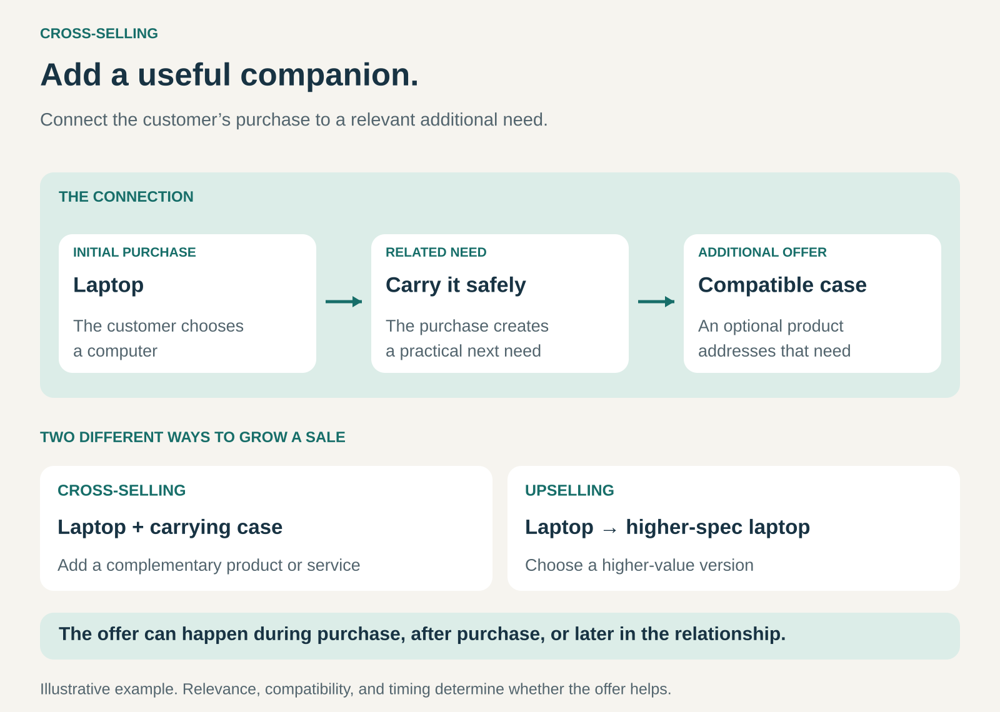

## What it is for

Increasing the value of a customer relationship by offering additional products or services that fit what the customer is buying, using, or trying to accomplish.

Someone buying a camera may also need a memory card. A business adopting software may need implementation support. A customer purchasing furniture may want someone to assemble it.

The initial purchase reveals a related need. Cross-selling connects that need to a relevant additional offer.

For the business, it can increase revenue and contribution per customer. For the customer, it can reduce search effort, prevent missing essentials, and make the original purchase more useful.

## The core idea

**Use knowledge of one customer need to serve another connected need.**

The connection matters. A recommendation becomes useful when the customer can readily understand why the additional offer belongs alongside the original purchase.

A compatible carrying case protects a laptop. Installation helps a customer put equipment into service. Training helps a team use its new software.

Cross-selling can happen during the initial transaction, immediately afterward, or months into an existing relationship. The additional purchase can be a physical product, a service, or a separate subscription.

It differs from **upselling**, which moves the customer toward a more valuable version of the original purchase:

- **Cross-selling:** a laptop plus a carrying case.
- **Upselling:** a laptop with a faster processor.

It also differs from **bundling**. Cross-selling concerns the relationship between offers; bundling concerns how several offers are packaged and sold. A business can cross-sell individually priced products or combine them into a bundle.

## How it works

The pattern has three connected parts.

**A relevant starting point.** A purchase, inquiry, or existing relationship provides information about what the customer needs. Someone buying hiking boots gives a different signal from someone browsing general outdoor clothing.

**A complementary offer.** The additional product or service addresses a related problem: protection, compatibility, installation, maintenance, convenience, or a broader task.

**An appropriate moment.** The offer appears when the customer can understand and assess its value. A memory card may be useful during camera checkout. Advanced training may become relevant only after a team has started using its software.

The seller can make the connection through a conversation, a product page, a recommendation system, a sales representative, or a later account review.

Sophisticated personalization is optional. A carefully selected recommendation based on compatibility can be more useful than a long list generated from weak associations.

## Why it works

Customers often think first about the most visible part of a purchase. They choose the furniture before considering assembly, or the device before considering how they will protect it.

A relevant additional offer brings part of the surrounding task into view.

Cross-selling can also reduce the effort of finding and evaluating another supplier. A customer who already trusts a business may find it convenient to buy a complementary service through the same relationship.

For the seller, an additional purchase can use an existing customer interaction, distribution channel, or account relationship. Some selling costs may already be covered by the original transaction.

The economics still depend on the offer. Additional products bring inventory, delivery, support, and return costs. A larger order does not automatically produce more profit.

## Famous examples

### Amazon: complementary products at the point of consideration

Amazon’s “Frequently bought together” feature presents related products alongside the item a customer is viewing. Amazon describes these as complementary recommendations based on products customers frequently purchase together, with individual items that can be added to the cart together. [Amazon’s explanation of complementary product recommendations](https://sell.amazon.com/blog/product-bundling)

The mechanism reduces the work of assembling a useful combination. The customer can consider the main product and its companions in one place.

The important distinction is between a complement and a substitute. Another camera may be an alternative to the camera being considered. A suitable memory card serves an additional need.

Purchase associations can help identify candidates, but the recommendation still needs to make practical sense for the particular customer.

### Apple: adding a service to a device purchase

Apple offers AppleCare coverage alongside its devices. Its purchasing guidance allows customers to start an eligible plan when buying a new product, with additional enrollment options after purchase. [AppleCare purchasing options](https://www.apple.com/applecare/)

The device and the coverage address connected needs. One provides the equipment; the other provides specified support and protection under the plan’s terms.

This demonstrates cross-selling across product categories: a physical product creates an opportunity for an additional service relationship.

The value depends on the customer’s circumstances and the coverage offered. Plan conditions, existing protections, exclusions, and applicable service charges remain relevant to the decision.

### IKEA: extending the purchase into assembly

In the United States, IKEA offers furniture assembly through Taskrabbit. Customers can book during checkout, through an in-store coworker, or after purchasing their furniture. Taskrabbit connects customers with independent contractors who perform the work. [IKEA’s Taskrabbit assembly service](https://www.ikea.com/us/en/customer-service/services/assembly/)

The connection follows the customer’s broader objective: having usable furniture in the room.

A customer comfortable with self-assembly can buy the furniture alone. Another customer can add assembly to reduce the time and effort required.

This also shows that the complementary offer can be delivered through a service partner. The retailer does not have to perform every additional service itself.

## The economics

Suppose a hypothetical retailer compares two otherwise comparable groups of **1,000 laptop buyers**.

Without a targeted case recommendation, **100 buyers** purchase a case. With the recommendation, **180 buyers** purchase one.

The difference is **80 additional case purchases**.

Assume each case produces **$15 contribution** after its product cost and incremental delivery, payment, and expected return costs. The recommendation costs **$300** to run.

The additional contribution is:

**80 × $15 − $300 = $900.**

Counting all 180 case purchases as gains from cross-selling would overstate the result. Some customers would have bought a case anyway.

This illustration assumes the recommendation does not change laptop sales, other purchases, or their costs. If the extra offer causes customers to abandon checkout, discounts purchases they would already have made, or increases support costs, those effects also belong in the calculation.

The relevant measure is **additional contribution across the customer interaction**, rather than basket size alone.

## Useful when

- The main purchase has clear complementary products or services.
- Customers may overlook something needed to use, protect, or maintain their purchase.
- Compatibility is difficult to assess, and the seller can simplify the choice.
- An established customer develops related needs over time.
- A business can provide a more complete solution through its own offering or a partner.
- Existing sales and service channels can support an additional offer economically.

It is less useful when the connection is weak, the customer already has an adequate solution, or the additional offer distracts from completing the main task.

## Common mistakes and limits

**Confusing association with relevance.** Products purchased by similar customers are not necessarily useful together. Recommendations need to account for compatibility, existing ownership, and the purpose of the purchase.

**Offering too much at once.** A crowded checkout creates more decisions. A small number of well-chosen offers can be easier to assess than an extensive catalogue of possibilities.

**Treating every customer as a prospect for every product.** An existing relationship provides context, not proof of need. Repeated irrelevant offers can consume the trust that made cross-selling possible.

**Measuring attachment without measuring additional sales.** The proportion of buyers adding a second product is useful, but some would have bought it without the recommendation. Baseline purchasing matters.

**Selling beyond delivery capability.** Installation, support, and other services create expectations. Poor fulfillment can damage the customer’s view of the original purchase as well.

**Making optional extras feel compulsory.** Clear prices, explicit choices, and straightforward explanations help customers understand what they are buying. Necessary components should be disclosed early enough to assess the complete cost.

## Related patterns

- [[bundling|Bundling:]] Packages complementary offers together, potentially making a cross-sell easier to understand and purchase.
- [[core-plus-add-ons|Core plus Add-Ons:]] Builds an offering around a base product and optional extensions; cross-selling can connect customers to relevant additions.
- [[solution-provider|Solution Provider:]] Takes responsibility for a broader customer problem, often combining several complementary products and services.
- [[one-stop-shop|One-Stop Shop:]] Brings related purchases into one place, creating opportunities to serve several needs through the same relationship.
