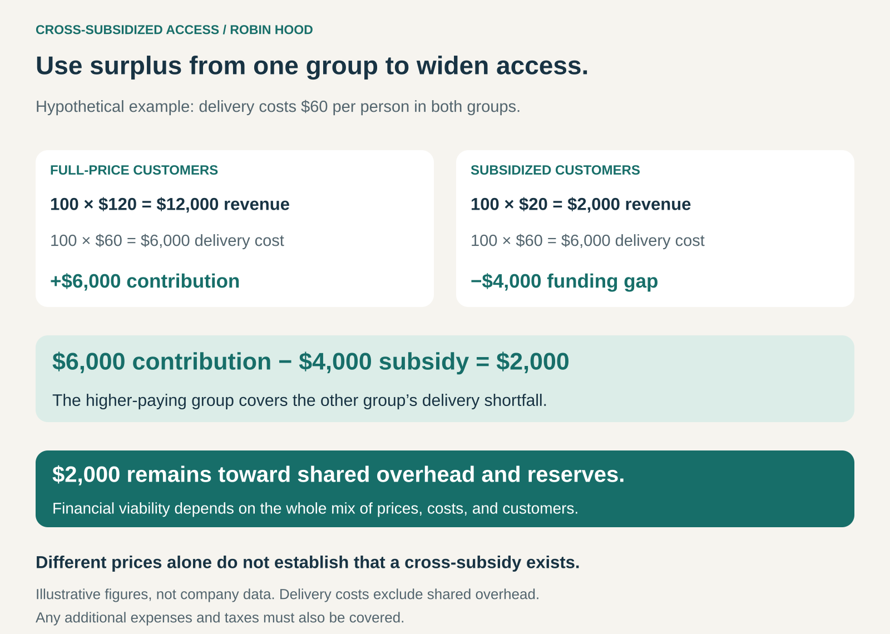

## What it is for

A service may be valuable to people who cannot afford its normal price. Other customers can pay enough to support both their own purchase and access for someone else.

Cross-Subsidized Access uses the financial contribution from one customer group to make an offering affordable—or free—for another.

It is useful when an organization wants to widen access while maintaining a dependable commercial income. The challenge is to design prices, costs, and customer numbers so the whole system remains viable.

## The core idea

Build an access commitment into the economics of the business.

Customers paying higher prices generate a contribution after the costs of serving them. Part of that contribution covers the shortfall associated with customers paying less.

Business Model Navigator calls the differential-pricing version **Robin Hood**: customers with greater ability to pay help support access for those with fewer resources. Its examples also include purchase-linked giving programs. [Business Model Navigator: Robin Hood](https://nis.businessmodelnavigator.com/pattern?id=44)

The higher-paying group need not be wealthy, and its prices need not be unusually expensive. What matters is whether its purchases can support the intended subsidy.

Different prices alone do not establish a cross-subsidy. A discounted offering might cover its own costs. The defining mechanism is a financial contribution from one part of the business supporting access elsewhere.

## How it works

In the hypothetical example above, delivery costs $60 per person.

One hundred customers pay $120 each. Their $12,000 in revenue leaves $6,000 after delivery costs.

Another hundred customers pay $20 each. Their $2,000 in revenue leaves a $4,000 delivery shortfall.

Combining the groups leaves $2,000 toward shared overhead, reserves, and other expenses. That remaining amount is not automatically profit.

There are two common arrangements.

**Direct cross-subsidy** operates within the service itself. Customers receive comparable core benefits at different prices, sometimes with different amenities or service options.

**Purchase-linked access** connects commercial sales with a commitment to provide goods or services through a separate program, often delivered by partner organizations.

The second arrangement requires its own production, funding, and distribution system. It is broader than charging different prices at the same counter.

## Why it works

**It accommodates differences in ability to pay.** A single price can exclude people who would benefit. A structured subsidy creates another route to access.

**It combines commercial demand with an access mission.** Paying customers receive something they value, while their purchases help finance the broader commitment.

**It can share infrastructure across customer groups.** Facilities, expertise, technology, and purchasing may support both full-price and subsidized provision.

**It can connect premium options with wider availability.** Some customers will pay for convenience, customization, privacy, or additional services. The contribution remaining after those extras can help support access to the core offering.

Efficiency matters alongside pricing. The less it costs to deliver a dependable core service, the further each available subsidy can go.

## Famous examples

### Aravind Eye Care: paying patients help support affordable care

Aravind Eye Care in India is a prominent example of direct cross-subsidy. Its model combines paying services with free and heavily subsidized care. Aravind reports that around half its patients receive services free or at steeply subsidized rates while the organization remains financially self-sustaining.

It also emphasizes consistent standards of care regardless of patients’ economic circumstances and identifies high patient volumes and efficient processes as important elements of its model. [Aravind’s description of its approach](https://aravind.org/our-story/)

The lesson is that cross-subsidy depends on an operating system: attracting paying patients, reaching people who need assistance, controlling costs, and maintaining quality.

The quality commitment concerns dependable care. It does not require every patient’s accommodation, procedure, or product specification to be identical.

### Warby Parker: commercial purchases support access through partners

Warby Parker’s Buy a Pair, Give a Pair program links eyewear sales with distributing glasses to people in need.

The company describes two approaches: funding nonprofit partners that train people to provide basic eye examinations and sell glasses at highly affordable prices, and working through partnerships that provide vision care and glasses directly. [Warby Parker: How the program works](https://www.warbyparker.com/buy-a-pair-give-a-pair)

This is purchase-linked access rather than a simple two-price retail system.

The paying customer purchases eyewear; partner organizations help deliver access in communities with unmet needs. The mechanism includes training, local delivery, and distribution—not merely transferring an identical retail item to another person.

### Bombas: sales support a separate donation operation

Bombas links purchases with donations of essential clothing through its Giving Partners. Its model includes producing donation items, coordinating quantities and needs, and shipping products to organizations that distribute them.

Its donation products include features intended for the circumstances of recipients, such as darker colors and flexible sizing. [Bombas’ explanation of its giving model](https://beebetter.bombas.com/impact)

This illustrates why providing access requires operational design. The item sold and the item distributed can serve different circumstances while meeting the same broad need.

The commercial business must support both its customer offering and the costs associated with its giving commitment. Donation counts alone do not demonstrate the profitability of that combined system.

## The economics

A sustainable arrangement must cover:

**The costs of serving paying customers + the access subsidy + shared operating costs + continuing investment.**

The amount available for subsidy comes from contribution after relevant costs. A high selling price is insufficient if acquiring and serving that customer is also expensive.

The customer mix matters. More subsidized demand can increase the funding requirement. Losing full-price customers can reduce the contribution available to meet it.

Capacity matters too. Serving additional people can require more staff, equipment, locations, or delivery resources. Costs may rise in steps rather than smoothly.

A useful subsidy budget therefore considers both current delivery costs and the resources needed to maintain access over time. Grants and donations can supplement the model, but they should be identified separately from the contribution generated by commercial sales.

## Useful when

Cross-Subsidized Access is particularly useful when:

- A valuable offering is unaffordable for part of its intended audience.
- A dependable paying market can generate sufficient contribution.
- The organization can deliver the core benefit efficiently.
- Eligibility, self-selection, or partner delivery can make assistance accessible.
- The access commitment can be funded without compromising essential quality.

It is less suitable when the paying business has weak margins, subsidy needs are unpredictable, or the organization cannot sustain both sides of the model.

## Common mistakes and limits

**Assuming a higher price creates a subsidy.** The contribution remaining after costs determines what can actually be supported.

**Treating every price difference as redistribution.** Differences may reflect costs, features, demand, or ordinary promotions. An access commitment needs a real funding mechanism.

**Neglecting the paying customer’s offer.** Customers still need a compelling reason to buy. The mission can strengthen that offer, but it cannot reliably substitute for quality and value.

**Making access difficult or stigmatizing.** Complex applications, inconvenient locations, and unclear eligibility can prevent intended beneficiaries from using the service.

**Underfunding the delivery system.** Outreach, assessment, distribution, maintenance, and support can be essential parts of access.

**Promising more than the model can carry.** A fixed giving promise or subsidized price needs enough financial headroom to withstand cost increases and changing sales.

**Measuring activity without measuring usefulness.** Products distributed and services delivered are important, but organizations also need to understand whether those offerings reach the intended people and meet their needs.

## Related patterns

[[good-better-best|Good-Better-Best]] — Higher-priced options can generate contribution for wider access. Offering tiers alone does not establish a subsidy.

[[freemium|Freemium]] — Paid users can support a free tier. Robin Hood emphasizes affordability and access; freemium often also aims to encourage upgrades.

[[third-party-funded-access|Third-Party-Funded Access / Hidden Revenue]] — Both separate a user’s access from the full cost of provision. Cross-subsidy draws support from another customer group or commercial activity; third-party funding can come from advertisers, employers, or sponsors.

[[blended-value|Blended Value]] — The model combines commercial viability with an access objective. Both need evidence: financial sustainability and meaningful benefit to the people served.
