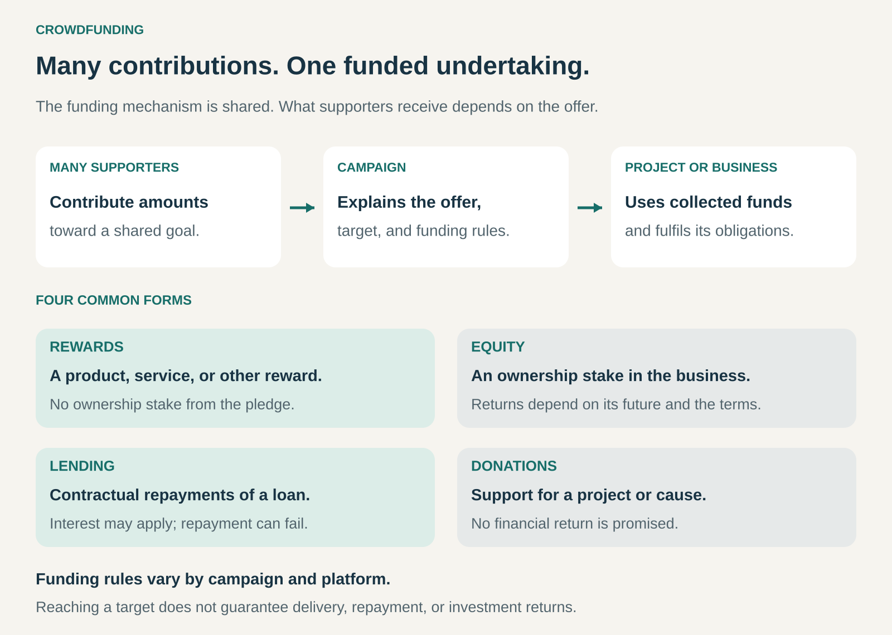

## What it is for

A new product may have enthusiastic supporters before its creator can afford to manufacture it. A growing business may have customers who want to become investors. A community project may matter to thousands of people, while none can fund it alone.

Crowdfunding brings those smaller contributions together to finance a shared undertaking.

It is useful when the people who want something to exist can also help pay for making it happen. Alongside funding, a campaign can reveal interest, attract attention, and establish relationships with early supporters.

## The core idea

Raise money from a broad group of contributors around a clearly explained project, business, or cause.

The offer answers three questions: what will the money make possible, what will contributors receive, and what happens if the plan changes or fails?

Four common forms differ in what supporters receive:

- **Rewards:** a product, service, experience, or other benefit.
- **Equity:** an ownership stake in the business.
- **Lending:** repayment of a loan, sometimes with interest.
- **Donations:** support for an undertaking without a financial return.

These forms create different obligations. Someone funding a watch through a reward campaign does not thereby become a shareholder. Someone buying shares is backing the business’s future rather than ordering its next product. [FCA: Understanding crowdfunding](https://www.fca.org.uk/investsmart/understanding-crowdfunding)

Crowdfunding belongs in a business-model taxonomy as a **financing pattern**. The company still needs a way to create value, serve customers, and sustain its operations after the campaign.

## How it works

A campaign presents the undertaking, its funding requirements, the offer to supporters, and the conditions for collecting money. A platform can provide discovery, payments, campaign tools, and administration, although an organization can also run a campaign through its own channels.

Some campaigns use a minimum funding threshold. Kickstarter, for example, uses **all-or-nothing funding**: backers are charged if the campaign reaches its goal by the deadline; otherwise, nobody is charged. This can prevent a creator from receiving only a fraction of the money needed to deliver a project. Reaching the threshold, however, does not eliminate production risk. [Kickstarter: How crowdfunding works](https://updates.kickstarter.com/how-crowdfunding-works-a-guide-for-creators/)

The campaign’s end begins the next stage: making and delivering rewards, developing the business, administering loans, or carrying out the funded work.

## Why it works

Crowdfunding combines several mechanisms.

**It aggregates dispersed support.** A niche project may be unattractive to a large financier yet meaningful to enough individual supporters. Their combined contributions can cover a substantial fixed cost.

**It makes commitment visible.** A pledge gives a stronger signal than a favorable comment. In a reward campaign, people commit money toward an offer before it becomes widely available.

**It gives participation a purpose.** Supporters may value helping a particular product, creative work, or business exist. Their contribution can express enthusiasm, identity, or attachment to a community.

**It can connect funding with distribution.** Backers may become customers, recommend the project, and provide feedback. That connection is especially valuable when the campaign reaches people likely to remain interested after launch.

These benefits depend on credibility and access to an audience. A campaign page can communicate an idea; it cannot create trust by itself.

## Famous examples

### Pebble Time: financing a product through its supporters

Pebble’s 2015 Kickstarter campaign attracted **78,471 backers who pledged $20,338,986**, against a $500,000 goal, to support its smartwatch project. The campaign illustrates how a clearly identifiable product can bring substantial funding commitments together through a public launch. [Pebble Time campaign](https://www.kickstarter.com/projects/getpebble/pebble-time-awesome-smartwatch-no-compromises)

As a reward campaign, its relationship with backers differed from selling company shares. The relevant promise concerned the project and its rewards.

The funding total demonstrates campaign demand. It does not, by itself, establish manufacturing profitability, long-term customer retention, or the durability of the business.

### Monzo: inviting customers to become investors

In December 2018, Monzo announced that **36,006 people had invested £20 million** in its crowdfunding round. The bank explicitly connected the opportunity to its community: customers could take a stake in the business they were helping to build. [Monzo’s crowdfunding announcement](https://monzo.com/blog/2018/12/05/crowdfunding-closes)

This illustrates equity crowdfunding’s distinctive relationship. A customer can also become an investor, with a financial interest governed by the investment terms.

It also shows that crowdfunding can complement other funding sources. Monzo’s round followed an £85 million investment round announced that October. [Monzo’s investment announcement](https://monzo.com/blog/2018/10/31/big-news)

### Kiva: pooling small contributions into loans

Kiva lets individual lenders contribute amounts starting at $25 toward loans for borrowers, including small-business owners. Repayments can then be lent again. Many international loans operate through local lending partners, which administer lending and repayment. [Kiva: How it works](https://www.kiva.org/about/how)

Kiva illustrates a form of lending crowdfunding motivated by social impact. Individual Kiva lenders do not earn interest, although many borrowers pay interest to local lending partners. Repayment is not guaranteed. [Kiva’s explanation of interest and repayment](https://www.kiva.org/about/how)

The contribution is therefore different from both buying a reward and making a donation: the lender expects principal to return, while accepting that it may not.

## The economics

The headline amount raised is only the beginning of the financial picture.

For a reward campaign, collected funds must cover the promised work: development, production, packaging, delivery, support, campaign expenses, applicable fees and taxes, and room for uncertainty.

Consider a hypothetical campaign collecting $100,000. If fees and campaign costs consume $15,000 and producing and delivering rewards costs $70,000, $15,000 remains before other expenses and contingencies. A large funding total can coexist with a thin margin.

Equity funding has different economics: the business receives capital in exchange for ownership rights. Loan funding creates repayment obligations. Neither becomes customer revenue merely because it arrived through a crowdfunding campaign.

A further distinction matters for the platform itself. A company raising funds and a platform earning fees from campaigns occupy different positions in the same system.

## Useful when

Crowdfunding is particularly useful when:

- A specific project has a clear funding requirement and an understandable outcome.
- An identifiable audience cares enough to contribute.
- Reward commitments can help justify a minimum production run.
- Customers or supporters want a closer relationship with the organization.
- A credible team can explain both its progress and its remaining uncertainties.

It is less suitable when the undertaking cannot be explained publicly, costs remain largely unknown, or success requires capabilities the team has not yet developed.

## Common mistakes and limits

**Assuming the platform supplies the audience.** A campaign still needs people to discover, understand, and trust it. Prototypes, demonstrations, outreach, and an existing community can require substantial work before launch.

**Setting an artificially low goal.** Crossing a small threshold looks impressive, but collecting too little to deliver leaves the underlying funding problem unresolved.

**Treating overfunding as effortless upside.** More backers can mean larger production runs, more destinations, more support requests, and greater exposure to mistakes. Stretch goals that add features or variants can consume the apparent surplus.

**Confusing early enthusiasm with a dependable market.** Backers are a self-selected group. Their interest may depend on launch discounts, novelty, or personal attachment. A successful campaign does not establish that later customers will buy at a sustainable price.

**Blurring the offer.** Rewards, donations, shares, and loans carry different expectations. Investment returns can fail to materialize, and investors may be unable to sell when they wish. The terms and applicable rules matter. [FCA: Crowdfunding risks](https://www.fca.org.uk/investsmart/understanding-crowdfunding)

**Underestimating the relationship after funding.** Delays and changed plans require clear communication. Money received creates responsibilities that can continue long after the campaign page stops attracting attention.

## Related patterns

[[customer-funded-working-capital|Customer-Funded Working Capital / Cash Machine]] — Reward crowdfunding can bring customer money in before production costs fall due. Equity and lending crowdfunding raise capital through different relationships.

[[demand-driven-production|Demand-Driven Production / From Push to Pull]] — Campaign commitments can inform whether to produce and how much, especially where a minimum viable batch matters.

[[membership|Membership]] — Crowdfunding can mobilize supporters around a particular undertaking; membership can sustain an ongoing relationship. Recurring crowdfunding can overlap with membership.

[[blended-value|Blended Value]] — Supporters may care about social or environmental outcomes alongside products or financial returns, as Kiva’s lending model illustrates.
