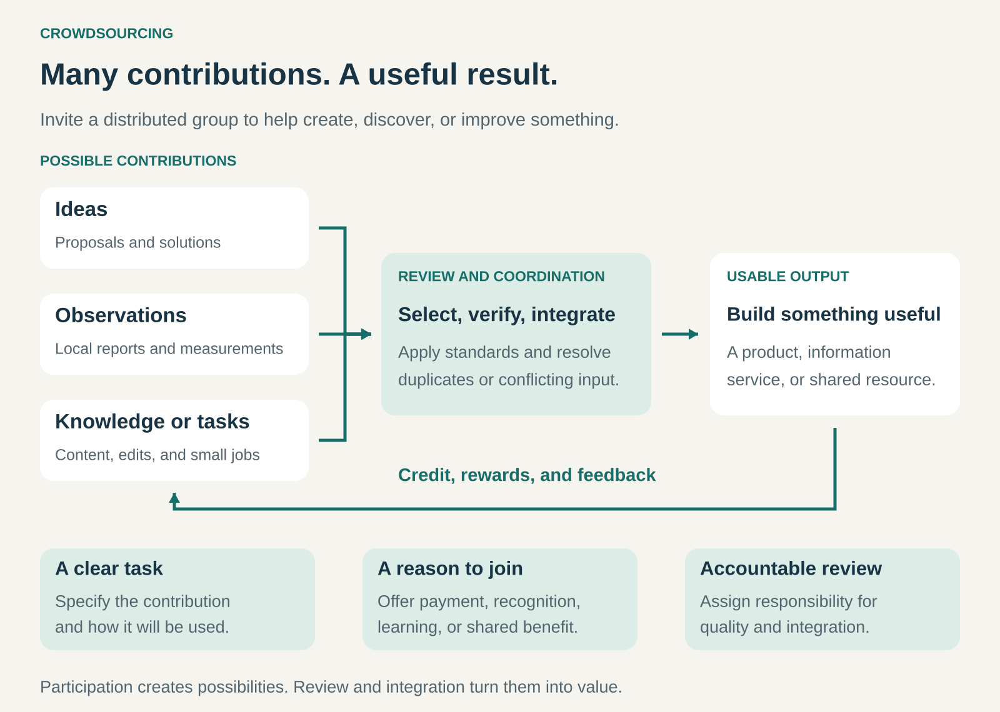

## What it is for

Crowdsourcing helps an organization access ideas, knowledge, observations, or effort distributed across many people.

It is useful when customers, enthusiasts, specialists, or local participants collectively know more—or can cover more ground—than an internal team could reasonably manage alone.

A business might invite people to propose products, identify defects, report changing conditions, translate content, or solve technical problems. The value comes from organizing those contributions into something useful.

## The core idea

**Invite a distributed group to contribute, then select, verify, or combine their contributions into a valuable result.**

The organization defines the opportunity, makes participation possible, and establishes how contributions will be used. Participants bring something the organization would otherwise have to develop, purchase, or discover itself.

Crowdsourcing can take several forms:

- **Selecting:** invite competing ideas or solutions and choose those worth developing.
- **Aggregating:** combine observations to reveal conditions, patterns, or estimates.
- **Collaborating:** let participants build and improve a shared resource.
- **Distributing tasks:** divide work into smaller contributions that can be completed separately.

Participants may receive payment, recognition, learning opportunities, or a better shared product. Different forms require different incentives.

Crowdsourcing concerns contributions of knowledge or work. Crowdfunding concerns contributions of money; a project can use both.

## How it works

The process connects five elements.

**1. A defined contribution.** Participants need to understand what they can submit, what a useful contribution looks like, and how it will be evaluated. An invitation to “help us innovate” gives much less direction than a specific problem or submission format.

**2. Access to suitable participants.** The relevant crowd might be a public community, existing customers, qualified specialists, or employees across a large organization. Its knowledge and motivation matter more than its size.

**3. A credible reason to participate.** Contributors should understand what they receive and what the organizer gains. A community project and a commercial design competition may need very different arrangements.

**4. Review and integration.** Someone must identify duplicates, check evidence, resolve conflicts, and turn accepted contributions into usable outputs. Participants can help perform this work, but responsibility still needs to be clear.

**5. Feedback.** Contributors need to see what happened to their work. Decisions, attribution, rewards, and visible improvements make participation more meaningful.

## Why it works

Crowdsourcing can access knowledge that is expensive to centralize.

A local resident may notice a changed street layout before a mapping team does. An enthusiast may recognize an overlooked product opportunity. A specialist outside the organization may approach a technical problem from an unfamiliar discipline.

It can also allow work to happen in parallel. Many people can observe different locations, explore different solutions, or improve different parts of a resource at the same time.

Participation can strengthen attachment to the result. People may become more invested in a product or community when their contributions visibly shape it.

These advantages depend on the task. Independent judgments can provide useful variety; copying visible answers can reduce it. Thousands of submissions create little value if the organization cannot evaluate or use them.

## Famous examples

### LEGO Ideas — discovering products through fan contributions

LEGO Ideas invites fans to submit product concepts and gather community support. Reaching 10,000 supporters moves a qualifying proposal into LEGO review; it does **not** guarantee that the proposal will become a commercial set. LEGO requests further design information and documentation as part of that review. [LEGO’s review process](https://www.lego.com/en-us/service/help-topics/article/what-happens-to-my-product-idea-after-i-reach-10-000-supporters).

The crowdsourced contribution includes both creative proposals and an indication of community enthusiasm. LEGO then makes the production decision and develops selected concepts into commercial products. The Ideas range includes recognizable sets such as _Home Alone_. [About LEGO Ideas](https://www.lego.com/en-us/themes/ideas/about).

This illustrates crowdsourcing as a source of product opportunities. Community support helps surface candidates, while commercial and technical evaluation remain necessary. Votes provide a signal of interest rather than a complete demand forecast.

### Waze — gathering distributed local knowledge

Waze draws on a community of drivers and volunteer map editors who contribute local information and maintain map details. People spread across different locations can contribute knowledge that a central team would struggle to collect with the same reach. [Waze’s map editor community](https://www.waze.com/communities/map-editors).

The process includes mechanisms for checking and correcting contributions. Suggested places are reviewed by volunteer editors before being added. For incident reports, user feedback can shorten the display time of information that is no longer accurate. [Waze’s contribution and reporting guidance](https://support.google.com/waze/answer/6262592?hl=en).

The lesson is that distributed observation needs a way to maintain freshness and quality. Collecting a report is only part of the process; correcting or retiring it also matters.

### Wikipedia — building a shared resource through continuous contributions

Wikipedia combines contributions from people with different interests, expertise, and language skills. Participants write, revise, discuss, and maintain articles rather than submitting entries to a single competition.

Its collaborative structure includes sourcing requirements, editorial guidelines, public revision histories, and discussion pages. These mechanisms allow contributors to challenge claims and improve material over time. They support quality without guaranteeing that every article or edit is correct. [Wikimedia’s explanation of Wikipedia’s editorial model](https://wikimediafoundation.org/knowledge-is-human/).

Wikipedia demonstrates how crowdsourcing can produce a cumulative resource. Small contributions can build on earlier work, provided the project maintains shared standards and ways to resolve disagreement. Its nonprofit setting also shows that the pattern can support public value as well as commercial products.

## The economics

Crowdsourcing changes where work happens and how it is coordinated. Its costs include recruitment, contributor compensation, tools, moderation, verification, and integration.

Consider an illustrative information-gathering project:

| Item                        |       Cost |
| --------------------------- | ---------: |
| Participant rewards         |     $4,000 |
| Verification and correction |     $2,000 |
| Platform and coordination   |     $2,000 |
| **Total**                   | **$8,000** |

Suppose the project receives 1,000 submissions, of which 800 become usable records.

The cost is **$10 per usable record**, although the cost per submission is only $8. If just 400 records prove usable, the cost rises to **$20 per usable record**, assuming the same total expenditure.

Whether that is attractive depends on the records’ value, coverage, freshness, and the available alternatives. Any further product development or implementation costs must also be included.

## Useful when

- Valuable knowledge is spread across customers, locations, or specialist communities.
- A problem benefits from varied approaches.
- Work can be divided into meaningful contributions.
- Contributions can be evaluated at a manageable cost.
- Participants have a credible reason to contribute.
- The organization can act on accepted contributions and maintain the resulting resource.

The pattern becomes especially attractive when distributed participation provides coverage or insight that would be difficult to obtain another way.

## Common mistakes and limits

**Treating participation as free capacity.** Recruitment, support, moderation, and review consume resources. Unpaid participation also depends on a convincing shared benefit.

**Confusing popularity with quality.** Voting can reveal enthusiasm, but organized campaigns and existing audiences can influence results. Technical validity and purchase intent require further evaluation.

**Assuming the crowd represents the market.** Contributors select themselves. Their preferences, locations, and expertise may differ substantially from those of intended customers.

**Creating a review bottleneck.** An organization can attract submissions faster than it can assess them. Growing the crowd without improving evaluation can make the process slower.

**Leaving rights and rewards unclear.** Participants need understandable terms covering ownership, permitted use, attribution, compensation, and treatment of unsuccessful submissions.

**Collecting without following through.** Repeated invitations followed by silence can weaken trust. A sustainable system needs visible decisions and evidence that useful contributions matter.

## Related patterns

- [[bounties|Bounties:]] offers a defined reward for an accepted result; one way to structure crowdsourced problem-solving.
- [[open-business-model|Open Business Model:]] brings external knowledge and capabilities into how a business creates value.
- [[open-source|Open Source:]] provides licensing freedoms that can support collaborative software development; crowdsourcing describes how contributions are organized.
- [[contribute-to-benchmark|Contribute-to-Benchmark:]] combines participants’ measurements into comparisons they can use themselves.
