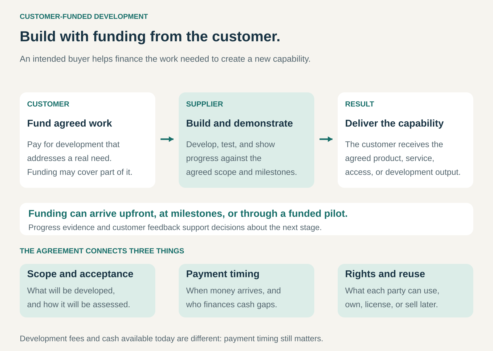

## What it is for

Customer-Funded Development helps a business finance the creation of something a customer needs before the complete product or capability is available.

It is useful when development requires substantial work, demand is uncertain, or a customer needs capabilities that existing products cannot provide.

Instead of carrying the entire development cost itself, the business secures a customer’s financial contribution toward that work. The customer gains a route to a needed solution; the supplier gains funding, a concrete use case, and access to practical feedback.

## The core idea

**Have an intended customer pay for some or all of the work required to develop the solution they want.**

The contribution might fund research, engineering, software development, prototyping, testing, or integration.

Common arrangements include:

- **Development fees:** a customer pays separately for creating a capability, then purchases the resulting product or service.
- **Milestone funding:** payments follow agreed stages of development.
- **Funded pilots:** a customer pays to develop and test a solution in a limited setting.
- **Co-development:** customer and supplier contribute resources toward an agreed development program.
- **Shared funding:** several customers support a capability they all need.

Customer funding can cover the entire project or only part of it. It can also coexist with the supplier’s own investment or external financing.

Two questions remain separate: **who ultimately pays for development, and who supplies the cash while the work happens?** A development fee paid after acceptance may cover costs without eliminating the supplier’s need for interim funding.

## How it works

The arrangement connects five elements.

**A valuable customer problem.** The customer needs a result strongly enough to help finance its creation. General enthusiasm provides less support than a specific operational requirement with an identifiable budget.

**A defined development contribution.** Both parties understand what the customer is paying for: exploration, a prototype, a working integration, a production-ready product, or another agreed output.

**A funding and payment structure.** The agreement establishes payment amounts, timing, dependencies, and treatment of changes. These determine how much financial exposure remains with the supplier.

**Evidence of progress.** Demonstrations, tests, reviews, or other acceptance criteria help the customer assess what has been achieved. They also provide opportunities to address problems before committing to later stages.

**Rights to the result.** The parties establish what each can use, own, license, modify, or sell. A customer may want exclusivity; a supplier may need permission to reuse parts of the work.

## Why it works

The pattern connects development spending to an identifiable source of demand.

A paying customer provides stronger evidence of a valuable problem than expressions of interest alone. Their involvement can also improve access to users, operating conditions, data, and technical requirements.

For the supplier, funding can reduce the amount it must invest before learning whether the capability has a buyer. For the customer, supporting an external specialist may provide access to expertise and development capacity it would struggle to build internally.

There can be further benefits when the resulting capability serves additional customers. However, reuse depends on both the agreement and the design. Work optimized for one organization may require substantial adaptation before it becomes a broader product.

## Famous examples

### IBM and American Airlines — financing a new reservation capability

American Airlines needed a better way to manage reservations as air travel expanded. IBM’s history describes American committing roughly $40 million to a joint research and development effort that produced Sabre.

The system connected reservation desks to a central processing facility, enabling information to be processed across a distributed network. Other airlines subsequently adopted related reservation technology, often working with IBM. [IBM’s history of Sabre](https://www.ibm.com/history/sabre).

The customer contributed more than a statement of requirements: it committed resources to developing a capability its operations needed. The example also illustrates how work for a demanding initial customer can help establish capabilities useful in a wider market.

### AMD — charging for engineering as well as products

AMD reports that certain customers pay non-recurring engineering fees for design and development services, alongside the purchase price of the resulting products.

Its annual report describes working with customers to define features, performance, and timing. It also identifies engineering fees and subsequent product sales as separate sources of revenue in its semi-custom business. [AMD’s annual report](https://ir.amd.com/financial-information/sec-filings/content/0000002488-26-000018/amd-20251227.htm).

This illustrates a useful commercial structure: the customer pays explicitly for development work rather than leaving the supplier to recover every development cost through later unit sales. The precise funding coverage and payment schedule depend on the particular arrangement.

### SpaceX and NASA — funding development through milestones

NASA’s Commercial Orbital Transportation Services program helped finance the development and demonstration of commercial cargo transport capabilities, including SpaceX’s Falcon 9 and Dragon system.

The program used funded Space Act Agreements. Payments were tied to successfully completed milestones, such as design reviews, testing, and demonstrations. NASA assessed completion before releasing the associated payment. [U.S. Government Accountability Office’s assessment](https://www.gao.gov/assets/a291016.html).

NASA was a prospective user and development partner, while later cargo services were purchased separately. SpaceX also contributed substantial private funding. [NASA’s COTS program history](https://www.nasa.gov/wp-content/uploads/2023/09/sp-2014-617-1.pdf).

The example shows partial customer funding supporting development over time. Milestone payments reduced exposure but still required the supplier to finance work between payments.

## The economics

Funding coverage and cash timing can produce very different results.

Consider an illustrative project with **$150,000 in development expenditure** and **$120,000 in customer development payments**:

| Event                             | Cash movement | Cumulative project cash flow |
| --------------------------------- | ------------: | ---------------------------: |
| Signing payment                   |      +$60,000 |                      $60,000 |
| Prototype development             |      −$50,000 |                      $10,000 |
| Prototype milestone payment       |      +$40,000 |                      $50,000 |
| Remaining development and testing |     −$100,000 |                     −$50,000 |
| Final acceptance payment          |      +$20,000 |                     −$30,000 |

The customer ultimately covers **80% of development expenditure**. However, the supplier must bridge a **$50,000 cash shortfall** before the acceptance payment arrives.

After all payments, the supplier has contributed $30,000. It needs a credible reason for that investment—for example, subsequent product sales or permitted reuse. Customer development payments alone do not recover the full expenditure.

These figures are hypothetical and exclude overhead, tax, financing costs, and overruns. They illustrate why a funded project still needs careful cash planning.

## Useful when

- A customer has an important need that existing offerings cannot meet.
- Development work can be scoped and assessed in meaningful stages.
- The customer can commit budget and provide useful access or feedback.
- A specialist supplier can develop the capability efficiently.
- Both parties can agree on rights, changes, and acceptance.
- Any supplier contribution has a credible route to recovery.

The pattern can support both bespoke solutions and capabilities intended for a wider market.

## Common mistakes and limits

**Treating one customer as the entire market.** Funding demonstrates that customer’s willingness to pay. Broader demand still needs separate evidence.

**Accepting a roadmap that becomes impossible to reuse.** Special requirements can consume the funding while producing little transferable value. That may still be worthwhile as paid custom work, but the economics need to reflect it.

**Confusing committed funding with available cash.** Delayed payments, acceptance disputes, and work between milestones can create substantial financing needs.

**Leaving exploration and delivery ambiguous.** Paying to investigate feasibility is different from paying for a guaranteed production outcome. Expectations need to match the uncertainty.

**Underpricing changes and overruns.** New requirements can make an initially funded project uneconomic. A fixed contribution does not automatically expand with development effort.

**Assuming funding settles ownership.** Payment does not, by itself, explain what either party may reuse or commercialize. Those arrangements need explicit agreement.

**Becoming dependent on one sponsor.** A customer’s budget cuts, strategy changes, or project cancellation can interrupt both funding and development.

## Related patterns

- [[preorder-funding|Preorder Funding:]] collects payment for future delivery; it overlaps when those payments finance development.
- [[customer-funded-working-capital|Customer-Funded Working Capital / Cash Machine:]] uses favorable payment timing to finance operations; Customer-Funded Development focuses on creating a new capability.
- [[crowdfunding|Crowdfunding:]] can gather development funding from many prospective customers, depending on the campaign structure.
- [[open-business-model|Open Business Model:]] combines external resources and knowledge; customer funding can support that collaboration.
