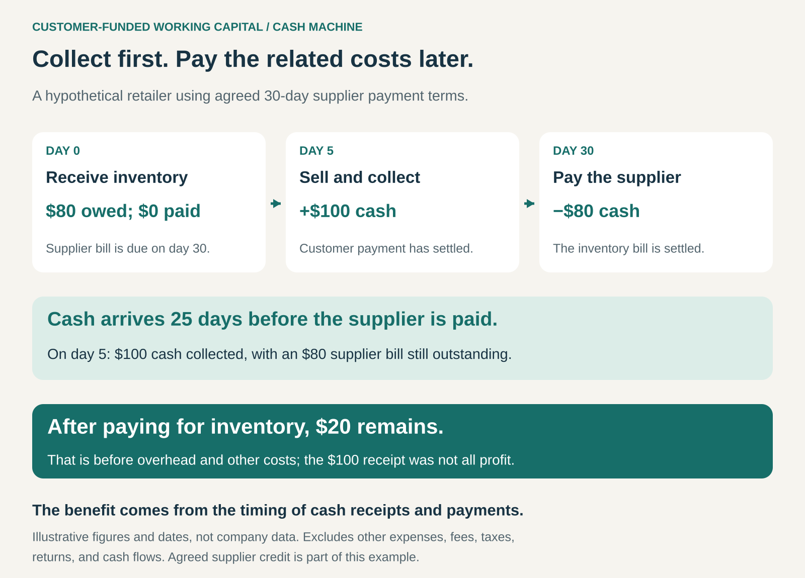

## What it is for

Collect customer cash before the corresponding operating payments fall due. Customer-Funded Working Capital helps a business finance its operating cycle through the timing of receipts and payments, reducing the cash it must supply from other sources.

A retailer receives inventory on agreed supplier credit. Customers buy it quickly and pay immediately. The supplier’s invoice becomes payable several weeks later.

For that interval, customer receipts are already in the business while the inventory bill remains outstanding.

A similar timing advantage can arise when customers pay deposits, purchase prepaid balances, or pay for services before delivery.

The name _Cash Machine_ describes this favorable operating cycle. It does not mean that the cash received is all profit.

## The core idea

Arrange the operating cycle so that customer receipts arrive early relative to the payments required to fulfill them.

Three mechanisms commonly contribute:

- **Collect early:** take advance payments, deposits, or payment at purchase.
- **Move quickly:** minimize the time resources remain tied up in inventory or unfinished work.
- **Pay on agreed later terms:** use supplier credit while meeting contractual obligations.

These mechanisms can work together. Fast-turnover retail often depends on both prompt customer payment and supplier credit.

For an inventory business, a common measure is the **cash conversion cycle**:

**Inventory days + customer collection days − supplier payment days.**

A negative result indicates that, on average, the business collects cash before paying the corresponding suppliers.

Prepaid services require a broader view of future delivery costs; inventory measures alone do not capture their obligations.

## How the timing works

In this hypothetical example, the retailer receives $80 of inventory on day zero, with payment due on day thirty.

It sells the inventory and collects $100 on day five.

Customer cash therefore arrives 25 days before the supplier is paid. After settling the $80 inventory bill, $20 remains before overhead and other costs.

The timing advantage and the trading margin are separate.

On day five, the business has collected $100, but it still owes $80. The receipt has improved liquidity without eliminating the obligation.

## Why it works

Many businesses need cash to bridge the period between paying for inputs and collecting from customers.

This pattern reduces or reverses that gap. Customer receipts can support the operating cycle before the related bills become payable.

When the arrangement repeats reliably, a business may maintain a continuing balance of receipts awaiting future expenditure. Growth can expand that funding contribution if collection, inventory, and payment patterns remain favorable.

The arrangement can also reduce financing costs and make more cash available for operational needs.

Its strength depends on the whole cycle. Earlier collection provides limited help if inventory sits unsold, fulfillment costs arrive sooner, or customers require refunds.

A cash advantage needs reliable operations and workable commercial terms.

## Famous examples

### Dell: a classic negative cash conversion cycle

Dell reported a negative 37-day cash conversion cycle in fiscal 2003. Its published measures combined low inventory holdings, customer collection timing, and supplier payment periods. [Dell’s fiscal 2003 annual report](https://www.sec.gov/Archives/edgar/data/826083/000095013403006596/d05041e10vk.htm).

This historical example demonstrates the combined effect of operating speed and payment terms.

The mechanism did not require every customer to pay upfront. Dell reported receivables as part of its cycle; supplier payment timing extended beyond its combined inventory and collection measures.

The transferable lesson is to examine the sequence of cash movements across the operation, rather than attributing the result to a single payment policy.

### Amazon: collecting before vendor and seller payments become due

Amazon’s 2025 annual report states that it seeks to turn inventory quickly and collect from consumers before payments to vendors and sellers become due. It explains that consumer receivables settle quickly because customers primarily use credit cards.

The report also notes that inventory turnover and payment periods vary with product mix, suppliers, seasonality, and commercial terms. [Amazon’s 2025 annual report](https://www.sec.gov/Archives/edgar/data/1018724/000101872426000004/amzn-20251231.htm).

Customer collection and later settlement create a favorable timing relationship.

That relationship remains operationally dependent. A change in inventory, demand, or payment terms can alter the amount and duration of funding it provides.

### Starbucks: customers fund balances before redemption

Starbucks customers can load money onto stored-value cards before using those balances for purchases. Its 2025 annual report says loaded amounts are initially recorded as deferred revenue and recognized as revenue upon redemption, with separate rules for amounts not expected to be redeemed. [Starbucks’ 2025 annual report](https://www.sec.gov/Archives/edgar/data/829224/000082922425000114/sbux-20250928.htm).

This brings customer cash forward relative to the eventual purchase.

The balance also represents continuing obligations. Starbucks must provide products when customers redeem it.

Prepayment can therefore support liquidity while leaving future fulfillment costs outstanding. It does not establish that the entire business has a negative cash conversion cycle or that loaded balances are immediately earned profit.

## The economics

The benefit is a reduction in the cash needed to support day-to-day operations.

Its scale depends on transaction volume, the timing gap, and the amount of operating expenditure still outstanding. It also depends on whether the cash has actually settled and is available.

Favorable timing cannot repair unfavorable unit economics. A business can collect money early while losing money on every completed sale.

Growth can also conceal the difference. New receipts may increase the cash balance while the costs of fulfilling earlier orders remain ahead.

The reverse matters too: when sales slow, older supplier bills and delivery obligations still come due while fewer new receipts arrive.

The business therefore needs enough liquidity to complete the cycle under less favorable conditions. Startup costs, facilities, equipment, and other investments may still require separate funding.

## Useful when

This pattern is especially useful when:

- **Customers accept early payment:** the offer and the provider’s reliability justify committing cash.
- **Inventory or production moves quickly:** resources spend relatively little time awaiting sale or delivery.
- **Supplier terms support the cycle:** payment deadlines fit the timing of customer receipts.
- **Demand is reasonably dependable:** incoming receipts and future obligations can be assessed.
- **Fulfillment remains economically sound:** completed transactions generate sufficient contribution after their costs.

It becomes harder when production is lengthy, inventory is unpredictable, customers pay slowly, or suppliers require substantial advances.

## Common mistakes and limits

**Confusing cash with profit.** A receipt can arrive before revenue is earned or costs are paid. Outstanding obligations remain relevant.

**Counting orders as available money.** Bookings, invoices, and unsettled payments do not necessarily provide cash the business can use.

**Treating overdue bills as supplier credit.** The model depends on agreed payment terms. Unilateral delays can damage supply relationships and future terms.

**Overlooking the price of favorable terms.** Longer payment periods may involve higher prices or the loss of early-payment discounts.

**Assuming growth will continue funding the cycle.** Slower sales, cancellations, and refunds can reduce receipts while existing commitments remain payable.

**Committing temporary funding to inflexible expenditure.** Cash needed for approaching bills may be unavailable when required if committed elsewhere for too long.

**Optimizing one measure at the expense of delivery.** Extremely low inventory can improve cash timing while creating shortages. The operating benefit must remain compatible with reliable service.

## Related patterns

- [[demand-driven-production|Demand-Driven Production / From Push to Pull:]] can reduce inventory and begin work closer to a confirmed order, improving the timing of expenditure.
- [[subscription|Subscription:]] advance billing can bring receipts ahead of service delivery, while creating continuing performance obligations.
- [[credits|Credits:]] prepaid balances collect cash before consumption; their value must still be honored under the applicable terms.
- [[membership|Membership:]] annual dues can bring receipts forward, but the funded benefits may require expenditure throughout the membership period.
