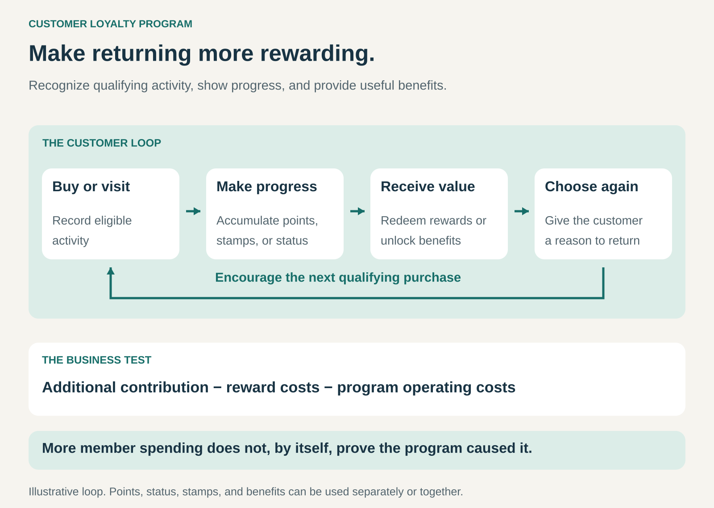

## What it is for

Give customers a continuing reason to return, concentrate more of their purchases with your business, or deepen an existing relationship.

A customer may enjoy a purchase and still choose a competitor next time. A loyalty program adds something that carries forward: progress toward a reward, recognition of previous activity, or access to benefits.

It is useful when customers have recurring needs, alternatives are readily available, and the business can offer benefits that customers value at a sustainable cost.

The opportunity is to make the next purchase more attractive while strengthening the relationship over time.

## The core idea

**Link qualifying customer activity to accumulated rewards, recognition, or continuing benefits.**

The mechanism can be simple: buy several coffees and receive one free. More elaborate programs combine points, status levels, exclusive access, and personalized offers.

Points are optional. A stamp card, priority service arrangement, or status-based benefit can perform the same role.

The customer needs to understand three things: what counts, what they receive, and when they can use it.

The business needs to understand whether the program produces enough additional contribution to cover its rewards and operating costs.

Repeat purchasing can reflect convenience, rewards, or genuine preference. A program can influence behavior without necessarily creating a stronger emotional attachment to the brand.

## How it works

**1. Define the activity the program recognizes.**

The program might reward qualifying purchases, visits, nights stayed, or renewals.

The rules should connect to a worthwhile business objective. Rewarding spending may encourage larger purchases; rewarding visits may encourage frequency. Those choices can produce different behavior.

Returns, cancellations, exclusions, and participating locations also need understandable treatment.

**2. Give customers a reason to participate.**

Benefits can include discounts, free products, priority service, special access, or experiences.

The reward needs to matter to the customer and feel reasonably attainable. A valuable benefit that appears unreachable may provide little motivation.

Benefits can also recognize a relationship immediately, rather than requiring every customer to wait for a distant redemption.

**3. Make progress and entitlement visible.**

Customers need to know what they have earned and what remains available.

A stamp card makes progress tangible. A digital account can show points, status, qualifying activity, and expiration dates.

Redeemable balances and status progress may follow different rules. Presenting them clearly prevents customers from confusing rewards they can spend with qualifications they must maintain.

**4. Deliver the benefit reliably.**

The program needs workable redemption, recognition, and support.

Employees and systems must understand what customers are entitled to receive. Availability restrictions should be clear before the customer tries to use a benefit.

The relationship is tested when the business fulfills the promise.

## Why it works

**It gives earlier activity continuing relevance.** Previous purchases can contribute toward something customers value later.

**It makes returning a more concrete choice.** Customers can see what another qualifying purchase would unlock.

**It recognizes valuable relationships.** Appropriate benefits can acknowledge customers who engage frequently or contribute substantially.

**It can connect interactions across channels.** A shared account can preserve rewards and recognition between stores, websites, and apps.

**It can make communication more relevant.** Where customers participate through an account, the business can use their activity and preferences to offer more useful benefits.

These are possible mechanisms, rather than proof that every program increases loyalty. The offering still needs to be attractive, and the rewards need to justify their cost.

## Famous examples

### Starbucks Rewards — frequent purchases connected through Stars and status

Starbucks launched a revised US Rewards structure in March 2026 with Green, Gold, and Reserve levels. Members earn Stars through qualifying activity, redeem rewards, and receive benefits associated with their level. Earning rates and benefits differ between levels. [Starbucks’ March 2026 program launch](https://about.starbucks.com/press/2026/reimagined-starbucks-rewards-loyalty-program-launches-with-new-member-benefits/), [US Rewards terms](https://www.starbucks.com/terms/rewards)

The program connects individual purchases through an ongoing account and visible progress.

It also illustrates why the rules matter: earning, redemption, status qualification, and expiration are separate parts of the customer experience.

### Sephora Beauty Insider — rewards combined with access and recognition

Sephora’s Beauty Insider program in the United States and Canada lets members earn points on qualifying merchandise purchases and redeem them for rewards such as samples, bundles, and experiences. Its Insider, VIB, and Rouge tiers provide different benefits. [Sephora Beauty Insider](https://www.sephora.com/beauty/loyalty-program), [Beauty Insider benefits](https://www.sephora.com/profile/BeautyInsider)

This illustrates a program that extends beyond a straightforward discount.

Product discovery, special rewards, and access can support the relationship alongside points. The tiers also create a separate recognition mechanism around qualifying spending.

### Marriott Bonvoy — redeemable rewards and ongoing status

Marriott Bonvoy distinguishes points used for rewards from Elite Night Credits that help members qualify for status. Status can provide benefits such as bonus points and eligible room upgrades, with conditions and availability restrictions. [Marriott Bonvoy terms](https://www.marriott.com/loyalty/terms/default.mi), [Elite Night Credits explained](https://help.marriott.com/s/article/marriott-elite-night-credit)

The program connects stays across a participating hotel network.

It demonstrates two complementary mechanisms: accumulating something to redeem and qualifying for benefits that apply during future visits.

## The economics

A loyalty program spends money on rewards across many purchases, including purchases customers might have made anyway.

Its value therefore depends on additional behavior, rather than total member spending alone.

Consider a hypothetical annual program:

| Item                                                   |     Amount |
| ------------------------------------------------------ | ---------: |
| Contribution from 500 additional purchases at $20 each |    $10,000 |
| Reward costs across the program                        |    −$7,000 |
| Program administration and technology                  |    −$2,000 |
| Estimated incremental contribution                     | **$1,000** |

The $20 contribution is measured after ordinary variable delivery costs, before program costs.

If the program generates only 250 additional purchases, that contribution falls to $5,000. With the same $9,000 in program costs, the result becomes a $4,000 loss.

Reward costs also depend on the benefit. A discount reduces receipts; a free product requires fulfillment and may replace a paid purchase. The advertised value and the business’s economic cost can differ.

The relevant question is how the complete customer relationship changes after accounting for these effects.

## Useful when

- **Customers have recurring needs.** There are realistic opportunities to return.
- **Customers can choose between alternatives.** A continuing benefit can influence where they purchase.
- **Rewards are meaningful and attainable.** Customers can understand the exchange.
- **The business has sufficient margin.** Benefits can be funded without undermining the underlying offering.
- **Activity and fulfillment can be tracked reliably.** Customers receive the recognition they have earned.

## Common mistakes and limits

**Mistaking existing loyalty for program impact.** Frequent buyers may be more likely to join. Research on Dutch grocery programs found that ignoring this self-selection substantially overstated the estimated effect of membership. [Research on loyalty-program self-selection](https://researchcommons.waikato.ac.nz/entities/publication/0c795feb-73b7-4374-96b2-dd236b787eb0)

**Rewarding purchases without enough additional benefit.** A program can become an expensive subsidy for behavior that would have happened anyway.

**Making the rules difficult to understand.** Multiple balances, exclusions, and changing thresholds can obscure the value.

**Creating rewards customers cannot use.** Limited availability or cumbersome redemption can turn apparent generosity into frustration.

**Changing the promise carelessly.** Unexpected reductions in value or access can weaken confidence in the relationship.

**Ignoring service quality.** Points rarely compensate for repeatedly disappointing customers.

**Collecting information without delivering corresponding value.** Registration and account management add effort; customers need a worthwhile reason to participate.

The pattern is less effective when purchases are extremely infrequent, margins are thin, or the reward requires more effort than customers consider worthwhile.

## Related patterns

- [[membership|Membership:]] establishes participation and access. A loyalty program links particular benefits to qualifying activity or accumulated status.
- [[credits|Credits:]] can represent a redeemable balance. Loyalty points are commonly earned through participation rather than purchased as prepaid spending power.
- [[omnichannel|Omnichannel:]] helps customers retain recognition and rewards across different ways of interacting with the business.
- [[brands-consortium|Brands Consortium:]] can extend recognition or benefits across participating brands, with agreed rules for earning, redemption, and funding.
