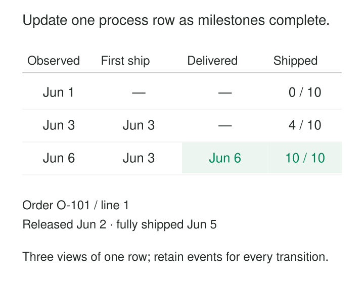

An order has been placed, released, partially shipped, and finally delivered. Each event lives in a different operational table. Answering “Where are orders getting stuck?” requires stitching those events together every time someone opens a dashboard.

A daily snapshot shows the backlog changing, but it still leaves the process milestones scattered.

[[data-accumulating-snapshots|Accumulating Snapshots]] brings the important milestones of one process instance into a single fact row. The row is created when the process begins and updated as work progresses. Dates, quantities, outcomes, and durations gradually fill in.

Kimball defines this pattern for workflows with identifiable beginnings, intermediate milestones, and endings, including order fulfillment. Its distinctive behavior is deliberately revisiting and updating the same fact row. [Kimball Group: Accumulating snapshot fact tables](https://www.kimballgroup.com/data-warehouse-business-intelligence-resources/kimball-techniques/dimensional-modeling-techniques/accumulating-snapshot-fact-table/)

## One row follows one process instance

The grain might be:

> One row represents the fulfillment lifecycle of one sales order line.

It could instead represent a shipment, application attempt, repair job, or procurement schedule. The choice determines what “complete” means.

An order-level row can become ambiguous when different lines progress independently. A customer-level row becomes ambiguous when the customer has several simultaneous orders.

Give each process instance a stable identity. Keep its business identifiers available for investigation, alongside references to relevant dimensions such as customer, product, and fulfillment location.

The row’s milestone dates represent different roles. Ordered Date, Released Date, and Delivered Date can reference the same calendar dimension through separately named relationships. Microsoft’s dimensional guidance describes this characteristic use of multiple milestone date keys. [Microsoft: Modeling fact tables](https://learn.microsoft.com/en-us/fabric/data-warehouse/dimensional-modeling-fact-tables)

## Example: first shipment is not full shipment

Order O-101, line 1, contains ten units.

It is ordered on June 1 and released on June 2. Four units ship on June 3; the remaining six ship on June 5. All ten are delivered by June 6.

The accumulating row progresses accordingly:

| Milestone or measure | June 3 view | June 6 view |
|---|---|---|
| Ordered | June 1 | June 1 |
| Released | June 2 | June 2 |
| First shipped | June 3 | June 3 |
| Fully shipped | Pending | June 5 |
| Fully delivered | Pending | June 6 |
| Shipped quantity | 4 | 10 |

*Illustrative data. These are successive views of one updated row, not three independently retained fact rows.*

Calling June 3 the “shipped date” would conceal an important distinction. It is the first shipment date, while June 5 marks full shipment.

Milestones earn separate columns when their meanings support different questions. “How quickly did fulfillment begin?” and “How long until the entire line shipped?” require different endpoints.

The individual shipment records remain useful for quantities, packages, carriers, and other details below this lifecycle grain.

## Missing milestones need meaningful states

When the row first arrives, later milestones are incomplete. That is expected.

However, **pending**, **unknown**, and **not applicable** describe different situations:

- Pending means the milestone may still occur.
- Unknown means evidence is missing.
- Not applicable means the milestone does not belong to this process outcome.

A cancelled line may never ship. Its cancellation date and outcome explain why shipment remains inapplicable. A line known to have shipped but lacking a trustworthy timestamp has a different problem.

Represent these distinctions through explicit status and suitable date-dimension members or equivalent fields. Do not manufacture calendar dates merely to satisfy a non-null column.

Likewise, an unfinished duration is not zero. Zero means the measured interval actually had no length under the chosen definition.

## Measure elapsed time with a declared clock

For the completed order line, the calendar-date difference from June 1 to June 5 is four days. The difference to June 6 is five days.

Those are date-based lags. Exact elapsed hours require timestamps. Business-hour measures require the appropriate working calendar, holidays, and treatment of pauses.

Never subtract surrogate date keys to calculate time. Resolve them to dates or use a defined calendar sequence.

Kimball describes storing milestone lags relative to the process start, allowing other intervals to be calculated by subtraction. Here, order-to-delivery minus order-to-full-shipment gives one calendar day. [Kimball Group: Lag and duration facts](https://www.kimballgroup.com/data-warehouse-business-intelligence-resources/kimball-techniques/dimensional-modeling-techniques/lag-duration-fact/)

That subtraction works when the underlying lag definitions are compatible. An elapsed-time measure and a paused service-clock measure cannot be mixed casually.

Open processes need an explicit measurement cutoff. “Age today” changes without another process event, so derive it using the report’s stated as-of time or refresh a clearly dated age measurement.

## Example: applications have different endings

A hiring pipeline might use one row per candidate application attempt, with submitted, screened, interviewed, offered, and closed milestones.

An application rejected after screening is complete even though interview and offer dates never occur. An applicant who withdraws has another terminal outcome.

Treating “offer accepted” as the only possible completion would leave those applications falsely open. A later application by the same candidate should have its own process identity.

Reporting also needs clear cohorts. An average calculated only from completed applications excludes the applications still waiting. Show their ages and counts alongside completed-cycle durations so a faster-looking average does not hide stalled work.

## Update from evidence, not arrival order

The loader must associate incoming events with the correct process instance and apply consistent milestone rules.

For repeated events, define whether a column retains the first occurrence, latest occurrence, or final successful occurrence. A generic approval date is ambiguous when approval can be withdrawn and granted again.

Delayed events should populate their actual milestone time rather than the warehouse arrival time. Corrections may require recalculating dependent lags.

Repeated delivery must leave the same accepted result. Blindly incrementing shipped quantity whenever a message arrives can double-count retries; use event identity, source versions, or deterministic recomputation.

Preserve provenance sufficient to explain a milestone. The accumulating row is a convenient process summary, while its dates and measures remain claims derived from source evidence.

## A documented implementation: Oracle purchasing cycles

Oracle’s published Supply Chain Analytics catalog documents `W_PURCH_CYCLE_LINE_F`, a purchasing-cycle table spanning requisition, approval, ordering, scheduling, and receipt.

It includes milestone dates, received-to-date quantities, and distinct first and last receipt dates. These support questions about ordering lead time and the interval across multiple receipts. [Oracle: Supply Chain Analytics presentation catalog](https://docs.oracle.com/cd/E18844_02/doc.1001/e18655/catalog.htm)

This packaged design illustrates the pattern’s practical value: several related business events become accessible through one cycle-oriented analytical record. Its separately named receipt milestones also demonstrate why a single generic completion date can be insufficient.

## Repeated stages expose the pattern’s limits

A process can reopen, loop through review, split into parallel branches, or create several independent sub-processes.

A single row can summarize selected first and last milestones, counts, and final outcomes. It cannot preserve every transition simply by adding more dates. First and last review timestamps also cannot establish total time spent in review across several visits.

Use transaction facts for individual transitions. Give independently progressing child processes their own grain when needed.

An ordinary accumulating snapshot also loses its earlier row states as updates occur. It cannot automatically answer “What did the pipeline look like last Friday?”

Kimball describes supplementing it with event history, periodic observations, or a timespan version that retains successive states with effective intervals. [Kimball Group: Timespan accumulating snapshots](https://www.kimballgroup.com/2012/05/design-tip-145-time-stamping-accumulating-snapshot-fact-tables/)

## Trade repeated reconstruction for maintained summaries

Accumulating snapshots make milestone filtering, bottleneck analysis, and cycle-time reporting straightforward. One maintained process row can replace substantial repeated event reconstruction.

The costs include updates, late-data handling, source correlation, reconciliation, and evolving milestone definitions. Historical versions increase storage; many optional milestones can produce wide, difficult tables.

Use the pattern when process identity and milestone meanings are stable enough to support a useful summary. Keep detailed events when retries, branching, or exact transitions matter.

[[data-declare-the-grain|Declare the Grain]] establishes which lifecycle the row follows. [[data-role-playing-dimensions|Role-Playing Dimensions]] distinguishes its milestone dates. [[data-periodic-snapshots|Periodic Snapshots]] preserves positions at regular cutoffs. [[data-recorded-time-history|Recorded-Time History]] preserves earlier recorded versions when explaining past reports requires more than the latest accumulated understanding.
