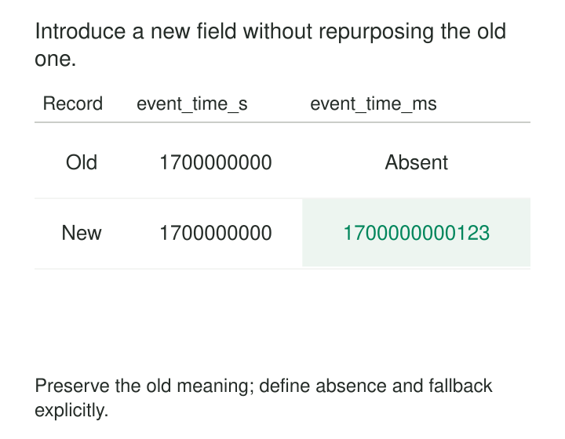

A team needs more precise event timestamps. The existing field stores seconds, so someone changes it to milliseconds. The type remains an integer, but older consumers now interpret dates thousands of years into the future.

The team could have introduced the new capability without changing the old field’s meaning.

[[data-additive-schema-evolution|Additive Schema Evolution]] extends a shared data interface while preserving the structure and interpretation that existing consumers depend on. New fields coexist with existing fields, and consumers adopt them gradually.

The purpose is to create room for change without requiring every producer, consumer, and historical record to change together.

## Add capability while preserving the existing promise

An additive change introduces information without removing, renaming, repurposing, or tightening existing requirements.

That usually means adding a field that newer readers can handle when absent and older readers can tolerate when present. Existing identifiers, units, grain, and business definitions retain their meaning.

The mechanism separates three events:

1. **The interface permits the new field.**
2. **Producers begin supplying it.**
3. **Consumers begin relying on it.**

Those events need not happen simultaneously. A schema can support a field months before every source populates it.

Correctness therefore depends on both directions of compatibility: newer consumers must handle older data, and supported older consumers must handle the expanded data. The exact rules depend on the format and implementation, as [Confluent’s schema-evolution documentation](https://docs.confluent.io/platform/current/schema-registry/fundamentals/schema-evolution.html) explains.

“Added” describes the edit. It does not, by itself, establish compatibility.



## Add delivery instructions without inventing historical facts

An order event gains a `delivery_instructions` field. Older orders contain no such information, and several producers will continue using the old format during rollout.

For an Avro record, an illustrative field definition is:

```json
{
  "name": "delivery_instructions",
  "type": ["null", "string"],
  "default": null
}
```

A newer reader can supply null when reading an older record that lacks the field. An older reader can ignore the additional field under Avro’s record-resolution rules. The [Avro specification](https://avro.apache.org/docs/1.12.0/specification/#schema-resolution) defines these behaviors.

The default’s meaning is a separate decision. Here, null means “instructions were not recorded.” It should not automatically mean “the customer explicitly requested no special handling.”

The distinction affects application behavior. A fulfillment system may continue its existing delivery process when instructions are unavailable, while displaying recorded instructions when present.

Avro defaults support reading older data; they do not make a field optional during encoding. Verify how the actual producer library constructs the expanded record rather than assuming omitted values will always be filled automatically.

Test old messages with new readers and new messages with supported old readers. Include records with null, empty text, and actual instructions if those values have different meanings.

## Add a warehouse column without fabricating coverage

A customer table gains `acquisition_channel`. Newly instrumented signups contain values such as `partner` or `paid_search`; historical customers have no recorded channel.

An illustrative result is:

| Customer | Signup cohort | Acquisition channel |
|---|---|---|
| C101 | Before instrumentation | NULL |
| C205 | After instrumentation | paid_search |
| C206 | After instrumentation | partner |

Adding the column makes the information representable. It does not reconstruct the past.

Delta Lake provides a concrete implementation: its [schema-evolution documentation](https://docs.delta.io/delta-batch/#update-table-schema) describes adding columns during approved schema evolution, with existing rows receiving null values for newly introduced columns.

A tempting shortcut is to replace every null with `organic`. That produces a tidy column while inventing attribution. Another is to require non-null values immediately, causing old writers or historical loads to fail.

Measure population coverage deliberately. Track the share of eligible, newly instrumented records with a valid channel, while keeping older cohorts distinguishable. If historical source evidence exists, backfill from that evidence and retain its provenance.

Schema evolution and backfill are separate operations. Review the backfill’s cost, consistency, and publication behavior independently.

## Add precision in a separate field

Suppose an event currently carries Unix time in seconds:

| Field | Value |
|---|---:|
| `event_time_s` | 1700000000 |

The new producer can capture milliseconds. Preserve the original field and add another:

| Field | Value |
|---|---:|
| `event_time_s` | 1700000000 |
| `event_time_ms` | 1700000000123 |

Older consumers continue reading seconds. Newer consumers use milliseconds when present and handle legacy precision explicitly.

Both fields should derive from the same captured instant under a documented conversion rule. Otherwise, independently populated fields can disagree.

In Protobuf, a new field receives a new field number. The [Proto3 language guide](https://protobuf.dev/programming-guides/proto3/#updating) documents adding fields as binary wire-safe, while qualifying application-level compatibility.

Presence matters. An absent millisecond timestamp must not silently become a genuine timestamp at epoch zero. Protobuf’s [field-presence guidance](https://protobuf.dev/programming-guides/field_presence/) describes explicit presence for scalar fields, including the `optional` label in Proto3.

Historical second-resolution timestamps cannot reveal the missing fractional second. Converting them into milliseconds changes their representation, but does not create additional measurement precision.

Removing the seconds field later requires a separate compatibility decision. Successful addition does not establish that every consumer has migrated.

## Check whether consumers tolerate extra information

Some readers deliberately reject fields they do not recognize.

For example, an older JSON Schema with `additionalProperties: false` rejects a newly added property, even when that property is optional in the new schema. The [JSON Schema object documentation](https://json-schema.org/understanding-json-schema/reference/object#additionalproperties) makes this behavior explicit.

Tabular consumers have similar dependencies. A new column can change a `SELECT *` result, break positional inserts, or alter the shape expected by an export reader. A nullable database column does not guarantee that every surrounding tool accepts it.

Intermediaries also matter. An older service may parse and reconstruct a message using only fields it understands, dropping the addition before it reaches newer consumers. Protobuf documents that unknown fields can be lost through JSON conversion or field-by-field copying.

Compatibility testing should therefore cover the route, including serializers, adapters, exports, and important intermediate transformations.

## Make absence safe before making presence necessary

Consumers should have an explicit policy for missing new information.

That policy might retain existing behavior, display an unavailable value, or decline a feature that requires the new field. It should preserve the business distinction between “unknown,” “not applicable,” and a genuine zero or false.

Deploy accepting schemas and consumers before depending on new values, according to the actual compatibility constraints. During overlap, verify that existing outputs remain correct and that new-field coverage grows as intended.

A requirement such as “all records must now contain this field” is a further change. Introduce it only after checking active producers, retained data, replay paths, and rollback behavior.

Rollback can restore an older producer that stops populating the addition. A newer consumer that has already made the field mandatory may then fail despite both schemas remaining available.

## Keep expansion deliberate and affordable

Additive evolution is useful when teams deploy independently, historical data must remain readable, or a new capability can coexist with the old interface.

It carries recurring costs: larger messages and tables, duplicate representations, additional documentation, broader tests, and maintenance of fallback logic. Historical backfills can cost far more than adding the schema entry.

Some platforms also impose operational work. Delta Lake documents that schema updates terminate streams reading the affected table, requiring restart. Structural compatibility does not imply interruption-free operation.

Avoid enabling unrestricted schema growth merely to keep ingestion running. Misspelled fields and accidental additions can become permanent interface clutter. Review additions against the contract and keep their ownership clear.

Additive evolution also has limits. A change in grain, identity, or fundamental meaning may need a separate version or dataset. Accumulating fields such as `amount_new`, `amount_v2`, and `amount_final` can conceal a migration that nobody completed.

[[data-explicit-data-contracts|Explicit Data Contracts]] defines the promises being preserved. [[data-schema-registries|Schema Registries]] records supported versions. [[data-compatibility-checks-in-delivery|Compatibility Checks in Delivery]] verifies the combinations consumers will encounter. [[data-distinguish-missing-unknown-inapplicable|Distinguish Missing, Unknown, and Inapplicable]] keeps defaults and historical gaps meaningful.
