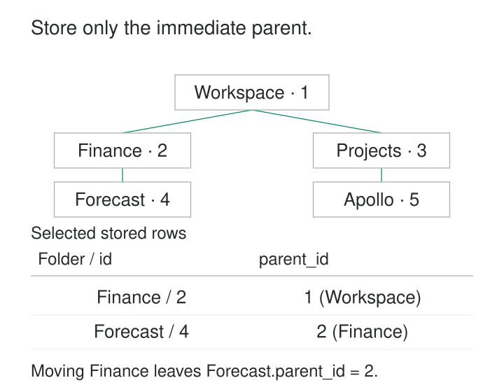

A document system starts with three folder levels: workspace, department, and project. Its database has a column for each. Then someone adds subprojects, archives, and nested working folders. Every extra level requires another column, another join, or another special case.

**Adjacency Lists represent a hierarchy by storing each node’s immediate connections.** In the common relational form for a tree, each row holds a reference to its parent. The database stores the local links; queries follow those links to discover ancestors, descendants, and whole branches.

This makes the pattern a useful starting point for folders, categories, organizational structures, and other hierarchies whose depth can vary.

## Store the immediate parent

A folder table needs an identifier, a parent reference, and the folder’s ordinary attributes:

| id | parent_id | name |
|---|---|---|
| 1 | NULL | Workspace |
| 2 | 1 | Finance |
| 3 | 1 | Projects |
| 4 | 2 | Forecast |
| 5 | 3 | Apollo |

`parent_id` refers to another row in the same table. Workspace is a root because its parent is `NULL`. Forecast belongs directly to Finance and indirectly to Workspace.



The parent reference expresses structure independently of names and depth. Renaming Finance leaves its children attached. Adding another level requires another row, without changing the table’s shape.

SQLAlchemy implements this arrangement through a self-referencing foreign key and mapped parent and children relationships. Its documentation includes both a working adjacency-list example and a composite-key folder model scoped to an account. [SQLAlchemy: Adjacency List Relationships](https://docs.sqlalchemy.org/en/20/orm/self_referential.html)

## Example: moving a folder and everything beneath it

Suppose Finance should become part of Projects. The structural change is:

```sql
UPDATE folder SET parent_id = 3 WHERE id = 2;
```

Forecast still points to Finance. It therefore moves with the branch, even though its own row remains unchanged.

This is the pattern’s main advantage for changing hierarchies: the stored relationship describes the immediate parent, so moving a branch does not require rewriting every descendant’s ancestry.

The operation still needs validation. Moving Finance beneath Forecast would create a cycle: Finance would contain Forecast, which would contain Finance. A safe move must reject the node itself and any of its descendants as the proposed parent.

Other consequences may also require work. A folder move can invalidate cached paths, inherited permissions, or search indexes. The structural update is small; the complete business operation may be larger.

## Follow the links to read a branch

Immediate children are easy to retrieve: select rows whose `parent_id` equals the chosen node’s ID.

Descendants require repeated application of that same step. A recursive common table expression starts with a node, finds its children, then finds their children until no further rows appear.

For the illustrated, valid tree:

```sql
WITH RECURSIVE branch(id, name, depth) AS (
  SELECT id, name, 0
  FROM folder
  WHERE id = 2

  UNION ALL

  SELECT f.id, f.name, b.depth + 1
  FROM folder AS f
  JOIN branch AS b ON f.parent_id = b.id
)
SELECT id, name, depth
FROM branch
ORDER BY depth, id;
```

The result contains Finance at depth zero and Forecast at depth one. The anchor includes the starting node deliberately; a descendants-only result would exclude it.

The final ordering groups rows by depth and ID. An indented tree display usually needs a path-based ordering that keeps each branch together. Recursive query output should not be assumed to arrive in presentation order. PostgreSQL documents both recursive traversal and explicit search ordering. [PostgreSQL: Recursive Queries](https://www.postgresql.org/docs/current/queries-with.html#QUERIES-WITH-RECURSIVE)

## A parent reference does not guarantee a tree

The model is compact because several important rules sit outside the basic pointer.

**Identity must be unique and parent references valid.** A self-referencing foreign key prevents a child from pointing to a nonexistent parent. It does not establish that the resulting structure is acyclic. PostgreSQL’s constraints documentation illustrates self-referencing foreign keys for tree structures. [PostgreSQL: Foreign Keys](https://www.postgresql.org/docs/current/ddl-constraints.html#DDL-CONSTRAINTS-FK)

**Each node has at most one parent in this representation.** That assumption fits a folder tree or a designated primary reporting line. It cannot represent several simultaneous parents in one scalar `parent_id`.

**Roots need an agreed meaning.** Several `NULL` parents produce a forest of separate trees. If the business requires one root, that requirement needs additional enforcement. During imports, an unresolved parent should not silently turn a node into a legitimate root.

**Cycles need separate prevention and detection.** Rejecting `id = parent_id` catches direct self-reference, but misses longer loops. Structural writes need an ancestry check coordinated with concurrent changes. Two individually reasonable moves can otherwise combine into a cycle. One approach serializes structural changes through a shared guard record for the tree.

Read-time protection is also valuable for imported or damaged data. PostgreSQL supports a `CYCLE` clause for recursive queries. Simply replacing `UNION ALL` with `UNION` is insufficient when a changing depth or path makes each revisited row different. [PostgreSQL: Cycle Detection](https://www.postgresql.org/docs/current/queries-with.html#QUERIES-WITH-CYCLE)

## Example: an organizational reporting chain

An organization records one primary manager per person:

| employee_id | manager_id | name |
|---|---|---|
| 10 | NULL | Ada |
| 11 | 10 | Ben |
| 12 | 11 | Cora |
| 13 | 10 | Dina |

Ada has two direct reports, Ben and Dina, and three descendants when Cora is included. Ben’s branch contains two people when the report includes Ben himself.

A single join answers “Who reports directly to Ada?” Recursive traversal answers “Who is anywhere beneath Ada?” Those are different questions, and the report should name which one it answers.

SQLite’s official documentation demonstrates this mechanism with an organization table containing a self-referencing `boss` field and a recursive query that finds everyone beneath a named person. The numeric identifiers above are illustrative and avoid depending on names being unique. [SQLite: Hierarchical Query Examples](https://www.sqlite.org/lang_with.html#hierarchical_query_examples)

The model also has a temporal boundary. Overwriting Cora’s manager changes the current reporting structure. It does not preserve the organization as it existed last quarter. Historical reporting requires dated relationships or hierarchy snapshots.

## Where the operating costs appear

Adjacency lists are especially useful when direct-child queries are common, branches move, and most requests explore a manageable part of the hierarchy.

Storage stays compact: one parent reference per non-root node. Inserts are local, and reparenting changes one stored link. Indexing `parent_id` supports repeated child lookups; parent existence alone does not guarantee that those lookups are efficiently indexed.

The main read cost is traversal. Large subtrees require visiting many rows, while deep ancestor chains require following many links. Recursive working data can consume memory, particularly when queries carry paths or wide records.

Application code can multiply that cost by fetching children separately for every node. Batch loading or a recursive query can avoid excessive database round trips.

Deletion needs an explicit policy. The system might reject deletion while children exist, delete a whole subtree, or reparent the children. Cascading deletion can affect far more records than the single selected node suggests.

## When the structure outgrows a tree

Some apparently hierarchical domains permit several parents. A reusable component can belong to several assemblies; a category can appear under several broader categories.

Adjacency lists still apply in their broader graph form, but connections belong in a separate edge table such as `parent_id, child_id`. Traversal must then distinguish unique reachable nodes from distinct paths. Those can produce different counts and totals.

Sibling order is another independent concern. A parent reference does not say which child appears first. Store an explicit position or define a deterministic sorting rule when order matters.

For workloads dominated by repeated ancestor and descendant queries, derived structures may be worthwhile. They exchange extra storage and maintenance for more direct reads.

## Related patterns

[[data-closure-tables|Closure Tables]] store ancestor–descendant relationships explicitly, reducing repeated traversal. [[data-materialized-paths|Materialized Paths]] store ancestry as a path, making branch membership easier to query while increasing the work of moves. **Nested Sets** encode subtree boundaries for efficient subtree reads, with more demanding structural updates. [[data-relationships-with-attributes|Relationships with Attributes]] becomes useful when connections need their own dates, quantities, ordering, or provenance.
