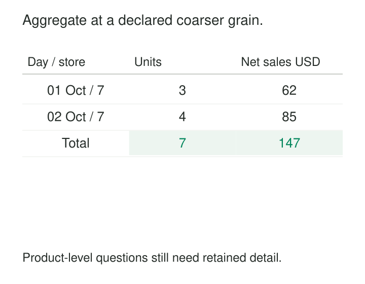

A sales dashboard repeatedly scans hundreds of millions of invoice lines to display totals by day and store. Most requests ask the same broad questions. The database keeps reconstructing answers that could have been prepared once.

[[data-aggregate-fact-tables|Aggregate Fact Tables]] store measurements summarized to a coarser grain so recurring queries can read fewer rows and perform less work.

They supplement the detailed facts. The central design challenge is knowing which questions a summary can answer correctly—and when a query must return to the detail.

## Give the summary its own grain

The detailed sales table might store one row per sales line. This is its atomic grain: the lowest level of observation retained here. Its aggregate could contain one row per day and store, or per month, region, and product category.

Each combination defines a separate grain. Measures are calculated from the underlying facts using explicitly supported aggregation rules.

Kimball describes aggregate fact tables as rollups built to accelerate queries, with both aggregate and atomic tables available to the analytical layer. Ideally, tools select an appropriate summary without requiring report authors to navigate competing versions of the same business measure. [Kimball Group: Aggregate Fact Tables](https://www.kimballgroup.com/data-warehouse-business-intelligence-resources/kimball-techniques/dimensional-modeling-techniques/aggregate-fact-table-cube/)

A table is not an aggregate merely because its grain is coarse. A monthly sales target may originate at month level. An aggregate monthly sales table is derived from more detailed sales observations.



*Every rollup preserves selected information and removes other information. Query routing must respect that boundary.*

## Prepare the store totals once

Consider the illustrative sales lines in the graphic. All belong to store seven, and all amounts are USD.

The first day contains two lines: two adapters for 50 USD and one case for 12 USD. The second contains two adapter lines totaling four units and 85 USD.

A daily store aggregate contains:

| Date | Store | Units sold | Net sales | Sales-line count |
|---|---:|---:|---:|---:|
| 2026-10-01 | 7 | 3 | 62 | 2 |
| 2026-10-02 | 7 | 4 | 85 | 2 |

The construction is straightforward:

```sql
SELECT
    date_key,
    store_key,
    SUM(quantity) AS units_sold,
    SUM(net_amount) AS net_sales,
    COUNT(*) AS sales_line_count
FROM fact_sales_line
GROUP BY date_key, store_key;
```

This assumes the input already represents the intended, deduplicated sales-line population and uses compatible units and currency.

Summing the aggregate produces seven units and 147 USD, matching the detail. Summing `sales_line_count` produces four lines. Counting aggregate rows produces two day–store groups.

At production scale, thousands of lines might collapse into each summary row. The benefit depends on that reduction and how often eligible queries reuse it.

## Preserve the ingredients of derived measures

Some measures survive further aggregation naturally. Sales amounts can be summed across compatible, nonoverlapping groups. Minimums can be combined by taking the minimum again; maximums behave similarly.

Other calculations need additional state.

Suppose a support operation summarizes handling times:

| Team | Completed calls | Total handling minutes | Average minutes |
|---|---:|---:|---:|
| North | 10 | 100 | 10 |
| South | 1 | 100 | 100 |

Averaging the two displayed averages gives 55 minutes. The combined average is actually:

`(100 + 100) / (10 + 1) = 18.18 minutes`

The aggregate should retain total handling time and the appropriate observation count. If handling time can be null, that denominator must count valid handling-time observations rather than indiscriminately counting every row.

Kimball recommends retaining additive components where possible and calculating non-additive results after aggregation. [Kimball Group: Additive and Non-Additive Facts](https://www.kimballgroup.com/data-warehouse-business-intelligence-resources/kimball-techniques/dimensional-modeling-techniques/additive-semi-additive-non-additive-fact/)

Distinct counts need particular care. Daily customer counts cannot generally be summed into a monthly customer count because customers can appear on several days. Exact calculation requires retaining sufficient identity information or returning to detail. Mergeable sketches can support approximate answers when their accuracy and compatibility are acceptable.

Inventory balances introduce another rule: adding balances across stores may be meaningful, while adding successive daily balances usually does not produce a meaningful month-end balance.

## Route the whole question, including its filters

A summary is eligible only when it retains enough information for the requested grouping, filtering, and calculation.

The day–store table can answer daily totals, monthly totals by store, or totals across stores. It cannot answer sales filtered to adapters because Product was removed. It cannot answer an hourly question because the time detail was removed.

A less obvious failure involves measure-based filters. “Sales from lines worth more than 100 USD” requires evaluating individual lines. Filtering daily totals above 100 USD answers a different question.

Higher-level dimensions need compatible representations too. A month–category aggregate can reference Month and Category dimensions that conform to the corresponding levels of Date and Product. These are commonly called shrunken rollup dimensions. Joining a category total back to every individual product would repeat the measure. [Kimball Group: Shrunken Rollup Dimensions](https://www.kimballgroup.com/data-warehouse-business-intelligence-resources/kimball-techniques/dimensional-modeling-techniques/shrunken-rollup-dimension/)

Dimension history must also agree. A category aggregate based on historical classifications cannot silently substitute for a query that restates sales under current classifications.

## A published implementation: Power BI aggregations

Microsoft’s Power BI aggregation feature implements this routing mechanism.

An imported aggregate table can serve eligible queries over a larger DirectQuery detail table. Model mappings identify grouping columns and summarized measurements; queries requiring unavailable detail fall back to the underlying source. [Microsoft: User-Defined Aggregations](https://learn.microsoft.com/en-us/power-bi/transform-model/aggregations-advanced)

Microsoft’s published training lab provides a concrete example. It creates a `Sales Agg` table grouped by `OrderDateKey` and `SalesTerritoryKey`, with summed Sales Amount. It then maps those columns to the corresponding detail fields through Manage aggregations. Report queries continue to reference the logical sales model while the engine selects the summary when applicable. [Microsoft Learning: Improve Query Performance With Aggregations](https://microsoftlearning.github.io/DP-500-Azure-Data-Analyst/Instructions/labs/12-improve-query-performance-with-aggregations.html)

This is a documented implementation exercise, rather than a production performance claim. Actual gains depend on workload, summary size, relationships, and refresh behavior.

## Keep summaries aligned with changing detail

An aggregate is another representation of the underlying measurements. Its maintenance must account for additions, corrections, deletions, and late-arriving facts.

Appending yesterday’s newly received records is insufficient if those records correct last month. The affected historical groups must also change.

Sums and counts can often be maintained using carefully applied deltas. Other states may require additional retained information or rebuilding affected groups. Deleting the record that supplied a minimum, for example, cannot reveal the next minimum from the old minimum alone.

Refreshing whole partitions is often simpler than maintaining every measure incrementally, but it spends more computation. Publication should avoid exposing a partially rebuilt summary.

Freshness alignment matters when queries can switch between detail and aggregates. Microsoft explicitly warns that imported aggregations and DirectQuery data can return different results when their states diverge. [Microsoft: Keeping Aggregations in Sync](https://learn.microsoft.com/en-us/power-bi/transform-model/aggregations-advanced#keep-caches-in-sync)

Reconciliation should compare eligible queries against detail at a consistent snapshot or cutoff, including corrections and boundary dates.

## Build a small portfolio of useful summaries

Aggregate fact tables are especially useful for recurring dashboards, broad historical analysis, high query concurrency, and workloads where many detail rows collapse into relatively few groups.

Their costs include storage, refresh computation, orchestration, metadata mappings, reconciliation, and backfills. Every added grouping dimension increases row counts and can reduce the benefit.

Creating every possible rollup is rarely practical. Start with observed query patterns and retain summaries that materially reduce expensive work.

Common mistakes include mixing detail and summary rows without a controlled design, unioning overlapping summaries, treating row counts as event counts, and routing a query to a summary that cannot enforce its filters. Access rules must also remain equivalent across detail and summary representations.

A summary cannot recover discarded detail. Keeping atomic facts available preserves investigation, new analytical questions, and the ability to rebuild summaries when definitions change.

[[data-declare-the-grain|Declare the Grain]] defines each summary row precisely. [[data-conformed-dimensions|Conformed Dimensions]] keeps retained grouping levels consistent. [[data-shared-metric-definitions|Shared Metric Definitions]] specifies the components and aggregation rules needed for equivalent answers. [[data-freshness-monitoring|Freshness Monitoring]] makes the summary’s publication progress visible alongside its performance benefits.
