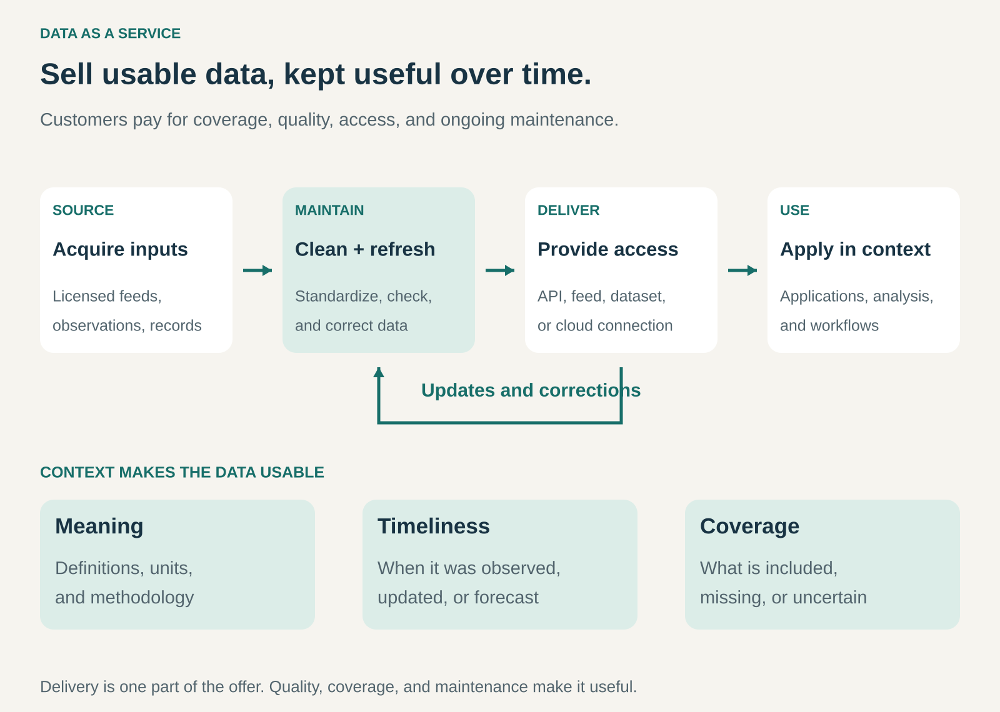

## What it is for

Giving customers access to useful, maintained data without requiring them to collect, organize, and update it all themselves.

A retailer needs weather information for demand planning. A travel application needs details about places. A financial institution needs consistent reference and pricing data across its systems.

Each could build parts of that capability internally. Doing so requires sources, permissions, quality checks, updates, and delivery infrastructure.

Data as a Service packages that work into an offering customers can access repeatedly.

## The core idea

**Sell access to data that is usable for a defined purpose and maintained over time.**

The product might contain observations, business records, reference information, historical datasets, estimates, or forecasts.

Customers obtain it through an application interface, downloadable files, scheduled feeds, or a connection to their data environment.

The delivery method is only one part of the offer. Customers also pay for coverage, consistency, documentation, freshness, and the effort of maintaining the dataset.

Data as a Service differs from providing storage for a customer’s own records. Here, the supplied information is a central part of what the customer purchases.

It can also differ from selling an analytics application. The customer may incorporate the data into its own software, models, reports, or workflows.

## How it works

The pattern connects four activities.

**Obtain appropriate inputs.** Sources may include licensed feeds, direct observations, public records, partner contributions, or information the provider generates.

The provider needs sufficient authority to offer the resulting data under its customer agreements.

**Make the data consistent and useful.** This can involve checking records, standardizing formats, resolving duplicates, linking related entities, and documenting definitions.

A company name in one source and a company identifier in another need a reliable connection before customers can combine them confidently.

**Maintain the offering.** Records change, errors emerge, sources disappear, and methods evolve. The service needs a way to handle updates and corrections.

Historical data also needs care. Customers may need to distinguish an original observation from a later revision.

**Deliver repeatable access.** Customers need dependable ways to retrieve the information and incorporate it into their work.

Pricing may depend on subscription level, datasets, coverage, licensed users, requests, records, or permitted uses. A service can combine a base subscription with usage charges.

## Why it works

Collecting data is often only the beginning of the work.

Customers must understand what fields mean, reconcile inconsistent sources, handle missing values, track changes, and keep integrations functioning.

A specialized provider can perform some of that work across many customers. It may also develop source relationships, collection infrastructure, or expertise that individual customers would struggle to reproduce economically.

The customer buys a maintained input into its own activities.

That can shorten development work and reduce duplicated effort. It can also make capabilities possible that would otherwise require a dedicated data operation.

The business advantage does not necessarily depend on exclusive information. Publicly available inputs can become more useful through reliable organization, documentation, integration, and maintenance—where the provider has the necessary rights.

The service still needs a clear reason to be chosen over alternative sources or internal collection.

## Famous examples

### Bloomberg: data supplied for enterprise workflows

Bloomberg Data License provides datasets covering areas such as reference information, pricing, fundamentals, estimates, and historical data. Delivery options include application interfaces, file transfer, and cloud access. [Bloomberg Data License](https://professional.bloomberg.com/products/data/data-license/)

The offering allows customers to incorporate Bloomberg content into their own systems rather than relying only on a person viewing information on a screen.

The value includes consistent delivery and organization across different categories of information.

This illustrates Data as a Service as an input to another organization’s operations. The customer still needs to determine how the data fits its particular analysis or workflow.

### Google Places: place information inside other applications

Google’s Places API supplies details about establishments and points of interest, including addresses, phone numbers, and other available attributes. Its data model also includes business status and opening-hours information. [Google Place Details](https://developers.google.com/maps/documentation/places/web-service/place-details), [Places data fields](https://developers.google.com/maps/documentation/places/web-service/reference/rest/v1/places)

A travel application, for example, can request information about a place rather than maintain every relevant detail independently.

The supplied information becomes part of the application’s customer experience.

Access comes with conditions. Google documents requirements governing matters such as attribution and storage, with terms that can vary by region. [Google Places policies](https://developers.google.com/maps/documentation/places/web-service/policies)

The example shows why usable access and unrestricted reuse are separate questions.

### The Weather Company: weather information supplied to business systems

The Weather Company offers data services covering current conditions, historical information, forecasts, and other weather products. Its documentation describes packaged access through a specified number of requests. [The Weather Company’s data packages](https://developer.weather.com/docs/standard-weather-data-package)

A customer can incorporate those inputs into planning, applications, or operational decisions.

The offering includes different kinds of information. Some products draw on station observations; others combine observations and models or provide forecasts.

Customers therefore need to understand which product they are using, its geographic coverage, and the period it describes.

This illustrates how Data as a Service can include processed and modeled information alongside collected observations.

## The economics

Consider a hypothetical provider with **100 customers**, each paying **$500 per month**.

Monthly revenue is:

**100 × $500 = $50,000.**

Assume monthly costs are:

| Monthly item                                             |      Amount |
| -------------------------------------------------------- | ----------: |
| Source access, licensing, curation, and data maintenance |     $25,000 |
| Delivery infrastructure and processing                   |      $5,000 |
| Customer support, sales, and platform engineering        |     $15,000 |
| Total                                                    | **$45,000** |

The remaining amount is **$5,000 before tax and recovery of initial investment**.

Serving an additional customer may be inexpensive when existing data and infrastructure can be reused. It may be costly when source agreements charge per customer, request, or permitted use.

A large dataset is therefore not automatically a high-margin business.

The economics depend on acquisition rights, maintenance effort, delivery costs, and enough customers who value the maintained offering.

## Useful when

- Several customers need similar information.
- Collecting and maintaining it independently creates substantial duplicated work.
- The provider has reliable sources or valuable collection capabilities.
- Standardization and documentation make the data significantly easier to use.
- Updates or dependable repeat access matter to customers.
- The provider can deliver the offering within appropriate usage rights and sustainable costs.

It is less attractive when data becomes obsolete faster than it can be maintained, coverage is too weak for the intended purpose, or customers can obtain an adequate alternative with little effort.

## Common mistakes and limits

**Confusing volume with usefulness.** More records do not compensate for poor definitions, missing coverage, or unreliable matching.

**Treating delivery as the whole product.** An interface can work perfectly while supplying unsuitable or outdated information.

**Leaving time ambiguous.** Observation time, publication time, update time, and forecast period can mean different things.

**Mixing facts and estimates without explanation.** Reported observations, inferred attributes, and model predictions need appropriate context.

**Promising uniform coverage.** Quality and availability can vary across locations, categories, sources, and time periods.

**Ignoring corrections and changes.** Customers need to understand revisions, altered definitions, and changes that affect their integrations.

**Assuming payment permits every use.** Storage, display, redistribution, and other uses depend on the applicable agreement.

**Confusing an input with a decision.** Customers remain responsible for assessing whether the data is suitable for their application and how uncertainty affects the result.

## Related patterns

- [[digitization|Digitization:]] Creates digital information that can become an input to a data service.
- [[curation|Curation:]] Improves usefulness through selection, organization, and context.
- [[licensing|Licensing:]] Defines the permissions and conditions attached to accessing and using data.
- [[pay-per-use|Pay per Use:]] Can price access by requests, records, or other consumption measures.
