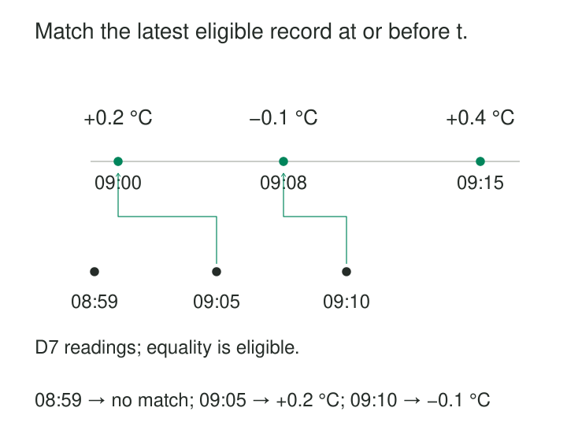

A temperature reading arrives at 09:05. Its device was calibrated at 09:00 and again at 09:08.

An equality join finds neither calibration. Joining to the latest calibration uses information from after the reading. An unrestricted inequality join returns several candidates and can multiply the measurement.

The intended question is precise: **Which calibration applied to this device at the reading’s timestamp?**

[[data-as-of-joins|As-of Joins]] aligns each observation with a time-relative reference record. The common historical form selects the latest eligible record at or before the observation time. Other forms look forward or choose nearby records, so direction belongs in the rule.

DuckDB describes this operation as a temporal lookup for timestamps that do not necessarily coincide. [DuckDB: AsOf joins](https://duckdb.org/2023/09/15/asof-joins-fuzzy-temporal-lookups.html)

## Define the match before choosing the syntax

A backward as-of lookup combines three decisions:

1. Match the relevant entity or business scope.
2. Admit reference records whose timestamp is at or before the observation.
3. Select the greatest eligible reference timestamp.

For a device, the equality key might be `device_id`. For a listed price, it might include product, market, and currency. Omitting part of the scope can attach another entity’s context even when the timestamp looks reasonable.

The result should contain at most one selected reference record per observation. Preserving unmatched observations is often essential: missing historical context is information worth reporting.

## Example: select the applicable calibration

Consider this illustrative calibration history for device D7:

| Effective time | Additive correction |
|---|---:|
| 09:00 | +0.2 °C |
| 09:08 | −0.1 °C |
| 09:15 | +0.4 °C |

A reading at 09:05 selects 09:00. A reading at 09:10 selects 09:08. A reading at 08:59 has no earlier calibration.



*Illustrative data on one UTC date. The example assumes a calibration continues applying until replaced, subject to any expiry policy.*

For a raw reading of 20.0 °C, the selected correction produces 20.2 °C at 09:05 and 19.9 °C at 09:10.

“Nearest timestamp” would be a different rule. At 09:05, the future 09:08 calibration is closer than 09:00, but it is ineligible for this backward lookup.

## A native implementation makes the intent visible

Snowflake expresses the example as:

```sql
SELECT
    r.reading_id, r.device_id, r.read_at,
    c.calibration_at, c.offset_celsius
FROM readings r
ASOF JOIN calibrations c
  MATCH_CONDITION(r.read_at >= c.calibration_at)
  ON r.device_id = c.device_id;
```

The equality condition establishes scope. The match condition establishes temporal direction and permits an exact timestamp match.

Snowflake’s documented behavior preserves left-side rows without a qualifying match, filling the selected right-side columns with nulls. [Snowflake: ASOF JOIN](https://docs.snowflake.com/en/sql-reference/constructs/asof-join)

An ordinary join on `calibration_at <= read_at` only generates candidates. It does not select the latest one automatically.

If implementing selection through ranking, partition by the unique observation identity. Partitioning only by device would collapse multiple readings into one winning row.

## Boundaries, ties, and expiry determine correctness

Decide whether an exact timestamp match is eligible. Using `<=` admits a reference beginning exactly at the observation time; using `<` requires it to precede the observation.

Normalize time zones and precision. Truncating one side to minutes while retaining seconds on the other can change eligibility.

Tied reference timestamps also need a policy. Two calibration records for D7 at 09:08 cannot be resolved meaningfully by timestamp alone. Use an authoritative revision, source precedence, or another defined discriminator. Snowflake explicitly documents nondeterministic selection when qualifying right-side records tie. [Snowflake: ASOF JOIN](https://docs.snowflake.com/en/sql-reference/constructs/asof-join)

Resolve those ties before the temporal lookup when the operator cannot express the required ordering.

Finally, latest does not mean sufficiently recent. A calibration may be expired, or a feature value too old to use. Define a maximum age where appropriate and expose the matched timestamp and age for diagnosis.

When rejecting stale matches, preserve the observation with an explicit unmatched or stale status. A careless post-join filter can silently remove it.

## Latest-before is not always interval containment

A sequence of reference changes often implies that each value continues until the next change. Under that assumption, latest-before selection represents the state at the observation time.

Explicit effective-dated records can have gaps, cancellations, or finite expiry. A record beginning yesterday might have ended before today’s observation.

In that case, the lookup must also respect the end boundary:

**valid_from ≤ observation_time < valid_to**

A native as-of operator is not automatically a complete interval-validity check. Validate the selected interval or use an appropriate interval join.

Overlapping intervals need resolution as well. Choosing the most recently started record merely hides an ambiguous model unless that precedence is an intentional business rule.

## Example: historical features can still contain later knowledge

A retention model makes a prediction at 10:00. An activity feature is effective from 09:30, but a delayed pipeline publishes it at 10:15.

A later training query using only `feature_time <= prediction_time` can attach that feature to the 10:00 prediction. Its business timestamp qualifies, but the prediction process could not have used it then.

This separates two requirements:

| Question | Relevant time |
|---|---|
| Which feature describes the business state then? | Effective or event time |
| Which feature was available to the prediction process then? | Recorded or publication time |

For availability-sensitive reconstruction, apply the knowledge cutoff before choosing the winning reference. Otherwise, a late-arriving candidate can displace an earlier available value.

The recording boundary must represent availability to the relevant process. Source ingestion, warehouse acceptance, and online feature publication can happen at different times.

“As-of” is therefore a query mechanism. Historical correctness depends on what its timestamps mean.

## A documented implementation: Feast historical retrieval

Feast documents point-in-time feature retrieval that joins feature histories onto entity rows with individual observation timestamps.

Its driver example retrieves historical feature values by driver identity and time. A feature-view TTL bounds how far backward retrieval searches. A row without a qualifying feature remains unmatched, including when its candidate lies outside the TTL window. [Feast: Point-in-time joins](https://docs.feast.dev/getting-started/concepts/point-in-time-joins)

The TTL is measured relative to each entity row’s timestamp—not the date when the historical query runs.

This implements a concrete backward lookup with an age limit. Whether a retrieval also reproduces historical availability depends on its timestamp definitions and configured handling of later arrivals or corrections.

Databricks similarly documents timestamp-based feature lookups and optional lookback windows. [Databricks: Point-in-time feature joins](https://docs.databricks.com/aws/en/machine-learning/feature-store/time-series)

## Preserve evidence and control the lookup cost

Retain the reference identity, selected timestamp, revision, and match status alongside enriched results when explanation or reproducibility matters. A later correction can otherwise change the answer when the join is rerun.

Do not automatically skip reference rows whose payload is null. A newer null may deliberately represent unavailable or cleared information; skipping it can revive an obsolete value.

Large inequality joins can generate many intermediate candidates. Native temporal operators can exploit the intended single-match relationship. DuckDB describes specialized as-of processing that avoids expressing the operation as a general inequality join followed by selection. [DuckDB: AsOf joins](https://duckdb.org/2023/09/15/asof-joins-fuzzy-temporal-lookups.html)

Filter scope carefully, but retain enough preceding history to match observations near the beginning of the requested window. Cutting both tables to the same date range can discard the reference that was already in force.

In streaming systems, late reference records also require a policy: delay enrichment, issue corrections, or retain a provisional result.

## Choose the historical perspective explicitly

Use as-of joins for event-time classifications, sensor context, historical prices, and feature retrieval where exact timestamp equality is unsuitable.

[[data-effective-dated-records|Effective-Dated Records]] defines when a reference applies. [[data-version-dimension-rows-scd-type-2|Version Dimension Rows — SCD Type 2]] preserves historical descriptions whose keys can be assigned through temporal lookup. [[data-recorded-time-history|Recorded-Time History]] supplies a knowledge boundary. [[data-bitemporal-records|Bitemporal Records]] combines applicability and recorded knowledge when one timestamp cannot express the required perspective.
