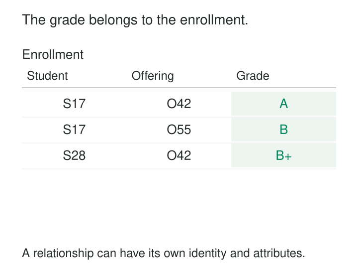

A student can attend several course offerings, and each offering has many students. Putting an `offering_id` on the student record allows only one offering. Putting a list of student IDs on the offering makes it awkward to record enrollment dates, withdrawals, or grades.

The missing object is the enrollment itself.

Associative Entities gives a relationship its own records. Each record identifies the participants and stores facts about their association. This makes many-to-many relationships explicit and provides a place for the relationship’s identity, attributes, and lifecycle.

## Give the relationship a meaningful name

An associative entity connects other entities through references. In a relational database, it is often implemented as a junction table, linking table, or join table.

A simple association might contain only two foreign keys. A richer association also carries information that belongs to the relationship: a membership’s start date, an enrollment’s grade, or a supplier offer’s price.

Each endpoint has a one-to-many relationship with the association. Together, those links represent the many-to-many relationship. Microsoft’s EF Core documentation describes this structure explicitly through its join entity type. [Microsoft: Many-to-Many Relationships](https://learn.microsoft.com/en-us/ef/core/modeling/relationships/many-to-many)

A business name helps establish meaning. `Enrollment`, `Membership`, and `SupplierOffer` communicate more than `StudentCourseLink` or `TableAB`. They encourage the model to express what one association represents.



## Example: the grade belongs to the enrollment

Consider these illustrative enrollment records:

| Student | Course offering | Enrollment date | Final grade |
|---|---|---|---|
| `S17` | `O42` | 2026-01-12 | A |
| `S17` | `O55` | 2026-01-13 | B |
| `S28` | `O42` | 2026-01-12 | B+ |

Maya, student `S17`, earns different grades in two offerings. Offering `O42` also has different grades for different students.

The grade therefore belongs to the enrollment. Neither the student nor the offering alone determines it.

A minimal implementation could be:

```sql
CREATE TABLE enrollment (
    student_id text NOT NULL REFERENCES student(student_id),
    offering_id text NOT NULL REFERENCES course_offering(offering_id),
    enrolled_on date NOT NULL,
    final_grade text,
    PRIMARY KEY (student_id, offering_id)
);
```

This expresses an important assumption: one enrollment per student and offering.

The offering must identify a particular delivery of a course, including the relevant term and section. Using only a reusable course definition would prevent the same student from taking it in a later term.

An enrollment can also have states such as registered, withdrawn, and completed. Withdrawal changes the relationship while leaving the student and offering intact. If attendance records or assessment results need to reference that participation, they can reference the enrollment.

## Example: the supplier’s offer carries the commercial terms

A product may be available from several suppliers, while each supplier sells many products.

For a fixed product unit and pricing context:

| Supplier | Product | Unit price, USD | Minimum order, units |
|---|---|---:|---:|
| North Supply | `P7` | 0.12 | 100 |
| Harbor Parts | `P7` | 0.11 | 1,000 |

The lower price comes with a larger minimum order. These terms describe each supplier’s offer for the product.

Storing the price on Product would imply one price across suppliers. Storing it on Supplier would imply one price across products. `SupplierOffer` places the terms at the appropriate grain.

The identifying rule needs the same care. If one supplier can offer different prices under several contracts, quantity tiers, or effective periods, the supplier–product pair no longer identifies one offer. Those distinctions need explicit representation.

The association might eventually become a substantial business entity with approval, negotiation, and expiry states. Its origin as a linking table does not restrict how much behavior it can legitimately acquire.

## The pair of references is not always the identity

A composite primary key is suitable when the participating identifiers uniquely determine one association.

A surrogate key can be useful when other records frequently reference the association or when its identity includes a more complicated context. It does not replace the business uniqueness rule. Two enrollment rows with different surrogate IDs can still be accidental duplicates.

Django’s intermediary-model mechanism illustrates this distinction. Its documentation supports extra fields on many-to-many relationships and advises adding a uniqueness constraint on the endpoints when multiple associations between the same instances should be prohibited. [Django: Extra Fields on Many-to-Many Relationships](https://docs.djangoproject.com/en/6.0/topics/db/models/#extra-fields-on-many-to-many-relationships)

History can change the key. A person who leaves and rejoins a project may have two membership episodes. A pair identifying current membership cannot also distinguish every historical episode without additional identity.

Adding a timestamp merely to make duplicates acceptable is insufficient. The model needs to explain what event or episode that timestamp distinguishes.

## A deployed implementation: PostgreSQL role memberships

PostgreSQL represents memberships between roles in its `pg_auth_members` catalog.

The catalog stores references to the role receiving a member, the member role, and the role that granted the membership. It also stores relationship-specific options, including whether the member can grant that membership to others and whether privileges are inherited. [PostgreSQL: pg_auth_members](https://www.postgresql.org/docs/18/catalog-pg-auth-members.html)

These are properties of a particular membership grant. They cannot be represented completely by attributes on either role alone.

The implementation also demonstrates why a two-column key should not be assumed. PostgreSQL 18 gives each catalog row an identifier and enforces uniqueness across **role, member, and grantor**. The grantor participates in distinguishing the stored associations. [PostgreSQL source: pg_auth_members.h](https://github.com/postgres/postgres/blob/REL_18_STABLE/src/include/catalog/pg_auth_members.h)

Both endpoints reference the same kind of entity, but play different roles in the relationship. Naming and direction remain important even when the referenced table is identical.

## What must hold for correctness

**One row needs a precise meaning.** Current membership, a membership episode, and a membership-change event are different grains. Combining them leads to ambiguous duplicates and updates.

**References must identify the intended participants.** Required references should be complete and enforced. Tenant-scoped identifiers need their scope preserved when forming relationships.

**Attributes must describe the association at that grain.** Student names belong to students; grades belong to enrollments. A relationship table should not become another place to maintain unrelated endpoint descriptions.

**Multiplicity must match the business rule.** If only one association is allowed for a combination, enforce that uniqueness. If several are legitimate, represent what distinguishes them.

Temporal rules may require more than uniqueness. Membership episodes can have distinct IDs while still overlapping in a way the business prohibits. Likewise, limiting an offering’s enrollment count requires additional logic; foreign keys and a composite key do not enforce capacity.

Relationships involving three participants may also need three references. Decomposing them into independent pairs can lose which complete combinations were valid.

## The operating cost of making relationships explicit

Associative entities are useful whenever both sides can have many counterparts, particularly when participation has dates, roles, quantities, terms, or status.

They replace embedded lists and repeating columns with records that can be constrained and queried. Their costs include more rows, additional joins, indexes, lifecycle handling, and migration work. Access paths should support queries from both endpoints.

Deletion behavior requires an explicit choice. Removing an endpoint may justify deleting simple tag associations, while completed enrollments or expired contractual relationships may need retention. Database cascades should follow that meaning.

Reporting also needs care. Joining product sales to every supplier offer can multiply sales rows. The association establishes valid relationships; it does not establish an allocation of each sale among suppliers. Filtering, aggregation, or allocation must follow the question being answered.

A separate associative entity adds little when a genuine one-to-many relationship is adequately represented by a foreign key on the dependent record. Its value comes from expressing the actual relationship and its facts.

## Related patterns

[[data-declare-the-grain|Declare the Grain]] establishes exactly what each association record represents.

[[data-composite-keys|Composite Keys]] identifies associations through their participants and required context.

[[data-normalized-relations|Normalized Relations]] keeps independently maintained facts in their appropriate relations. [[data-relationships-with-attributes|Relationships with Attributes]] explains why a grade belongs to an enrollment rather than to either endpoint; Associative Entities supplies the record structure for that relationship.

[[data-model-lifecycle-states-explicitly|Model Lifecycle States Explicitly]] makes registration, withdrawal, approval, expiry, and similar relationship transitions interpretable.
