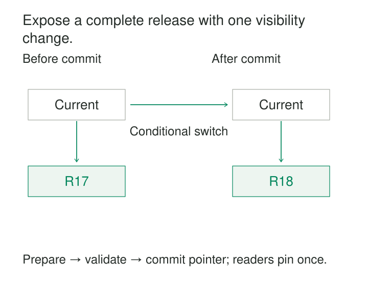

A pipeline replaces a product catalog in three files. The first upload succeeds. Before the other two finish, a reporting job starts reading.

It sees new products from the first file, old products from the second, and a missing third file. Every individual write may have succeeded correctly, yet the reader observes a dataset that never existed as a complete release.

Atomic Publication gives a dataset a clear visibility boundary. Readers use a complete previous version or a complete new version, according to the publication protocol.

Its purpose is to separate the work of preparing data from the moment that data becomes authoritative.

## Make the visibility change small

Building a dataset can involve thousands of writes. Publishing it can often be reduced to one transaction commit or one atomic metadata change.

A common design has three stages:

1. **Prepare:** build a new version without changing the version readers currently use.
2. **Validate:** establish that the proposed release is complete and acceptable.
3. **Commit:** atomically make that release the published version.

With immutable files, the commit usually changes a small pointer or catalog entry. With transactional tables, it may commit several related changes together.

The key idea is that the large preparation process does not become visible piece by piece.



This requires cooperation from readers. A consumer that bypasses the publication record and scans a directory containing unfinished output can still observe partial data.

## Example: publish a three-file catalog

A catalog pipeline creates release R18:

| Artifact | Purpose |
|---|---|
| `R18/part-1.parquet` | First data partition |
| `R18/part-2.parquet` | Second data partition |
| `R18/part-3.parquet` | Third data partition |
| `R18/manifest.json` | Exact file membership, schema, and release identity |

The writer uploads all three immutable data files, checks their availability, and writes the completed manifest. The published pointer still refers to R17 throughout this work.

Only then does it replace the pointer with a reference to R18’s manifest.

A reader resolves the pointer once, obtains R18, and reads exactly the files named in that manifest. It does not repeatedly ask for “latest” while fetching individual parts.

Amazon S3 provides a useful underlying primitive: updates to one object key are atomic, so a concurrent reader gets the old object or the new object rather than partially overwritten content. That can support a small publication-pointer object. It does not turn several independent object writes into one dataset transaction. [Amazon S3 consistency model](https://docs.aws.amazon.com/AmazonS3/latest/userguide/Welcome.html#ConsistencyModel)

The release paths must remain immutable after publication. Otherwise, a pinned manifest can still lead to changing content.

A completion marker can serve a similar role when readers require it before opening a uniquely identified release. A marker left beside files that continue changing provides no such boundary.

## Example: refresh a lookup table in one transaction

A category lookup contains an old classification scheme. The new scheme changes several labels and adds new categories.

Deleting the old rows and committing before inserting replacements exposes an empty table. Committing each replacement separately exposes a partial refresh.

For a suitably sized PostgreSQL table, the publisher can make the replacement one transaction:

```sql
BEGIN;

DELETE FROM category_lookup;

INSERT INTO category_lookup (category_id, category_name)
SELECT category_id, category_name
FROM category_staging
WHERE release_id = 'R18';

COMMIT;
```

The staging release must already have passed completeness and constraint checks, and concurrent publishers need coordination.

PostgreSQL transactions keep intermediate changes invisible to other transactions and make the committed changes visible together. If the replacement transaction fails, its deletion and insertion roll back together. [PostgreSQL transactions](https://www.postgresql.org/docs/current/tutorial-transactions.html)

Reader scope still matters. Under PostgreSQL’s default Read Committed isolation, each ordinary `SELECT` obtains its own snapshot. A report issuing several queries can therefore read one release before the commit and another afterward. A report needing one consistent database view across those queries requires suitable transaction isolation, such as Repeatable Read. [PostgreSQL transaction isolation](https://www.postgresql.org/docs/current/transaction-iso.html)

For a large table, rewriting everything in one transaction may impose excessive logging, storage, and transaction-management costs. Preparing a versioned replacement and switching a smaller publication reference can be more practical.

## Example: commit a lakehouse snapshot

A lakehouse table may contain thousands of data files. Adding them to storage one at a time should not make each file immediately part of the table.

Apache Iceberg implements this separation through snapshots and metadata. Writers prepare files and new metadata, then commit a new table version through an atomic metadata operation. Readers use the snapshot selected when they load table metadata and continue using it until they refresh. [Apache Iceberg specification](https://iceberg.apache.org/spec/#overview)

Concurrent writers must validate that the version they based their change on remains appropriate. A conflicting commit can require refreshing and revalidating the proposed update. The precise atomic commit mechanism depends on the catalog or table-tracking implementation. [Iceberg metadata commits](https://iceberg.apache.org/spec/#table-metadata)

The publication boundary belongs to that table. Updating two separate tables independently does not automatically publish a consistent pair.

If a reporting release requires orders snapshot 42 together with customers snapshot 17, a higher-level release manifest can identify both. Readers must resolve that bundle once and use its pinned versions.

## Concurrency needs more than an atomic overwrite

An atomic pointer replacement prevents readers from seeing a torn pointer. It does not prevent one publisher from overwriting another publisher’s valid release.

Suppose two jobs both prepare updates based on R17. One publishes R18. The other must detect that the current version changed before publishing its own result.

A compare-and-swap operation checks the expected previous value while performing the update. S3 supports conditional writes using `If-Match`, which rejects a write when the object’s ETag no longer matches the supplied value. [S3 conditional writes](https://docs.aws.amazon.com/AmazonS3/latest/userguide/conditional-writes.html)

A failed comparison requires revalidation. Blindly refreshing the pointer and retrying can let an older business release replace a newer one simply because its job finished later.

Publication ordering, ownership, and conflict policy must therefore be explicit.

## Handle failures around the commit boundary

The useful recovery question is: **Did the publication commit happen?**

| Failure | Expected reader behavior |
|---|---|
| Preparation fails | Continue using the previous release |
| Validation fails | Keep the proposed release unpublished |
| Commit succeeds but its response is lost | Resolve publication state before retrying |
| Cleanup fails afterward | Continue reading published data; reclaim storage later |

A stable release identity helps resolve an uncertain commit. A retry can inspect whether that release became current rather than creating another indistinguishable publication.

Unpublished files may remain after failure. They need eventual cleanup, but cleanup must distinguish abandoned output from files belonging to an active writer.

Rollback is another publication decision. Switching back to a retained previous version can restore its visibility, but it cannot undo exports, notifications, or decisions already made by downstream consumers.

## Retain the versions readers still need

Publishing R18 does not mean R17 is immediately disposable. A long-running query may already have pinned R17.

Safe reclamation needs a policy covering reader lifetimes, leases or references where available, cache lifetimes, and rollback requirements. Deleting old files too early turns a consistent snapshot into an unreadable one.

Caches can also delay adoption. Some readers may temporarily use R17 while others use R18. That can preserve complete-version reads while providing different freshness. Atomic publication does not imply that every reader switches simultaneously.

Validation remains a separate concern. A perfectly atomic release can contain incorrect totals, inconsistent source snapshots, or an unsupported schema. Publication makes a chosen version visible as a unit; quality checks establish whether it deserves publication.

## When the extra boundary is worthwhile

The pattern is especially useful for full refreshes, partition replacements, reference-data releases, search-index builds, and datasets spread across multiple files.

Costs include staging storage, retained generations, manifests, validation, catalog operations, and garbage collection. Keeping the previous release available also means serving older data while a replacement is being prepared.

Useful signals include the current release ID, publication age, preparation failures, commit conflicts, missing referenced artifacts, and orphaned storage.

## Related patterns

[[data-manifest-based-file-ingestion|Manifest-Based File Ingestion]] gives consumers an explicit inventory of a published file set. [[data-partition-replacement|Partition Replacement]] uses an atomic boundary when substituting rebuilt partitions.

[[data-checkpoint-and-resume|Checkpoint and Resume]] preserves recoverable progress while preparing or committing a release. [[data-idempotent-writes|Idempotent Writes]] makes retries safe when publication succeeds but confirmation is lost.
