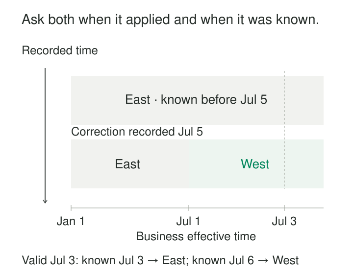

An account moved from East territory to West on July 1. The warehouse learned about the move on July 5.

Which territory should a July 3 report show?

That depends on the question. A corrected historical report should show West. Reproducing what the warehouse understood on July 3 should show East. Both answers are useful, but a single timeline cannot preserve the distinction.

[[data-bitemporal-records|Bitemporal Records]] tracks two independent periods: when information applies in the business, and when a particular system recorded that understanding. It lets a query ask:

**“What applied at this business time, according to what was recorded at that knowledge cutoff?”**

Fowler describes these as actual history and record history: the accepted business timeline, and the history of how that timeline became known. [Martin Fowler: Bitemporal History](https://martinfowler.com/articles/bitemporal-history.html)

## Give each timeline its own meaning

A bitemporal representation commonly includes four boundaries:

| Boundary | Meaning |
|---|---|
| `valid_from` | When the assertion begins applying in the business |
| `valid_to` | When that business applicability ends |
| `recorded_from` | When this version enters the system’s recorded history |
| `recorded_to` | When this recorded version is superseded |

The pairs answer different questions. A correction can move a business boundary into the past while entering recorded history today.

These are intervals, not merely creation and modification timestamps. Retaining only `created_at` and `updated_at` does not preserve the intervening values or earlier understandings.

XTDB documents this four-column model explicitly, using separate valid-time and system-time periods with inclusive starts and exclusive ends. [XTDB: Temporal columns and bitemporality](https://docs.xtdb.com/concepts/key-concepts.html)

## Example: preserve both answers about July 3

Suppose account A42 was initially recorded on January 10 as belonging to East from January 1 onward.

On July 5, the warehouse accepts a notice establishing West from July 1 onward.

A conceptual history now contains:

| Territory | Valid from | Valid to | Recorded from | Recorded to |
|---|---|---|---|---|
| East | January 1 | Open | January 10 | July 5 |
| East | January 1 | July 1 | July 5 | Open |
| West | July 1 | Open | July 5 | Open |

All dates are illustrative dates in 2026. Boundaries are inclusive at the start and exclusive at the end.

The first row preserves the earlier claim: East was understood to continue indefinitely. The later rows preserve the revised timeline: East ends when West begins.



*Each recorded-time slice contains a business-effective timeline. The diagram is schematic.*

For business date July 3:

- With a July 3 knowledge cutoff, the answer is East.
- With a July 6 knowledge cutoff, the answer is West.

The correction preserves the earlier report’s explanation while allowing later reports to use corrected history.

## A correction replaces an understanding

A tempting implementation changes the original East row’s business end to July 1, then inserts West.

Without preserving the original recorded version, that rewrites what the system previously claimed. A query for the earlier knowledge cutoff would encounter a boundary that had not yet been recorded.

Instead, close the earlier version’s recorded interval and introduce the revised business intervals under the new recording boundary. Database system-versioning can perform part of this bookkeeping automatically.

Publish the change atomically. Readers should not encounter East already shortened while West is still missing.

A correction affecting the middle of an interval may require splitting the business timeline into before, corrected, and after portions. Existing future changes must remain intact unless the correction explicitly supersedes them.

## Every historical query chooses two coordinates

For an explicit four-column table, a point lookup can be written as:

```sql
SELECT territory
FROM account_territory_history
WHERE account_id = :account_id
  AND valid_from <= :business_at
  AND (valid_to IS NULL OR :business_at < valid_to)
  AND recorded_from <= :known_at
  AND (recorded_to IS NULL OR :known_at < recorded_to);
```

Here, null represents an open upper boundary.

A business-time predicate alone can return several superseded understandings. A recorded-time predicate alone can return several business periods.

Native temporal databases can express these coordinates directly. IBM Db2 documents queries combining `FOR BUSINESS_TIME` and `FOR SYSTEM_TIME` on a bitemporal table. [IBM: Querying bitemporal data](https://www.ibm.com/docs/en/db2/11.5?topic=bt-querying)

Choose defaults deliberately. “Current knowledge about a past business date” differs from “the knowledge available when an earlier decision was made.”

## Example: revise a scheduled future price

A company records a price of $15 per month on June 10, effective July 1. On June 20, it corrects the scheduled price to $16, still effective July 1.

For a July 15 business date:

| Knowledge cutoff | Recorded scheduled price |
|---|---:|
| June 15 | $15 |
| June 25 | $16 |

This explains why two quotations for the same future service period could use different recorded schedules.

Business time can therefore lie after recorded time. Bitemporality supports advance notice as well as delayed notice.

A quotation that must remain reproducible should also retain its actual terms or referenced version. A queryable schedule does not, by itself, prove which inputs a particular quotation process used.

## Correctness depends on scope and capture

Two timelines do not remove ordinary modeling responsibilities.

**Define the entity and scope.** A price may depend on product, market, currency, and customer class. Leaving out one component can make legitimate alternatives look like conflicting versions.

**Define whose recording boundary matters.** Source acceptance, warehouse ingestion, and publication to a feature store occur at different moments. Source history cannot automatically establish downstream availability.

**Prevent ambiguity at each pair of coordinates.** For a single-valued attribute, one entity should have at most one answer for a given business time and recorded time. Business periods may overlap across superseded recorded versions; that overlap is expected. The ambiguity occurs when competing values apply at the same pair of coordinates.

**Handle gaps explicitly.** No matching row can mean unavailable history, an inactive relationship, or an assertion that has not yet been recorded. It does not automatically establish absence in the business.

Recording timestamps also inherit implementation semantics. SQL Server system periods, for example, use transaction begin time rather than commit time. Exact reproduction of reader visibility may require additional snapshot or publication identifiers. [Microsoft: Temporal tables](https://learn.microsoft.com/en-us/sql/relational-databases/tables/temporal/overview?view=sql-server-ver17)

## A documented implementation: XTDB address changes

XTDB’s documentation demonstrates an address change reported on August 13 but effective September 1.

An August 20 lookup still returns the old address. A lookup for a later business date returns the scheduled new address. System-time queries preserve the earlier recorded understanding alongside the changed valid-time timeline. [XTDB: Time in XTDB](https://docs.xtdb.com/about/time-in-xtdb.html)

Its query reference also documents independent defaults: system time uses the latest processed transaction on the queried node, while valid time defaults to the current clock time. Explicit temporal clauses override those defaults. [XTDB: SQL temporal queries](https://docs.xtdb.com/reference/main/sql/queries.html)

These mechanisms implement the two-coordinate model. Applications still determine authoritative dates, identities, and the meaning of each assertion.

## Pay for the second timeline when it matters

Bitemporal records are useful when late information and corrections must coexist with explanations of prior reports, decisions, or model inputs.

The costs include additional versions, interval maintenance, temporal indexes, more demanding joins, retention management, and a greater burden on readers. One correction can create several business segments while preserving their superseded predecessors.

Use consistent knowledge cutoffs across related tables. Joining historically selected accounts to today’s classifications can produce an incoherent result. Report logic, reference data, and model versions also matter for reproducibility.

Avoid adding bitemporality when a current corrected timeline plus a saved decision trace already answers the requirement. Retained history also contains assertions that may be wrong; temporal precision does not establish factual accuracy.

[[data-effective-dated-records|Effective-Dated Records]] supplies the business timeline. [[data-recorded-time-history|Recorded-Time History]] supplies the knowledge timeline. [[data-version-dimension-rows-scd-type-2|Version Dimension Rows — SCD Type 2]] offers a versioned-row structure, but its dates need explicit semantics. [[data-separate-source-facts-from-derived-interpretations|Separate Source Facts from Derived Interpretations]] helps preserve the evidence and rules behind each successive understanding.
