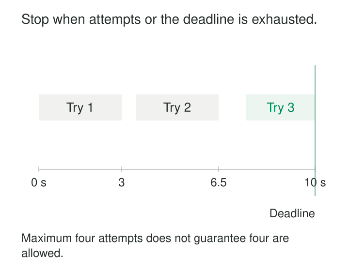

A database becomes unavailable for ten minutes. Each ingestion worker keeps retrying until it succeeds. Soon, workers hold thousands of pending requests, new work accumulates, and the recovering database receives a flood of repeated calls.

The retry loop was intended to improve reliability. Without a stopping rule, it becomes another source of failure.

Bounded Retries gives an operation a limited opportunity to recover automatically. It constrains attempts, elapsed time, and additional load, then moves unresolved work to an explicit outcome.

Its purpose is to recover from temporary failures without allowing one operation—or an entire fleet—to consume resources indefinitely.

## Bound more than the attempt count

“Retry three times” is incomplete. A single attempt might hang for hours, or retries might spend most of their lifetime sleeping.

A complete policy distinguishes several limits:

| Bound | What it controls |
|---|---|
| Attempt limit | How many executions are allowed |
| Per-attempt timeout | How long one execution may occupy resources |
| Operation deadline | How long the complete operation may take, including waits |
| Retry budget | How much additional traffic retries may generate |
| Work lifetime | How long deferred background work remains eligible for recovery |

These limits work together. Another attempt starts only when the failure is eligible, repeating the operation is safe, and the relevant budgets permit it.

A maximum is permission, not a requirement. The system should stop earlier when further attempts cannot be useful.

## Count attempts precisely

An **attempt** is an execution, including the initial one. A **retry** is an execution after an earlier attempt failed.

Three retries ordinarily permit four attempts. Configuration names do not always follow that convention.

The AWS SDK reference counts `max_attempts` as total attempts, including the initial request. Step Functions’ retrier `MaxAttempts` counts retries. A value of three therefore expresses different limits in these two interfaces. [AWS SDK retry settings](https://docs.aws.amazon.com/sdkref/latest/guide/feature-retry-behavior.html), [Step Functions retry fields](https://docs.aws.amazon.com/step-functions/latest/dg/concepts-error-handling.html#concepts-error-handling-retrying-after-an-error)

The policy also needs to identify its unit. Retrying a whole import job, one partition, one batch, and one network request are different operations with different costs.

A useful limit belongs to a named logical operation and includes the work performed by its underlying clients.

## Example: a read with ten seconds to finish

A metadata lookup permits four total attempts, a ten-second operation deadline, and a three-second per-attempt timeout.

One possible execution is:

| Activity | Elapsed time |
|---|---|
| Attempt 1 times out | 0–3 seconds |
| Backoff | 3–3.5 seconds |
| Attempt 2 times out | 3.5–6.5 seconds |
| Backoff | 6.5–7.5 seconds |
| Attempt 3 reaches the deadline | 7.5–10 seconds |

Although the count permits a fourth attempt, the time budget does not.

The third attempt receives a timeout of at most 2.5 seconds because that is all the operation has left. If the client cannot honor the remaining deadline, starting it may be inappropriate.

The deadline should cover the relevant waiting and request stages, including connection establishment and internal retries. A timeout that measures only socket reads may leave substantial work outside the intended bound.

AWS’s reliability guidance discusses this problem, including timeouts that fail to cover connection setup and other remote-call stages. [AWS guidance on timeouts and retries](https://aws.amazon.com/builders-library/timeouts-retries-and-backoff-with-jitter/)

Backoff and jitter determine spacing. They do not extend the deadline.

## Retry eligibility comes first

A bounded loop can still waste every permitted attempt on a permanent error.

A temporary connection failure may justify another try. An invalid schema or malformed query usually requires correction. Persistent throttling may require lower admission rates rather than more repetitions.

Classification should follow the dependency’s documented contract. Even familiar status codes can have service-specific meanings.

The operation’s age matters too. A metadata result needed for an interactive request may become useless after seconds. An overnight import can tolerate durable deferral, provided its source and recovery context remain available.

Choosing a bound therefore requires a recovery objective, not just a preferred integer.

## Example: a bulk load has an uncertain outcome

A warehouse load B42 times out. Its client cannot determine whether the destination committed.

Three more attempts are allowed, but blindly appending the batch could create duplicates. Exhausting the count would not prove that the original load failed.

The loader uses a stable batch identity and a destination-supported idempotency mechanism. It can retry safely or query the destination’s recorded outcome.

If immediate recovery still fails, it records B42 as unresolved and schedules reconciliation. It does not mark the partition successfully loaded merely because automatic retries ended.

The recovery record retains the batch identity, source manifest, error history, and destination context. A later worker continues the same logical operation.

This separates **stopping automatic attempts** from **abandoning the intended work**.

For background processing, durable deferral should have its own age and escalation limits. Moving an infinite loop into a queue does not make it bounded.

## Example: stop a poison message from cycling forever

A consumer receives an event with an unsupported schema version. Every delivery reaches the same parsing failure.

Immediate requeueing makes the event circulate without progress. It consumes worker time and may delay healthy messages.

The consumer classifies the failure as requiring intervention and transfers the event to durable quarantine, preserving its identity, payload, and diagnostic context. Transient processing failures can instead receive a limited number of delayed attempts before following that path.

RabbitMQ quorum queues provide a documented broker-level delivery limit. However, the counted event matters: current documentation explains that some explicit returns, including `basic.nack`, do not increment the failed-delivery count. A configured limit therefore does not necessarily bound every application requeue loop. [RabbitMQ poison-message handling](https://www.rabbitmq.com/docs/quorum-queues#poison-message-handling)

The handoff must also preserve the message. RabbitMQ documents different safety properties for dead-lettering configurations, including at-least-once dead-lettering support for quorum queues. Simply naming a dead-letter destination does not establish a lossless transfer. [RabbitMQ dead-lettering safety](https://www.rabbitmq.com/docs/dlx#re-publishing-with-publisher-confirms)

For ordered workflows, moving a prerequisite aside can make later messages invalid. Quarantine may need to pause the affected key rather than permit its dependent work to continue.

## Protect the dependency across many operations

Per-operation limits do not establish a fleet-wide load bound.

Two thousand logical operations with four attempts each can generate eight thousand calls. During a shared outage, those extra calls arrive precisely when the dependency has less capacity.

A retry budget limits additional attempts across a defined scope. It might use tokens replenished by successful requests or enforce a ratio of retries to original requests.

AWS documents retry quotas in its standard SDK strategy that can stop retries when the quota is exhausted. Exact behavior depends on SDK version and configuration; the newer documented behavior includes an opt-in transition. These budgets are generally client-scoped rather than automatically shared across a fleet. [AWS SDK retry quotas](https://docs.aws.amazon.com/sdkref/latest/guide/feature-retry-behavior.html#retry-quota)

Nested retry layers also multiply work. A scheduler, task wrapper, and SDK each allowing three attempts can generate up to 27 lowest-level calls. Retry ownership and budgets must account for those layers.

## Keep the bound through restarts

A counter stored only in worker memory resets when the process restarts. Requeueing or republishing under a fresh identity can have the same effect.

Durable work needs persisted attempt history or another authoritative lifetime bound. Operational redrive should be deliberate: Step Functions, for example, documents resetting relevant retry counts when an execution is redriven. [Step Functions redrive retry behavior](https://docs.aws.amazon.com/step-functions/latest/dg/concepts-error-handling.html#concepts-error-handling-retrying-after-an-error)

Ending the client’s wait also does not guarantee remote execution stopped. Timed-out work may continue consuming resources or produce a late effect. Cancellation, bounded concurrency, and idempotency remain separate requirements.

## Costs and useful limits

Bounded retries help with remote calls, partition loads, message handling, and workflow steps subject to temporary failure.

Limits that are too small expose recoverable errors to users or operators. Limits that are too large increase latency, cost, contention, and recovery time. There is no universal attempt count that balances these tradeoffs.

Monitor attempts per logical operation, successful recoveries, exhaustion reasons, unresolved outcomes, deferred-work age, and retry traffic. Distinguish “attempts exhausted” from “deadline exhausted” and “unsafe to repeat”; they call for different responses.

The stopping rule is only complete when unresolved work has a visible owner and recovery path.

## Related patterns

[[data-exponential-backoff-with-jitter|Exponential Backoff with Jitter]] spaces eligible attempts. [[data-idempotent-writes|Idempotent Writes]] protects effects when outcomes are uncertain.

[[data-checkpoint-and-resume|Checkpoint and Resume]] reduces the amount of work repeated after failure. [[data-transactional-inbox|Transactional Inbox]] preserves message-processing progress and duplicate protection across retries and restarts.
