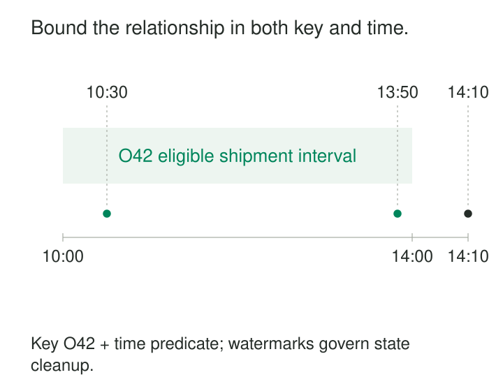

An order arrives on one stream. Its shipment arrives on another. Sometimes the shipment record reaches the processor first; sometimes it appears hours later.

Joining only records received in the same batch misses valid relationships. Remembering every order and shipment forever keeps matching opportunities open but lets state grow without limit.

**Bounded Stream-Stream Joins match events by key and a finite relationship between their timestamps.** The temporal condition defines which pairs are meaningful. Event-time progress and late-data policies tell the processor when retained records can stop waiting for possible partners.

The pattern makes continuous correlation practical when the business relationship has a defensible time horizon.

## Define the relationship before its retention

A bounded join normally combines two predicates:

1. The records share a suitable key.
2. Their timestamps satisfy a bounded relationship.

For example, a shipment qualifies when it references the same order and occurs between zero and four hours after order placement.

The lower and upper bounds both matter. A condition saying only “shipment time is after order time” leaves an order eligible to match shipments arbitrarily far into the future.

Flink documents this mechanism as an **interval join**: equality predicates identify related records, while temporal predicates bound their relationship. Its SQL implementation supports append-only inputs with time attributes. [Apache Flink interval-join documentation](https://nightlies.apache.org/flink/flink-docs-release-2.3/docs/sql/reference/queries/joins/#interval-joins)

“Bounded” describes the matching horizon. Predictable state also requires progressing inputs, workable lateness assumptions, and manageable event volume.



## Match shipments within four hours

Consider an illustrative order placed at 10:00:

| Order | Order time |
|---|---|
| O42 | 10:00 |

Its shipment stream contains:

| Shipment | Order | Shipment time | Qualifies? |
|---|---|---|---|
| S1 | O42 | 10:30 | Yes |
| S2 | O42 | 13:50 | Yes |
| S3 | O42 | 14:10 | No |

With inclusive bounds, the relationship can be expressed as:

```sql
SELECT o.order_id, s.shipment_id
FROM orders AS o
JOIN shipments AS s
  ON o.order_id = s.order_id
 AND s.ship_time >= o.order_time
 AND s.ship_time <= o.order_time + INTERVAL '4' HOUR;
```

In a streaming implementation, both time fields need the appropriate event-time configuration and progress policy.

The output contains two pairs: `(O42, S1)` and `(O42, S2)`. The interval does not select a single shipment.

If the order amount is `100` and is copied onto both output rows, summing that amount produces `200`. The output grain is **one qualifying order–shipment pair**. A question such as “was this order shipped within four hours?” needs an existence calculation or another explicit reduction to one result per order.

The horizon also defines the question’s limits. S3 is a real shipment, but this particular computation measures shipments occurring within four hours.

## Buffer both sides because arrival order can reverse

A stateful join retains eligible records from each stream. When a record arrives, it searches the opposite side’s retained state for matching keys and timestamps.

Thus, S1 can match O42 even if S1 reaches the processor first. Once O42 arrives, the join can discover their relationship—provided S1 is still retained and both records remain eligible.

Spark’s documented stream-stream join model buffers both inputs. It combines watermarks with event-time constraints so the engine can determine when older records are no longer needed. [Spark Structured Streaming join documentation](https://spark.apache.org/docs/latest/streaming/apis-on-dataframes-and-datasets.html#join-operations)

This exposes two independent limits:

- **Business horizon:** how far apart the events may occur.
- **Arrival tolerance:** how much disorder or delay the runtime accepts.

A shipment occurring at 13:50 can satisfy the four-hour relationship but arrive after the order’s state has been removed. A shipment occurring at 14:10 fails the relationship even if delivered immediately.

Increasing arrival tolerance does not expand the business horizon.

## Retire state using the opposite stream’s progress

For O42 at 10:00, the latest qualifying shipment timestamp is 14:00. Its retained order record remains potentially useful until the relevant shipment-side progress and lateness policy establish that no further accepted match can arrive.

The reverse calculation differs. A shipment timestamped 13:50 can match orders placed between 09:50 and 13:50 under the same rule. Its retention therefore depends on progress through that order-time range.

An arbitrary processing-time TTL does not establish either condition. Deleting records after four wall-clock hours can lose matches during an outage or backlog.

The exact cleanup calculation depends on the engine, its watermark combination, endpoint conventions, and supported late-data behavior. Test those semantics rather than assuming every interval-join API implements the same retention policy.

Flink’s DataStream interval join, for example, exposes inclusive bounds by default and options to make them exclusive. [Apache Flink DataStream interval joins](https://nightlies.apache.org/flink/flink-docs-release-2.3/docs/dev/datastream/operators/joining/#interval-join)

## An unmatched result requires evidence of absence

Suppose O43 has no observed shipment. An inner join produces no pair, but a left outer join may need to publish “no qualifying shipment.”

Publishing that immediately would confuse “nothing observed yet” with “nothing qualifying arrived under the policy.”

Spark documents delayed unmatched outer-join results based on watermark progress and the temporal condition. It also notes that input silence can delay their production. [Spark outer-join semantics](https://spark.apache.org/docs/latest/streaming/apis-on-dataframes-and-datasets.html#outer-joins-with-watermarking)

An unmatched result should therefore mean **no accepted match within the defined horizon**. It does not prove that the order will never ship.

A valid shipment discovered after live cleanup may require historical repair. If consumers receive provisional unmatched results earlier, they also need a correction protocol.

## Temporal proximity can produce several plausible matches

Consider an advertising stream:

| Event | Key | Event time |
|---|---|---|
| Impression I1 | Campaign C7 | 10:00 |
| Impression I2 | Campaign C7 | 10:03 |
| Click K1 | Campaign C7 | 10:04 |

A rule matching clicks to impressions from the preceding thirty minutes produces two pairs. Both satisfy the key and temporal predicates.

That does not establish which impression caused the click. A specific impression identifier would provide stronger correlation. Otherwise, selecting the nearest or latest impression is an additional attribution rule.

Kafka Streams explicitly documents that one input record produces an output for each matching record on the other side. Its stream-stream joins also require compatible partitioning by key. [Kafka Streams join documentation](https://kafka.apache.org/41/streams/developer-guide/dsl-api/#joining)

Repeated deliveries amplify this behavior. Two copies of an impression and three copies of its click can produce six matching pairs. Deduplicate according to event identity where required, and give output pairs identities such as `(impression_id, click_id)` for retry protection.

## A shared window is a different temporal rule

Putting both streams into five-minute tumbling windows and joining equal window identifiers does not implement “events within five minutes of each other.”

Events at 10:04:59 and 10:05:01 are two seconds apart but occupy different windows.

Flink distinguishes window joins, which require a common key and window, from interval joins, which compare timestamps relative to one another. [Apache Flink joining documentation](https://nightlies.apache.org/flink/flink-docs-release-2.3/docs/dev/datastream/operators/joining/)

Choose window equality when shared reporting-period membership is intended. Choose an interval when relative temporal distance defines the relationship.

## Budget for state, skew, and fan-out

This pattern is useful for request–response correlation, order–shipment analysis, sensor-event association, and other relationships bounded in time.

Costs include buffering both inputs, repartitioning, timestamp indexes, checkpoints, recovery, and output writes. Longer horizons and more conservative lateness policies retain more records. Hot keys can generate many candidate pairs even within a short interval.

A stalled input can prevent safe cleanup while the other stream continues accumulating state. Event-time bounds therefore provide a cleanup opportunity, not a hard memory ceiling.

Correctness also assumes compatible clocks, stable keys, defined endpoint behavior, and understood update semantics. Append-only interval joins should not be assumed to propagate later source corrections or deletions automatically.

Verification should cover reversed arrival order, exact boundaries, delayed partners, unmatched output, duplicate delivery, and several legitimate matches per key. Compare the resulting pair set with a bounded offline calculation over the same accepted input.

## Related patterns

[[data-watermarks|Watermarks]] supplies the progress evidence used for retention and unmatched results.

[[data-stateful-stream-deduplication|Stateful Stream Deduplication]] prevents repeated deliveries from multiplying pairs.

[[data-as-of-joins|As-of Joins]] selects a historical reference version when enrichment, rather than event-pair correlation, is the goal.

[[data-historical-restatement|Historical Restatement]] repairs relationships discovered beyond the live acceptance horizon.
