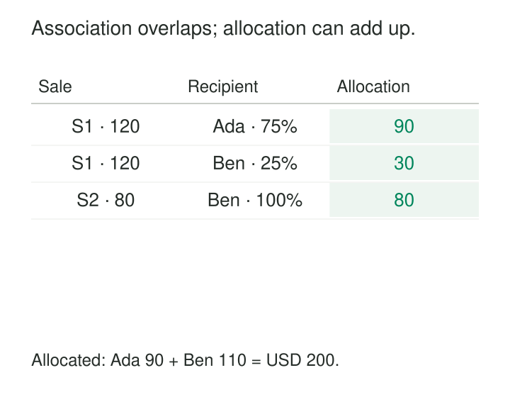

A sale worth USD 120 belongs to two sales representatives. Another sale worth USD 80 belongs to one of them.

The warehouse contains USD 200 of sales. After joining sales to representatives, a report adds up USD 320.

The relationships are real. The problem is that one sale now appears alongside more than one representative, and the report has treated those appearances as separate sales.

**Bridge Tables represent multivalued relationships explicitly while preserving the grain of the measurements they connect.** They let a fact relate to several dimension members, or one dimension member relate to several others.

The design must also specify what analysis across that relationship means: association, distinct coverage, or allocation.

## Give the relationship its own rows

A conventional star schema associates each fact row with one member of each directly attached dimension. Some relationships legitimately have several members: a sale has several representatives, an account has several holders, or an employee has several skills.

A bridge records those associations individually.

For a reusable group design, the fact carries a group key and the bridge contains one row per group member. Another design connects individual fact identifiers directly to members.

Kimball documents the group-key approach for multivalued dimensions, allowing a single fact to retain its measurement grain while referring to several dimension members. [Kimball: Multivalued Dimensions and Bridge Tables](https://www.kimballgroup.com/data-warehouse-business-intelligence-resources/kimball-techniques/dimensional-modeling-techniques/multivalued-dimension-bridge-table/)

Declare the bridge’s own grain. It might be “one representative in one sales-credit group,” or “one customer-account association during one valid interval.” Roles, versions, and dates can be part of that identity.

## Example: allocate sales credit without duplicating revenue

Consider two illustrative sales:

| Sale | Amount USD |
|---|---:|
| S1 | 120 |
| S2 | 80 |

The agreed credit allocation is:

| Sale | Representative | Weight |
|---|---|---:|
| S1 | Ada | 0.75 |
| S1 | Ben | 0.25 |
| S2 | Ben | 1.00 |

The sale remains one fact. The bridge describes how its amount is allocated.



A query applying those weights is straightforward:

```sql
select b.person_id,
       sum(s.amount_usd * b.weight) as allocated_usd
from sales s
join sale_person_bridge b
  on b.sale_id = s.sale_id
group by b.person_id;
```

Ada receives 120 × 0.75 = 90. Ben receives 120 × 0.25 + 80 = 110. Their allocated amounts sum to the original USD 200.

The weights express a business policy. The database cannot infer that 75/25 is the correct division.

For an ordinary complete proportional allocation, weights should be nonnegative and total one for each applicable fact or group. Define the policy’s scope: the same weight may not be appropriate for revenue, units, and commission.

Use appropriate numeric precision and a documented rounding rule when allocations must reconcile to individual cents.

## Association answers a different question

Suppose the question is instead: “What sales was each person involved in?”

Ada is associated with USD 120. Ben is associated with USD 200. Those answers are valid, but they overlap.

Adding them produces USD 320 because S1 appears in both groups. An “all selected representatives” total based on the union of their sales is still USD 200.

Give these measures distinct names, such as **Associated Sales** and **Allocated Sales**. Explain that associated amounts are non-additive across overlapping groups.

Filtering also needs a clear interpretation. Selecting only Ada does not normally change her allocated share from 75% to 100%. Renormalizing weights after filtering silently changes the question.

For “sales involving any selected representative,” a semi-join or `EXISTS` condition can select each fact once. `SUM(DISTINCT amount)` is unsafe: different sales can legitimately have equal amounts.

## A documented implementation: customers and joint accounts

Microsoft’s Power BI guidance demonstrates a bridge between customers and accounts. One account belongs to two customers; another belongs to only one.

In its worked example, the account balances total 275. One customer is associated with 75 and the other with 275, while the combined total remains 275. Summing the customer rows would produce 350 because the shared account appears in both associations.

The example also demonstrates that relationship direction matters: filters must travel from the selected customer through the bridge to the relevant accounts and transactions. [Microsoft: Many-to-many relationship guidance](https://learn.microsoft.com/en-us/power-bi/guidance/relationships-many-to-many)

This is a documented semantic-model implementation, rather than a requirement to divide joint accounts into ownership percentages.

Configure filter paths deliberately. Broadly enabling bidirectional filtering can create ambiguity in a larger model. Test single-member selections, multiple selections, and grand totals against the intended measure definitions.

## Example: preserve membership as it changes

A project initially involves Ada and Ben. On June 1, Ada leaves and Cora joins.

A May activity should remain associated with the May team when the report asks who participated at the time. Joining every historical activity to the current membership would incorrectly associate Cora with that earlier work.

Two common approaches preserve the distinction.

An immutable membership group can be referenced by the original facts, with a new group created when membership changes. Alternatively, an effective-dated bridge can select associations using the activity’s date.

Kimball specifically describes effective and expiration timestamps for bridges whose relationships change over time, together with constraining the query to the relevant moment. [Kimball: Multivalued Dimensions and Bridge Tables](https://www.kimballgroup.com/data-warehouse-business-intelligence-resources/kimball-techniques/dimensional-modeling-techniques/multivalued-dimension-bridge-table/)

Historical dimension versions also need consistent treatment. Current-membership analysis can be useful, but it should be an explicit alternative perspective.

Reusable group identity must include the relevant semantics. Ada/Ben at 75/25 is different from Ada/Ben at 25/75, even though the member list is unchanged.

## Validate the bridge as carefully as the facts

Duplicate associations can multiply measures again. Enforce uniqueness at the declared bridge grain, including role or validity where those are meaningful.

Check that referenced facts, groups, and dimension members exist. Where relationships are dated, test interval boundaries and unintended overlaps.

Missing associations need a policy. An inner join can quietly remove an otherwise valid fact. Depending on the model, an unassigned category or visible exception may preserve that fact while ownership is resolved.

For allocations, check weight totals and reconcile allocated measures to their source amounts. Report incomplete allocation visibly rather than disguising it as a complete distribution.

Also test combinations of bridges. Joining a sale to two representatives and three campaign tags can create six combinations. A weight that correctly allocates across representatives does not automatically protect the measure from multiplication across campaigns.

Filter one relationship before aggregating, or define a justified joint allocation when that is the intended analysis.

## Costs, alternatives, and useful situations

Bridge tables help when multiplicity is real, the number of associated values varies, and consumers need to filter or group by those values.

Their costs include additional rows, joins, indexing, temporal maintenance, allocation governance, and more demanding semantic-model behavior. Large groups can substantially expand intermediate query results.

Kimball notes both over-counting risks and usability difficulties, and discusses alternatives such as allocating measures at a finer fact grain or retaining a clearly designated primary relationship. [Kimball: Potential Bridge Table Detours](https://www.kimballgroup.com/2014/05/design-tip-166-potential-bridge-table-detours/)

An allocated fact table can simplify common queries when allocation is the central business meaning. A primary representative can simplify reporting when that role genuinely answers the question. Neither choice preserves every form of multivalued analysis.

A bridge makes the relationships explicit. Correct totals still depend on the question, measure definitions, filtering behavior, and complete relationship data.

## Related patterns

[[data-associative-entities|Associative Entities]] provides the broader relational idea of giving a relationship its own record.

[[data-relationships-with-attributes|Relationships with Attributes]] places roles, dates, and allocation weights on those associations.

[[data-factless-fact-tables|Factless Fact Tables]] can represent membership without numeric measures. [[data-effective-dated-records|Effective-Dated Records]] preserves changing associations, while [[data-declare-the-grain|Declare the Grain]] keeps both the bridge and the connected facts understandable.
