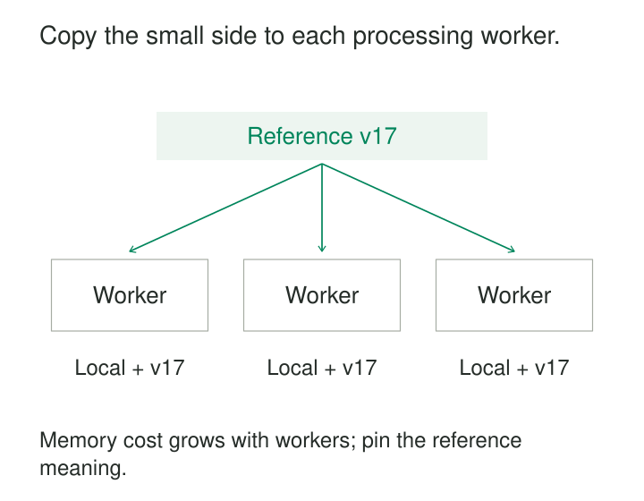

A pipeline joins millions of events to a small reference table. The events already sit across many workers, but the join redistributes them by reference key so matching records meet on the same machine. Most of the network traffic carries the large input.

**Broadcast Small Inputs copies the smaller input to every participating worker, allowing each worker to process its share of the larger input locally.**

The pattern trades replicated storage and distribution work for less movement of the large dataset. It is especially useful for enrichment with compact reference data, such as country mappings, product categories, or processing rules.

## Move the lookup to the work

In a partitioned hash join, records are distributed by join key so corresponding values meet. In a broadcast hash join, each worker receives the complete small input and builds a local lookup structure. Records from the large input probe that structure where they are already being processed.

Trino implements both distributions. Its documentation emphasizes the defining constraint: the broadcast build side, after filtering, must fit in memory on each participating node. [Trino join distribution](https://trino.io/docs/current/optimizer/cost-based-optimizations.html#join-distribution-selection)



The large input still has to be read and processed. Earlier or later operations may still require redistribution. Broadcasting avoids movement needed for this particular join; it does not eliminate every shuffle in the job.

“Small” means small enough in the representation and concurrency conditions of execution. A lookup that is tiny compared with a trillion-row fact table can still be too large to replicate safely.

## Example: enrich events with a fixed country mapping

Suppose an event dataset contains country codes and amounts:

| event_id | country_code | amount |
|---|---|---:|
| E1 | DE | 30 |
| E2 | US | 20 |
| E3 | DE | 40 |

A compact reference snapshot maps `DE` to Europe and `US` to North America. Each worker receives that snapshot and enriches its local events.

In Spark SQL, a broadcast hint can express the intended strategy:

```sql
SELECT /*+ BROADCAST(r) */
       e.event_id, r.region, e.amount
FROM events e
LEFT JOIN country_regions_v17 r
  ON e.country_code = r.country_code;
```

Here, `country_regions_v17` represents an immutable reference version. The left join retains events whose country code has no mapping, leaving the region null for explicit handling.

Spark supports broadcast join hints, although the requested strategy is not guaranteed for every join type. [Spark join hints](https://spark.apache.org/docs/latest/sql-ref-syntax-qry-select-hints.html#join-hints)

The mapping must also satisfy the intended cardinality. If two reference rows match `DE`, an ordinary join produces two output rows for each German event. Broadcasting preserves that multiplication. It does not turn a many-to-many join into a lookup.

The performance gain comes from distributing the small mapping instead of repartitioning the event dataset by country. A subsequent total by region may still require an aggregation shuffle.

## Measure the expanded copy

The file size of the reference table is a poor memory budget. Compressed storage, serialized transfer, and an in-memory hash structure can have substantially different sizes.

A useful planning relationship is:

> Replicated footprint ≈ number of resident copies × resident size per copy.

If a measured lookup occupies 20 MB and there are 100 resident copies, it consumes roughly 2 GB across those copies. The practical question remains whether each process has room for its local copy alongside buffers, other joins, and concurrent queries.

Replica counts depend on the engine’s execution model. Do not assume there is exactly one copy per physical machine.

Filter unnecessary reference rows and remove unused fields before broadcasting. A product table with descriptions, images, and historical versions may become a suitable lookup after selecting only current product identifiers and categories.

Good statistics help an optimizer choose sensibly. Spark uses estimated and runtime sizes, and its adaptive execution can convert a suitable sort-merge join into a broadcast join. A forced broadcast hint can prioritize broadcasting even above the automatic size threshold. [Spark performance tuning](https://spark.apache.org/docs/latest/sql-performance-tuning.html#optimizing-the-join-strategy)

Increasing that threshold does not create memory.

## Example: enrich a stream without repartitioning it

An order stream is partitioned by customer because downstream processing needs customer order. Each order also carries a product identifier, and enrichment needs a compact product-category table.

Repartitioning orders by product merely to perform the enrichment can interfere with that useful placement. Kafka Streams offers a `GlobalKTable`: every application instance consumes every partition of the reference topic and maintains the complete table locally. A stream can join against it without repartitioning the input stream for that lookup. [Kafka Streams GlobalKTable](https://kafka.apache.org/42/javadoc/org/apache/kafka/streams/kstream/GlobalKTable.html)

For example, customer C7’s order for product P42 can obtain its category from the local product copy while the order remains on its customer-oriented processing path.

The reference data is bootstrapped at startup and maintained separately. Kafka’s documentation explicitly warns that updates are not synchronized with stream time and can lead to nondeterministic results.

That makes this suitable when the application accepts the reference value available during processing. It does not automatically provide the category that was effective when the order occurred. A replay after a category change may produce a different enrichment unless the required reference version is retained and selected explicitly.

## Example: distribute changing rules to live workers

A device-monitoring application processes a high-volume measurement stream and a much smaller stream of alert rules. Each processing task needs the applicable rules locally.

Flink’s broadcast state pattern distributes rule updates to downstream tasks, where they are stored and used against incoming records. Its documented example separates a stream of items from a changing stream of matching rules. [Flink broadcast state](https://nightlies.apache.org/flink/flink-docs-stable/docs/dev/datastream/fault-tolerance/broadcast_state/)

Suppose rule R5 changes from version 17 to version 18. Blindly replacing state with the last update received can be unsafe: Flink warns that broadcast updates may arrive in different orders at different tasks.

A version-aware update rule can retain the highest valid version for each rule identifier, with an explicit policy for conflicting equal versions. Versioned removals must also prevent an older delayed update from restoring a deleted rule.

That addresses convergence of the rule copies. It does not establish a simultaneous switch across all tasks. If every measurement must use the rule effective at its event time, the application additionally needs retained history and a temporal selection policy.

Flink also keeps broadcast state in memory and checkpoints it at every parallel task, so replication affects recovery storage as well as runtime capacity. [Flink broadcast-state considerations](https://nightlies.apache.org/flink/flink-docs-stable/docs/dev/datastream/fault-tolerance/broadcast_state/#important-considerations)

## When replication stops paying

Broadcasting works well when one input is compact, reused heavily, and inexpensive to distribute relative to moving the large input. It can also avoid concentrating a popular lookup key’s probe traffic on one join worker, although uneven input partitions can still cause imbalance.

The case weakens as the lookup grows, update frequency rises, or many queries maintain separate copies. Scaling out adds processing capacity but also adds replication, initialization, and recovery work.

Broadcasting also does not make expensive matching cheap. Without a suitable equality key, Spark may use a broadcast nested-loop strategy. A small input compared against every large-input record can still generate substantial computation. [Spark broadcast strategies](https://spark.apache.org/docs/latest/sql-performance-tuning.html#join-strategy-hints)

Verify the actual plan, reference size, peak memory, distribution time, and bytes shuffled. For long-running applications, include startup duration, update lag, checkpoint size, and recovery time.

Common mistakes are forcing broadcast from stale size estimates, budgeting from compressed files, ignoring duplicate lookup keys, and treating replicated reference data as an automatically consistent historical snapshot.

## Nearby patterns

[[data-predicate-projection-pushdown|Predicate and Projection Pushdown]] reduces the input before replication, often making broadcast practical.

**Stream-Table Enrichment** describes the enrichment relationship. Broadcast is one way to place the table near stream processing.

[[data-as-of-joins|As-of Joins]] define which historical reference version applies to an event; replication alone leaves that question open.

[[data-workload-isolation|Workload Isolation]] helps protect live processing when broadcasts, initialization, or concurrent analytical joins compete for memory and bandwidth.
