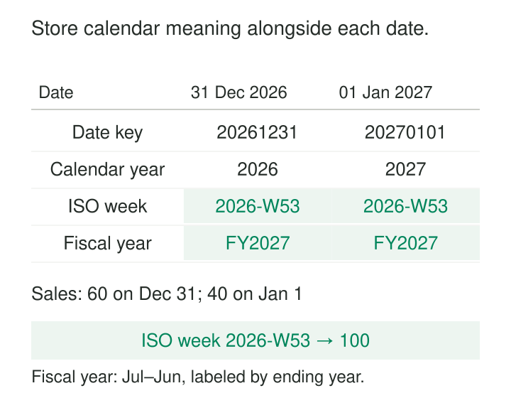

A weekly report splits New Year’s activity between two years. Finance keeps the same activity in one fiscal year. Operations counts a public holiday as a working day because its calculation excludes only weekends.

The dates are correct. Their business interpretation is inconsistent.

**Calendar Dimensions store the agreed attributes of dates so that datasets and reports can use consistent periods, labels, and business-day rules.** A typical base dimension has one row per calendar date, with attributes such as calendar year, ISO week, month, fiscal period, and relevant operating-day classifications.

The purpose is to make calendar meaning explicit, reusable, and reviewable instead of rebuilding it independently in every query.

## Store date meaning alongside the date

A date dimension normally contains an actual date column and a key used by facts. The key may be sequential or a meaningful integer such as `20270101`.

Its other attributes support interpretation and navigation:

| Attribute | Question it answers |
|---|---|
| Calendar year and month | Which ordinary calendar period contains this date? |
| ISO week and ISO year | Which week-numbering period contains it? |
| Fiscal year and period | Where does it fall in the organization’s reporting calendar? |
| Business-day classification | Is it an operating day under the selected calendar? |
| Period boundaries | Which dates start or end the relevant period? |

Kimball’s calendar-dimension guidance includes fiscal periods, week numbers, holidays, and other descriptive date attributes. It also recommends using those attributes for filtering and grouping, even when the key itself encodes a date. [Kimball: Calendar Date Dimensions](https://www.kimballgroup.com/data-warehouse-business-intelligence-resources/kimball-techniques/dimensional-modeling-techniques/calendar-date-dimension/)

A meaningful key remains an identifier. Adding one to `20261231` does not produce the next valid date.

## Example: two dates, three different year assignments

Consider December 31, 2026 and January 1, 2027.

Their ordinary calendar years differ. Both belong to ISO week **2026-W53**. Under an illustrative fiscal calendar running July through June and named by its ending year, both belong to **FY2027**.



*The fiscal convention is an explicit example. Organizations can use different boundaries and naming rules.*

If sales are 60 on December 31 and 40 on January 1, the ISO-week total is 100. Grouping by ordinary calendar year instead separates the amounts.

Store ISO year together with ISO week. Combining week 53 with January’s calendar year would mislabel the period. PostgreSQL’s documentation explicitly notes that ISO week-numbering years can differ from ordinary calendar years around January and December. [PostgreSQL date/time functions](https://www.postgresql.org/docs/current/functions-datetime.html)

Fiscal periods need their own approved mapping. A week-based retail calendar, for example, cannot safely be inferred from an ordinary month number.

## Example: working days depend on the selected calendar

Two facilities operate on Monday, May 3, 2027. Facility A closes for a planned event on Tuesday, May 4; Facility B remains open.

Counting open dates across those two days gives:

| Operating calendar | May 3 | May 4 | Open dates |
|---|---|---|---:|
| Facility A | Open | Closed | 1 |
| Facility B | Open | Open | 2 |

A single global `is_working_day` flag cannot represent both answers.

For a small, stable set of calendars, separate named attributes may suffice. For many locations or policies, use a base date dimension plus a calendar-specific mapping identified by calendar and date.

The selected calendar must be part of the join or filter. Joining a fact date to every location’s calendar can multiply the fact.

Holiday names, observed holidays, closures, and operating days also express different concepts. A holiday may fall on a weekend while its observed closure occurs on another date. Half-days and shifts may require richer operating schedules than one Boolean flag.

## Derive the business date before assigning its key

A calendar dimension describes dates. An event timestamp must first be interpreted under the relevant time-zone and business-date rule.

For example, January 1, 2027 at 00:30 UTC is December 31, 2026 at 19:30 in New York. Grouping that event by UTC date and grouping it by New York local date produce different assignments.

Preserve the original timestamp and derive explicitly named date roles, such as `event_date_utc` and `store_business_date`. Avoid relying on a database session’s default time zone.

PostgreSQL documents time-zone conversion through `AT TIME ZONE`, illustrating that the conversion is a separate operation from extracting date attributes. [PostgreSQL date/time functions](https://www.postgresql.org/docs/current/functions-datetime.html#FUNCTIONS-DATETIME-ZONECONVERT)

A business day may also start at a defined cutoff rather than midnight. That rule belongs in the transformation contract.

A date dimension alone cannot describe elapsed hours across daylight-saving changes or every interval within an operating shift.

## Example: show days with no activity

Merchant M7 has USD 60 of sales on October 1, no sales on October 2, and USD 40 on October 3.

A query starting only from sales returns two dates. A report averaging those rows produces 50 per observed sales day. A report covering all three calendar days produces approximately 33.33 per calendar day.

The calendar supplies the reporting dates:

```sql
select d.calendar_date,
       coalesce(s.net_usd, 0) as net_usd
from dim_date d
left join daily_sales s
  on s.date_key = d.date_key
 and s.merchant_id = 'M7'
 and s.currency = 'USD'
where d.calendar_date >= date '2026-10-01'
  and d.calendar_date <  date '2026-10-04';
```

This assumes one sales row per merchant, currency, and date, that M7 is in scope throughout the period, and that capture is complete. An absent row can then mean zero activity.

If October 2 is missing because ingestion failed, replacing it with zero invents a business result. Preserve an incomplete or unknown state instead.

For reports involving many stores or accounts, the required coverage may be valid entity-date combinations rather than every entity crossed with every historical date.

## A documented implementation: Power BI date tables

Microsoft’s Power BI guidance describes date tables containing one row per date and supporting period-based filtering and grouping.

Its documented requirements include unique date values, no blanks or missing dates, and coverage of full years. It also distinguishes configuration requirements for Classic and Calendar-based time intelligence. [Microsoft: Date-table design guidance](https://learn.microsoft.com/en-us/power-bi/guidance/model-date-tables)

This provides a concrete implementation of the pattern in a semantic model. A governed warehouse date dimension can supply that table, allowing multiple reports to share the same definitions.

Check the requirements of the actual reporting engine. A table containing a few dates observed in sales is not necessarily a valid date table for its time-intelligence functions.

## Handle date roles, unknowns, and future periods

The same date dimension can serve several roles: order date, promised date, shipment date, and delivery date. Name those relationships clearly so a report’s filters have an understandable meaning.

An unknown delivery date should not be replaced with a plausible real date simply to satisfy a join. Kimball describes special members for unknown or undetermined dates. Where a BI engine requires an exclusively valid, contiguous date column, expose the valid-date range separately from such warehouse sentinel members. [Kimball: Calendar Date Dimensions](https://www.kimballgroup.com/data-warehouse-business-intelligence-resources/kimball-techniques/dimensional-modeling-techniques/calendar-date-dimension/)

Generate sufficient future coverage for forecasts, commitments, and scheduled work. A calendar built only from observed transactions may omit dates consumers already need.

## Maintain rules without silently changing history

Ordinary date attributes are predictable, but business-calendar assignments can change.

A newly declared closure or revised fiscal mapping may alter working-day calculations and period totals. Record who owns the calendar, the applicable convention, and how changes affect historical reporting.

When consumers need both the originally published calendar and a revised interpretation, retain identifiable versions or separate mappings. Overwriting a fiscal-period assignment can restate history even though the facts remain unchanged.

Test year transitions, leap days, fiscal boundaries, closures, date continuity, and calendar-specific uniqueness. Labels also need stable sort attributes: month names alone do not establish chronological order.

## Costs, uses, and limits

Calendar dimensions are useful wherever multiple reports share business periods, operating-day rules, or complete date coverage.

Storage is usually modest. Recurring costs come from agreeing definitions, obtaining authoritative calendar changes, maintaining mappings, and propagating revisions consistently.

A calendar cannot repair missing source data, establish that a business process completed, or make incompatible reporting conventions equivalent. Its contribution is a clear, shared mapping from dates to the meanings consumers require.

## Related patterns

[[data-conformed-dimensions|Conformed Dimensions]] shares calendar meaning across business processes. [[data-role-playing-dimensions|Role-Playing Dimensions]] lets one calendar support several date relationships.

[[data-half-open-time-intervals|Half-Open Time Intervals]] makes temporal boundaries unambiguous. [[data-periodic-snapshots|Periodic Snapshots]] uses calendar boundaries to define recurring observations, while [[data-distinguish-missing-unknown-inapplicable|Distinguish Missing, Unknown, and Inapplicable]] prevents absent activity from becoming an unjustified zero.
