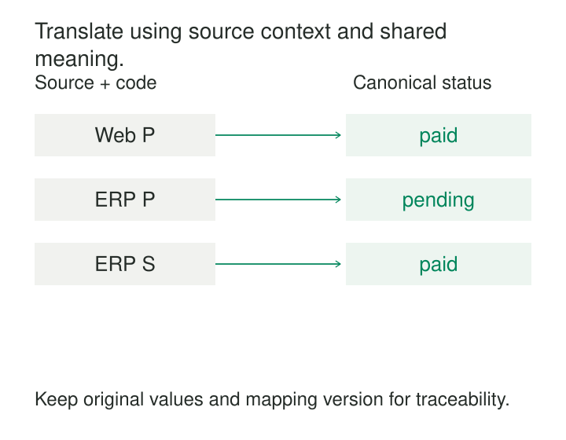

A company combines payment data from its website and enterprise system. Both contain a field called `status`. Both use the code `P`. On the website, `P` means *paid*. In the enterprise system, it means *pending*.

The combined table loads successfully. Its columns have consistent names and types. Its payment report is wrong.

**Canonical Mapping translates source-specific representations into an explicitly defined shared model.** It makes data comparable across systems by reconciling structure, codes, units, and meaning. Each source keeps its own internal representation; a mapping expresses how that representation relates to the shared contract.

The difficult part is establishing which meanings can safely be treated as equivalent.

## Give each source a route into shared meaning

A canonical model defines the representation that participating consumers agree to use. It might describe a payment, shipment, customer contact, or measurement. Its scope should be clear enough that people can explain what every record and field means.

A mapping connects a source representation to that model. It can specify:

- Which source fields populate which target fields.
- How source codes correspond to target concepts.
- Which conversions or contextual conditions apply.
- What happens when no valid translation exists.

This follows the established **Canonical Data Model** integration pattern: applications translate through a common representation, reducing dependencies between their individual formats. A new participant can integrate with the shared model without requiring a separate translation for every existing application. [Enterprise Integration Patterns](https://www.enterpriseintegrationpatterns.com/patterns/messaging/CanonicalDataModel.html)

In data engineering, those translations may run in batch transformations, streaming jobs, integration adapters, or views. Their location matters less than their explicit, reusable semantics.

## The same code can mean different things

Consider this illustrative payment mapping:

| Source | Source code | Source meaning | Canonical status |
|---|---|---|---|
| Website | `P` | Paid | `paid` |
| Enterprise system | `P` | Pending | `pending` |
| Enterprise system | `S` | Settled | `paid` |

The target contract defines `paid` as a completed payment under the agreed reporting rules. Source owners have confirmed that website `P` and enterprise `S` satisfy that definition.

The lookup therefore depends on **source plus code**. A rule based only on `P` would silently misclassify one system.

Even this mapping needs boundaries. If the enterprise system distinguishes settlement from capture, and consumers need that distinction, collapsing both into `paid` may be too coarse. The target might need separate payment and settlement states.

Now suppose a source introduces `R`. The pipeline should expose an unresolved mapping, retain the original value, and follow an explicit handling policy. Automatically translating every unfamiliar code to `pending` manufactures a business assertion.

## Mapping fields also means mapping their contracts

Two parcel systems describe package weight:

| Source | Source representation | Canonical representation |
|---|---|---|
| Carrier A | `weight_g = 1250` | `weight_kg = 1.250` |
| Carrier B | `mass_kg = 1.25` | `weight_kg = 1.250` |

Carrier A requires division by 1,000; Carrier B requires a field rename and compatible numeric representation.

The conversion is correct only if both sources measure the same thing. If Carrier A reports gross parcel weight while Carrier B reports the contents alone, converting their units does not make the values comparable. The canonical model must distinguish those quantities or define how the missing packaging weight is obtained.

Structural mapping tools can implement part of this mechanism. AWS Glue’s `ApplyMapping`, for example, declares source columns and types alongside target columns and types. It also returns only the specified fields, so preserving provenance requires including it deliberately. Such a tool executes structural instructions; the team still has to establish semantic correspondence and implement required conversions. [AWS Glue ApplyMapping documentation](https://docs.aws.amazon.com/glue/latest/dg/aws-glue-api-crawler-pyspark-transforms-ApplyMapping.html)

## A documented implementation: OMOP vocabulary mapping

The OMOP Common Data Model provides a concrete implementation of mapping heterogeneous source concepts into standardized concepts.

Its vocabulary documentation includes a mapping from source code `M65.3`, “Trigger finger,” to a standard concept with the same meaning. It also documents broader mappings and cases where one source concept maps to several standard concepts. These relationships are represented through vocabulary tables rather than independently embedded in every analytical query. [OMOP vocabulary mapping documentation](https://ohdsi.github.io/CommonDataModel/vocabulary)

OMOP also provides fields for the original source value, the source concept, and the standardized concept. This lets standardized analysis use shared concepts while retaining the source representation for investigation. [OMOP data model conventions](https://ohdsi.github.io/CommonDataModel/dataModelConventions.html)

The distinction becomes important when a compound source concept produces multiple standardized records. One source record can legitimately expand into several target records. A downstream count must therefore distinguish source occurrences from mapped concepts. Canonical mapping can change representation and cardinality; its output grain must be declared.

## Correctness depends on context, direction, and time

A mapping expresses a claim about meaning. Several assumptions determine whether that claim holds.

**The source must be identifiable.** A code often needs a namespace, field, vocabulary version, or business context. Identical text is weak evidence of equivalence.

**The target must be precise enough for its intended use.** Mapping several detailed categories into one broader category loses information. That can be appropriate for reporting, provided consumers understand the loss and the original detail remains available.

**The relationship has a direction.** A detailed source category may map safely into a broader target category, while the reverse translation cannot recover the original detail. HL7 FHIR’s `ConceptMap` explicitly treats mappings as directional and contextual. It can describe semantic relationships, multiple candidate targets, and dependencies on additional attributes. A mapping suitable for one business use cannot automatically be assumed suitable for another. [HL7 FHIR ConceptMap specification](https://hl7.org/fhir/R5/conceptmap.html)

**The selected rule must be reproducible.** Retain the mapping release and target-model version used to produce an output. Where code meanings change over time, define which effective date selects the rule. Reprocessing an old record through today’s mappings may produce a different result; that change should be deliberate.

For an ordinary scalar translation, overlapping applicable rules are an error unless precedence is explicitly defined. For a legitimate compound mapping, multiple outputs may be required. Those two situations need different handling.

## Make uncertainty and change visible

A useful mapping system distinguishes several outcomes: a successful exact translation, an accepted broader translation, an unknown source code, an ambiguous mapping, and a source concept with no suitable target.

Putting all of these into `other` makes the output convenient while hiding why information was lost. Coverage should be measured by source and important segment. A mapping that covers 99% of rows overall may still fail for most records from a newly acquired business.

Verification should examine semantic examples as well as schema validity. Useful checks include expected translations, conflicting rules, unexpected row multiplication, valid target concepts, and reconciled measures after conversion. A structurally valid output can still misrepresent its source.

Mapping changes also require an explicit historical policy. A corrected rule may justify rebuilding past outputs. A new business classification may apply only from a chosen date. Quietly editing a lookup table leaves consumers unable to tell which interpretation produced a report.

## Where the investment pays off

Canonical Mapping is especially useful when several sources feed shared analytics, multiple consumers repeat the same translations, or acquisitions and vendor changes regularly introduce new representations.

Its main operating cost is often stewardship: investigating source semantics, resolving disagreements, reviewing new codes, and maintaining compatibility. Runtime costs depend on implementation. Small mappings can be loaded into memory; large or conditional mappings may require joins, distributed processing, or terminology services. Historical remapping adds recomputation and validation costs.

A shared model also creates a dependency. Changes can affect many producers and consumers, so it needs ownership and a manageable evolution policy.

Keep its scope bounded. A focused canonical payment model can be useful without settling every meaning of “customer” across the enterprise. With only two simple systems and one stable consumer, a direct translation may be easier to maintain.

## Related patterns

[[data-shared-business-vocabulary|Shared Business Vocabulary]] supplies the agreed meanings that mappings express. [[data-controlled-vocabularies|Controlled Vocabularies]] defines the permitted target concepts.

[[data-reference-data-enrichment|Reference-Data Enrichment]] can implement a mapping lookup or add descriptions afterward. Canonical Mapping carries the responsibility for translating source meaning into the shared contract.

[[data-preserve-raw-inputs|Preserve Raw Inputs]] retains the evidence needed to inspect a disputed translation and rebuild outputs when the mapping changes.
