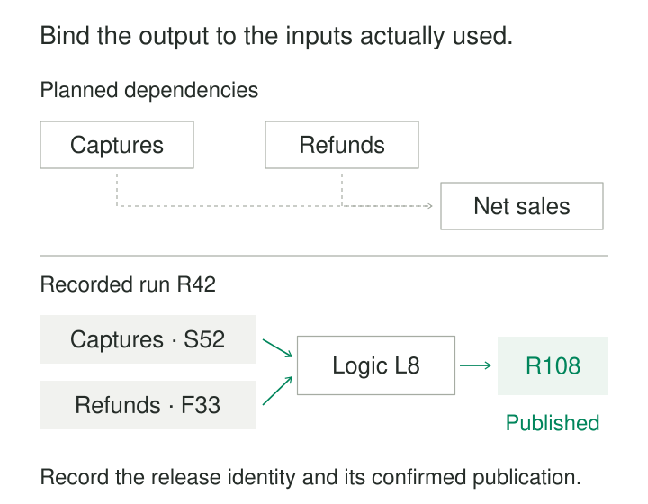

Yesterday’s sales report showed USD 100. Today, the same reporting date shows USD 95. The dashboard definition appears unchanged, and every pipeline job is green.

Did a refund arrive late? Did a filter change? Did the report read a different source snapshot?

A diagram showing “payments feed sales” cannot answer those questions.

**Capture Lineage at Transformation records the relationship between an output, the specific inputs used to produce it, and the transformation that connected them.** Its purpose is to make provenance available while the execution context still exists, supporting investigation, change assessment, and controlled rebuilding.

The useful question is precise: **what produced this particular output?**

## Separate planned dependencies from recorded execution

A planned dependency describes how a system is intended to work. A model definition might declare that net sales depends on captures and refunds.

Recorded execution adds another layer: run R42 used captures snapshot S52, refunds snapshot F33, and transformation L8 to produce output release R108.

Both forms are useful. Planned dependencies help assess possible downstream effects before execution. Runtime records help investigate what happened during a particular execution.

OpenLineage makes this distinction explicit through runtime `RunEvent` records and design-time job and dataset events. Its object model separates a reusable job from an individual run and the datasets involved. [OpenLineage object model](https://openlineage.io/docs/spec/object-model/)

A runtime observation still has limits. Recording an input table does not establish which individual rows contributed to every result, or prove that instrumentation captured every dependency.



*The lower graph binds an execution to identifiable versions. Publication requires its own confirmed evidence.*

## Capture identities at the execution boundary

A useful lineage record identifies the job and execution, its inputs, the transformation version, and its output.

| Element | Illustrative evidence |
|---|---|
| Execution | Run R42, attempt A2 |
| Inputs | Captures S52; refunds F33; reporting date October 25 |
| Transformation | Logic L8; configuration C7 |
| Output | Release R108; destination and affected partition |
| Outcome | Committed publication, linked to its receipt |

Dataset identities need sufficient scope. `orders` is ambiguous across databases, tenants, and environments. A snapshot identifier also needs the dataset to which it belongs.

Capture versions when inputs are resolved or opened. Looking up the latest version after processing can attach information the job never used.

Record relevant reference data, parameters, time zones, and external responses where they affect the answer. A code revision alone does not identify the full computation.

OpenLineage provides a dataset version facet and a source-code-location facet containing revision information. These are mechanisms for carrying evidence; instrumentation must populate them accurately. [Dataset version facet](https://openlineage.io/docs/spec/facets/dataset-facets/version_facet/), [source code location facet](https://openlineage.io/docs/spec/facets/job-facets/source-code-location/)

## Example: explain a restated sales figure

Consider two releases for the same reporting date:

| Release | Captures | Refunds | Logic | Net sales USD |
|---|---|---|---|---:|
| R108 | S52: 120 | F33: 20 | L8 | 100 |
| R109 | S52: 120 | F34: 25 | L8 | 95 |

A late refund increases the refund total from 20 to 25. The captures and transformation remain unchanged.

The lineage records narrow the investigation: the difference comes from the refund input version. Engineers can inspect F33 versus F34 instead of starting with every component in the reporting pipeline.

Preserve R108’s original relationship to F33. Updating its lineage to point to the latest refund snapshot would erase the explanation for its original value.

The evidence also identifies inputs for a reproduction attempt. Successful reproduction additionally requires those versions to remain accessible and the transformation’s other dependencies to be controlled. Lineage can identify expired evidence without making it retrievable.

## Example: a field can influence output without appearing in it

Consider this transformation:

```sql
select region, sum(amount_usd) as captured_usd
from captures
where status = 'settled'
group by region;
```

The amount contributes to the aggregate. Region determines its grouping. Status controls which records participate, even though status is absent from the output.

If the business meaning of `settled` changes, the report can change without any modification to its amount calculation.

A lineage extractor that records only selected columns misses this dependency. Similar influences arise through join conditions, window definitions, and conditional expressions.

Field-level lineage should therefore distinguish value derivation from other influences where the capture system supports that detail. OpenLineage’s lineage facet supports both entity-level and field-level relationships. [OpenLineage lineage facet](https://openlineage.io/docs/spec/facets/dataset-facets/lineage/)

This remains dependency evidence, rather than a guarantee that a particular source row contributed to a particular total. Exact record-level provenance requires additional machinery and potentially much more storage.

## Example: an incremental output inherits earlier data

A table contains daily summaries for October 23–25. A correction rebuilds October 25 while retaining the other days.

Recording only the correction’s new source inputs gives an incomplete explanation of the resulting table version. Its unchanged days still derive from earlier processing.

There are several valid representations. Partition-level lineage can identify the newly replaced partition and retain the existing lineage for unchanged partitions. A snapshot-level representation can record that the new release incorporates an earlier snapshot plus replacement data.

Make the scope explicit. An edge explaining the October 25 partition should not imply that the same run recomputed the entire table.

Append and merge operations raise the same issue: the resulting state may depend on previous destination state as well as incoming records.

## Couple lineage with publication evidence

Computation, output creation, and publication can succeed or fail independently.

A job may write a private candidate and fail validation. It may commit an output and crash before transmitting its lineage event. A metadata event may arrive before the output becomes visible.

Keep those states distinguishable. An output mentioned in a run event should not automatically be treated as a successfully published release.

Where the architecture permits, place the provenance reference in the output’s durable manifest or commit metadata. Deliver catalog events through a reliable path, then reconcile published releases against recorded lineage.

Retries also need identifiable attempts and outputs. Repeated delivery of one metadata event should not create several fictional executions.

For important datasets, define the response to missing evidence: block promotion, publish with a visible warning, or open a bounded repair task. The appropriate choice depends on the dataset’s requirements.

## Verify what the instrumentation actually captures

Apache Airflow’s OpenLineage integration demonstrates why a visible job graph can overstate coverage.

Basic task events can exist while input and output dataset details are missing. Supported operators and hooks can provide additional evidence, including dataset identities and query identifiers, but the available detail varies by implementation. [Airflow OpenLineage supported classes](https://airflow.apache.org/docs/apache-airflow-providers-openlineage/stable/supported_classes.html)

Check representative paths: ordinary SQL, dynamically constructed queries, custom code, external lookups, and incremental writes. Compare captured relationships with independently understood examples.

Label declared, inferred, and observed relationships clearly. Preserve unknowns rather than presenting an incomplete graph as exhaustive.

Monitor coverage as an operational concern: missing output-version links, unmatched publication receipts, extraction failures, and delayed events all deserve attention.

## Costs, limits, and useful situations

This pattern is particularly useful when outputs combine many sources, logic changes frequently, historical corrections matter, or failures require targeted backfills.

Costs include instrumentation, metadata delivery, retention, graph storage, reconciliation, and maintaining stable identities across platforms. Field-level and record-level detail increase both storage and interpretation costs.

Choose a useful granularity. A table-level graph may answer broad impact questions; partition or version detail may be necessary for historical investigation.

Protect the metadata itself. Query text, paths, parameters, and dataset names can reveal sensitive information or accidentally include credentials. Retain the evidence needed for investigation without copying unnecessary payloads.

Lineage does not establish correctness. A perfectly documented transformation can still use the wrong business rule. Its value is making the chain of dependencies inspectable.

## Related patterns

[[data-run-ledgers|Run Ledgers]] records execution history; lineage connects those executions to their data dependencies.

[[data-version-transformation-logic|Version Transformation Logic]] identifies the implementation behind an output. [[data-replayable-backfills|Replayable Backfills]] uses provenance and retained inputs to rebuild a controlled scope.

[[data-source-to-target-reconciliation|Source-to-Target Reconciliation]] checks whether records and measures agree across boundaries. Lineage helps identify which boundaries and versions should be compared.
