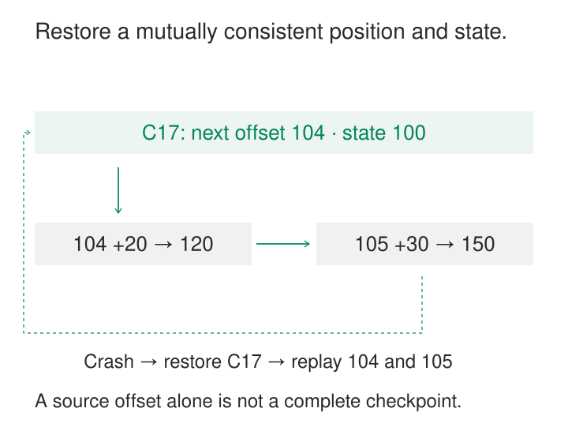

A pipeline has processed most of a large import when its worker disappears. Restarting from the beginning wastes hours. Starting from the last record it remembers is faster—but only if that memory agrees with what actually reached the destination.

Checkpoint and Resume preserves a durable recovery point so processing can continue after failure or interruption. The checkpoint connects completed input, retained computation state, and recoverable output.

Its purpose is to limit repeated work while preserving the meaning of the result. The difficult part is identifying a point from which repeating the remaining work is safe.

## Save a consistent recovery boundary

A checkpoint records enough information to reconstruct a valid continuation.

What that includes depends on the computation:

| Component | Example |
|---|---|
| Input identity | Topic and partition, immutable export version, or file manifest |
| Input position | Next offset, last completed key, or completed chunks |
| Computation state | Running totals, join buffers, deduplication markers, timers |
| Output progress | Committed transaction, published batch, or recoverable pending write |
| Compatibility information | Pipeline version, state schema, configuration, reference-data version |

A stateless file copy may need little more than a source identity and completed-part manifest. A stateful streaming join needs substantially more.

The components must describe the same logical boundary. Saving an input cursor after processing record 105 while retaining aggregate state only through record 103 skips two contributions on recovery. Restoring newer state with an older cursor can apply them twice.

With partitioned input, the recovery position is usually a collection of positions. There need not be one global offset or timestamp representing progress everywhere.

## Example: restore a running total

A stream processor maintains a running quantity total. Its latest completed checkpoint, C17, contains:

- Next input offset: **104**
- Aggregate total: **100**

It then processes offset 104, adding 20, and offset 105, adding 30. The in-memory total reaches 150. The worker crashes before another checkpoint completes.

Correct recovery restores C17’s total of 100 and resumes reading at offset 104. Replaying the two records produces 150 again.

Starting at offset 106 with total 100 loses 50. Replaying those records into total 150 produces 200.

Flink’s checkpoint mechanism recovers operator state together with stream positions. Its documented prerequisites include replayable durable input and persistent checkpoint storage. [Flink checkpointing](https://nightlies.apache.org/flink/flink-docs-release-2.3/docs/dev/datastream/fault-tolerance/checkpointing/)

Spark Structured Streaming similarly records progress information, including offset ranges, alongside running aggregate state in its checkpoint location. [Spark recovery with checkpointing](https://spark.apache.org/docs/latest/streaming/apis-on-dataframes-and-datasets.html#recovering-from-failures-with-checkpointing)

Position conventions deserve explicit names. Kafka distinguishes the consumer’s current position from its committed recovery position; committed offsets identify where reading should resume. Fetching records advances position before the application necessarily finishes their effects. [Kafka consumer positions](https://kafka.apache.org/41/javadoc/org/apache/kafka/clients/consumer/KafkaConsumer.html)

A cursor should therefore mean something precise, such as `next_offset`, rather than an ambiguous `last_seen`.

## Output already written still matters

The aggregate example reconstructs internal state. Suppose the processor also wrote results to an external database before crashing.

Restoring C17 does not automatically undo those writes. Replaying records may append duplicates or repeat increments.

Two common designs resolve this boundary.

One stores output changes and recovery progress in the same destination transaction. Either both commit or neither does. Kafka’s consumer documentation describes storing offsets with relational database results for this purpose. [Kafka atomic result and offset storage](https://kafka.apache.org/41/javadoc/org/apache/kafka/clients/consumer/KafkaConsumer.html)

Another allows replay but makes destination writes idempotent through stable event identities, batch identities, or version-aware replacement. Some streaming sinks instead coordinate transactional publication with checkpoint completion.

The guarantee depends on the complete source–processor–sink arrangement. Checkpointed operator state alone cannot make an arbitrary HTTP call or database increment happen exactly once.

Uncertain outcomes are especially important: a destination may have committed even when the worker never received confirmation.

## Example: resume an extraction from a stable source

An import reads an immutable customer export identified as version V17. It processes records in increasing customer-ID order.

After loading through customer 20,000, it commits both the destination rows and a progress record identifying V17 and the last completed key. The next page begins strictly after that key.

If a later page fails, the importer restores that committed position and repeats the unfinished work. If destination rows and progress cannot share a transaction, stable destination keys can make replay safe.

Source identity matters as much as the cursor. Reusing `last_customer_id = 20000` against a changed export can combine records from different versions. A mutable table can also receive updates behind the cursor that a simple forward scan never revisits.

A database snapshot token may have a limited lifetime. PostgreSQL documents that an exported snapshot is available for import only while its exporting transaction remains open. Saving the token does not preserve that snapshot across the exporting transaction’s failure. [PostgreSQL snapshot synchronization](https://www.postgresql.org/docs/current/functions-admin.html#FUNCTIONS-SNAPSHOT-SYNCHRONIZATION)

A resumable extraction therefore needs a source contract that survives the intended interruption: retained immutable exports, supported historical versions, or a snapshot-and-change-capture protocol with its own recovery rules.

## Example: resume a multistage workflow

A daily product-catalog workflow has four stages:

**Extract → Validate → Build search index → Publish**

Extraction and validation succeed. Index construction fails.

A useful recovery record preserves the validated artifact’s location, version, and completion status. Resumption rebuilds the index from that artifact rather than repeating extraction against today’s changing source.

AWS Step Functions provides a documented workflow-level implementation through redrive for eligible Standard Workflows. It preserves successful-step results and resumes unsuccessful work using the same input and original state-machine definition. Its documentation also describes state-specific exceptions and eligibility limits. [Step Functions redrive](https://docs.aws.amazon.com/step-functions/latest/dg/redrive-executions.html)

The failed task may still have produced partial external effects. Index construction can use a stable build identity and isolated staging location so a retry can replace or continue that build safely. Publication then switches readers to the completed version.

A recorded failure means the workflow did not confirm completion. It does not prove that the external task did nothing.

## Publish checkpoints only when they are complete

A checkpoint can span many files and workers. Recovery must avoid selecting a half-written collection.

A common design writes immutable checkpoint components, verifies their completion, and publishes a manifest or completion record only afterward. Recovery follows that completed manifest. Framework-managed checkpoints provide their own coordination protocol.

The checkpoint must live somewhere that survives the failures it is intended to cover. Worker-local storage cannot protect against losing that worker and its disk.

Concurrent ownership also needs control. An old worker must not continue advancing progress or publishing output after a replacement resumes the job. Leases, ownership generations, fencing, or transactional conditions can enforce that boundary.

## Balance recovery cost against checkpoint cost

Frequent checkpoints reduce replay but consume storage bandwidth, metadata operations, serialization work, and coordination time. Large operator state can make checkpointing a significant part of the workload.

Less frequent checkpoints reduce that overhead while increasing recovery work. If the latest completed checkpoint is thirty seconds behind a stream processing 10,000 records per second, recovery may need to replay roughly 300,000 records.

The relevant measurement is the age of the latest **completed** checkpoint. A checkpoint configured to start every minute provides little protection if none has completed for an hour.

Recovery time also includes restarting workers, loading state, restoring connections, and catching up with arrivals. A job needs spare processing capacity to reduce backlog after resumption.

Monitor checkpoint completion age, duration, failures, stored size, restore duration, and post-restart lag. Failure tests should verify result correctness as well as whether the process starts again.

## Know when an old checkpoint no longer applies

Input retention must outlast the recovery horizon. A saved offset pointing to deleted records cannot reconstruct missing state.

Code and state must remain compatible too. Changing grouping keys, state schemas, or source identity can invalidate continuation. Spark explicitly documents restrictions on restarting changed stateful queries from existing checkpoints. [Spark checkpoint compatibility](https://spark.apache.org/docs/latest/streaming/apis-on-dataframes-and-datasets.html#recovery-semantics-after-changes-in-a-streaming-query)

Checkpoints preserve progress through a particular computation. Correcting historical logic may require migration or recomputation rather than resuming its old state.

## Related patterns

[[data-idempotent-writes|Idempotent Writes]] makes replay safe at destinations. [[data-deterministic-transformations|Deterministic Transformations]] helps repeated computation reproduce its intended result.

[[data-microbatch-processing|Microbatch Processing]] supplies convenient bounded execution and commit units. [[data-preserve-raw-inputs|Preserve Raw Inputs]] keeps the material needed when recovery requires replay or rebuilding from an earlier boundary.
