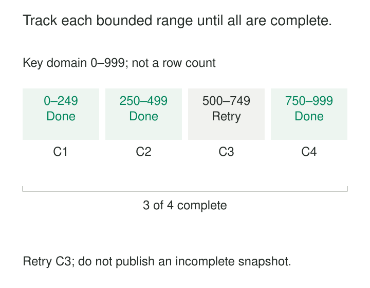

A large customer export runs for six hours before its connection fails. Most of the table has already been copied, but the job has no reliable record of which parts completed. Restarting means reading everything again.

Adding more workers may shorten the run, but introduces another problem: how does the system know that their combined output covers the whole table?

[[data-chunked-snapshotting|Chunked Snapshotting]] divides a large snapshot into bounded, identifiable units of work. Each chunk has explicit coverage, durable output, and recorded progress. Completed chunks can be distinguished from unfinished ones, making retries, throttling, and parallel execution manageable.

Chunking controls the work. A separate consistency protocol determines what source state that work represents.

## Give every chunk a precise boundary

A chunk might cover a primary-key range, a physical partition, or a bounded number of rows selected in a deterministic key order.

For an illustrative scope containing integer keys from 0 through 999, four chunks could cover:

`[0,250)`, `[250,500)`, `[500,750)`, `[750,1000)`

The boundaries include their lower value and exclude their upper value. A key of 500 belongs to the third chunk, so adjacent chunks neither omit nor duplicate that boundary.

The selection mechanism can be simple:

```sql
SELECT customer_id, name, region
FROM customer
WHERE customer_id >= :lower_bound
  AND customer_id <  :upper_bound
ORDER BY customer_id;
```

This query defines coverage; it does not establish snapshot consistency.

A useful run manifest records the source scope, chunk boundaries, consistency context, output locations, and completion status. If boundaries are generated dynamically, the recorded continuation key must include every field needed to order rows uniquely.



## Example: retry the unfinished range

In the illustrated run, C1 writes 220 rows, C2 writes 60, and C4 writes 12. C3 fails before its output is complete.

The manifest records three successful chunks and one unfinished range. Recovery retries C3 rather than assuming the entire export failed.

C4’s completion does not mean extraction can resume “after key 999.” That would skip C3. Parallel progress requires individual chunk status or another representation that preserves unfinished gaps.

A chunk becomes complete only after its output is durably accepted. A crash after writing output but before recording completion can cause replay. Replacing output for the same run-and-chunk identity, or applying suitable deduplication, prevents that retry from duplicating data.

An empty range can be a successfully completed chunk. Likewise, fewer rows than expected may reflect sparse keys rather than failure. Completion follows the extraction contract, not a guessed row count.

## Choose boundaries that remain navigable

Primary-key range scans are common because they provide an indexed, deterministic traversal.

Offset pagination is less attractive for large extractions. PostgreSQL documents that skipped rows still have to be computed, making large offsets potentially inefficient. It also requires a uniquely constrained ordering to produce predictable subsets. [PostgreSQL: LIMIT and OFFSET](https://www.postgresql.org/docs/18/queries-limit.html)

Equal key intervals do not imply equal work. One interval may contain almost every row, while another is empty. A practical planner can choose boundaries using observed keys or partition statistics.

Row width matters too. Ten thousand short reference records and ten thousand documents with large payloads create different memory and transfer demands.

A traversal key should remain stable under the chosen protocol. If a row’s key can move into a range already processed, simply continuing forward can miss it. Composite keys need complete ordering rules; sorting only by a nonunique timestamp leaves ambiguous boundaries.

The run also needs a termination rule. Under a frozen source snapshot, the visible population is bounded. Under concurrent writes, a coordinated upper boundary and change-capture protocol may be necessary so the scan does not endlessly chase new rows.

## Two consistency contracts

Chunked snapshotting commonly follows one of two designs.

**All chunks share one database snapshot.** Each chunk reads a different subset of the same visibility view. Their combined output can represent one source state, provided coverage is complete.

PostgreSQL supports exporting a transaction snapshot and importing it into other sessions. Independently opened transactions do not automatically share visibility. [PostgreSQL: Snapshot Synchronization](https://www.postgresql.org/docs/18/functions-admin.html#FUNCTIONS-SNAPSHOT-SYNCHRONIZATION)

This design preserves point-in-time meaning, but the shared snapshot may need to remain alive for the entire extraction. Small queries do not remove the cost of retaining that older view. If it disappears, unfinished chunks cannot simply resume against today’s data while keeping yesterday’s completed chunks.

**Chunks are reconciled with ongoing change capture.** Individual reads can occur at different times, while a defined protocol combines their rows with intervening mutations.

Here, the raw chunk files are not automatically a snapshot of one instant. Correctness comes from reconciliation with the stream.

## Example: a live update overtakes a copied row

A chunk reads customer C-418 with region North. While that chunk is in progress, the source commits a change to South.

If the stream delivers South and the snapshot later delivers North, an ordinary arrival-order upsert can restore the stale value.

Watermark-based protocols address this collision. In one approach, recognizable markers bracket the chunk read in the source change stream. Changes observed within that window are compared with buffered snapshot rows. A colliding snapshot row is suppressed so it cannot overwrite the corresponding logged mutation.

Debezium’s incremental snapshot documentation describes this buffering and collision handling, including updates and deletes. It also documents resumable progress and continued streaming during incremental snapshots. [Debezium: Incremental Snapshots](https://debezium.io/documentation/reference/stable/connectors/postgresql.html#postgresql-incremental-snapshots)

Those guarantees depend on the protocol’s read visibility and ordering assumptions. An arbitrarily lagging replica read cannot be substituted merely because it returns the requested keys.

The watermark mechanism is more than a timestamp attached to each chunk. It connects the read to identifiable positions in the change history.

## Example: repair existing state without stopping the stream

A downstream search index loses a subset of customer records. Future changes alone will not restore customers whose source rows remain unchanged.

A chunked rescan can repopulate the affected table or key ranges while change capture continues. This limits repair work and avoids forcing unrelated tables through another full initialization.

The DBLog paper describes this design: selected table rows are read in chunks, progress is retained for pause and resume, and watermarks reconcile those reads with the live transaction log. The authors reported production use across multiple Netflix microservices at publication in 2020. [Andreakis and Papapanagiotou: DBLog](https://arxiv.org/abs/2010.12597)

The repair must still define deletion behavior. Recopied rows restore present records; they do not automatically remove stale destination rows absent before the repair window. That requires authoritative reconciliation or rebuilding the affected scope into a fresh destination.

## Tune for bounded work, not maximum throughput

Smaller chunks reduce memory requirements and the amount repeated after failure. They also increase query overhead, checkpoint writes, and scheduling work.

Larger chunks reduce that overhead but increase retry cost, buffer size, and exposure to timeouts. Additional workers can improve throughput while increasing source I/O, connection use, and competition with operational traffic.

Debezium exposes chunk size as a configurable row limit and documents the efficiency-versus-buffer-memory tradeoff. [Debezium: Chunk Size](https://debezium.io/documentation/reference/stable/connectors/postgresql.html#debezium-property-incremental-snapshot-chunk-size)

Useful measurements include chunk duration, bytes read, retries, source load, and change-stream lag. A slow chunk may indicate skew or large rows rather than a need for more concurrency.

Checkpoint metadata and output storage also need cleanup policies. Completed chunks must remain attributable to their run so retries cannot accidentally combine different scopes or schema versions.

## Completion is a separate decision

Chunked snapshotting is useful for large initial loads, resumable exports, selective repairs, and controlled backfills.

Common mistakes include marking chunks complete before durable storage, treating the largest completed key as complete coverage, and assuming each short transaction shares the same snapshot.

A run should finish only when every required chunk is accepted and its consistency obligations are satisfied. For stream-reconciled initialization, copying the last chunk may still leave changes to apply. For a retained point-in-time export, losing the shared read view may require restarting the run.

Publishing partial output can be intentional, but readers then need an explicit completeness contract.

## Related patterns

[[data-consistent-snapshot-reads|Consistent Snapshot Reads]] gives independently processed chunks a shared visibility boundary.

[[data-snapshot-then-stream|Snapshot Then Stream]] connects copied state with continuing mutations; chunking changes the unit of that coordination.

**Idempotent Processing** makes repeated chunk delivery safe.

[[data-half-open-time-intervals|Half-Open Time Intervals]] uses the same boundary convention often applied to chunk ranges, though these ranges may partition keys rather than time.
