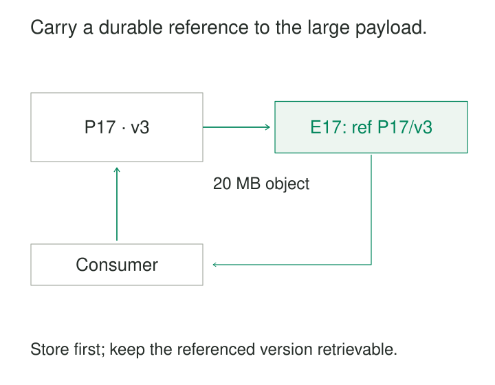

A document-processing pipeline needs to send a 20 MB attachment through a message broker. The broker rejects it, or accepts it at a cost that becomes painful as traffic grows. Routing services repeatedly serialize and transfer content they never inspect.

**Claim Check stores a payload separately and sends a small reference through the messaging system.** Consumers retrieve the content when they need it. The broker handles delivery and routing; a separate store holds the large bytes.

The name comes from checking luggage: the receipt travels with you while the luggage takes another route. In the original [Enterprise Integration Patterns description](https://www.enterpriseintegrationpatterns.com/patterns/messaging/StoreInLibrary.html), components temporarily remove message content, preserve it in a persistent store, and pass a reference that lets later components recover it.

## Two paths, one logical message

The producer first writes the payload to durable storage. After that write succeeds, it publishes an envelope containing a reference and enough metadata for routing and interpretation. The consumer receives the envelope, retrieves the referenced content, and processes it.

The reference can be an object-storage location, an opaque identifier resolved through a service, or another stable storage key. The pattern can externalize an entire payload or selected large fields.

A useful envelope might describe this illustrative document:

| Field | Example | Purpose |
|---|---|---|
| Event ID | `E17` | Identifies this publication |
| Event type | `DocumentSubmitted` | Supports routing |
| Document ID | `D42` | Identifies the business entity |
| Payload reference | `P17`, version `3` | Identifies the stored content |
| Content type | `application/pdf` | Describes its representation |
| Byte length | `20000000` | Supports validation and planning |
| Content digest | Full SHA-256 value | Supports integrity checking |

The event ID and payload reference serve different purposes. Two processing requests might reference the same document while representing distinct business operations.

The consumer also needs a compatible interpretation of the content. Moving JSON into object storage does not remove the need for schema versions, units, or agreed field meanings.

## A document reaches a processing worker

Consider an illustrative invoice service. It stores a scanned invoice, then sends a small `DocumentSubmitted` message to an extraction worker.

The worker downloads the exact document, extracts invoice fields, and commits its result under the event ID. A temporary processing failure can retry the same reference without making the producer upload the document again.

Amazon provides a concrete implementation through the **SQS Extended Client Library for Python**. The library stores a message payload in Amazon S3 and sends its reference through SQS. It can retrieve the payload for the receiver and provides an option for deleting the stored object when deleting the message. See [Managing large SQS messages using Python and S3](https://docs.aws.amazon.com/AWSSimpleQueueService/latest/SQSDeveloperGuide/extended-client-library-python.html).

That convenience requires agreement between producers and consumers. An ordinary receiver that does not understand the reference format receives an envelope rather than the original document.

## Large fields can leave the rest of a message intact

An application may need to send ordinary business fields alongside a large attachment. Routing components need the customer identifier and document category; the final handler needs the attachment.

NServiceBus implements this approach through its Claim Check, historically called DataBus, support. Selected properties are stored separately, while the message carries their references. Particular’s documented [Azure Blob Storage sample](https://docs.particular.net/samples/databus/blob-storage-databus/) demonstrates sending a large attachment through external storage to a receiving application.

This variation preserves useful metadata in the messaging path. It also makes the serialization contract important: the receiving application must be able to reconstruct the externalized property using the agreed format.

Framework support can automate storage and retrieval, but ownership of retention, recovery, and access still needs explicit design.

## Several subscribers can share one payload

Now consider an illustrative audio pipeline. A recording produces one publication for transcription, quality analysis, and usage metrics.

Transcription and quality analysis download the recording. The metrics consumer uses only the duration and recording category already present in the envelope. The recording does not need to pass through every intermediate component.

The benefit depends on actual access. If all three consumers download a 20 MB recording, their downloads still total approximately 60 MB, excluding retries and overhead. Claim Check reduces the broker’s payload traffic; it does not eliminate the consumers’ need to transfer content.

Sharing also changes deletion ownership. If transcription deletes the recording when it finishes, quality analysis may fail later. Particular explicitly discusses multiple subscribers, delayed processing, and retries as reasons that [Claim Check attachments cannot always be removed immediately](https://docs.particular.net/nservicebus/messaging/claimcheck/).

## The reference must survive failure

Correctness depends on keeping the envelope and payload meaningfully connected.

**Store before publishing.** Publishing first can deliver an unusable reference. Storing first creates a different failure case: the producer may crash before publishing, leaving an orphaned object. A durable publication record and retry mechanism can recover the intended message; cleanup must allow enough time for that recovery. Microsoft describes this coordination problem in its [Claim Check guidance](https://learn.microsoft.com/en-us/azure/architecture/patterns/claim-check).

A transactional outbox can record publication intent alongside a business transaction once the payload reference exists. It does not automatically make object storage and the application database one atomic transaction.

**Reference stable content.** An immutable object path or supported object version lets retries retrieve the same bytes. A mutable location such as `documents/latest.pdf` can return a different document during replay. A digest helps detect unexpected content, provided producer and consumer agree on exactly which bytes were hashed.

**Retain content through the recovery horizon.** Queue retention alone is insufficient. Delayed work, dead-letter recovery, operational replay, and slower subscribers may all extend the period during which retrieval remains necessary.

**Make processing repeatable.** A consumer can commit its result and crash before acknowledging the message. Redelivery then repeats retrieval and potentially the business operation. Stable event identities and idempotent effects remain necessary.

## Retrieval and authorization are part of delivery

A healthy broker cannot compensate for an unavailable payload store. Consumers may have valid messages while storage requests fail, permissions have changed, or required decryption keys are unavailable.

The reference should identify the content; authorization should determine who may retrieve it. Microsoft recommends keeping security credentials separate from the claim check. Temporary access links introduce an additional expiry that must match the processing and recovery window. See the [token and access considerations](https://learn.microsoft.com/en-us/azure/architecture/patterns/claim-check#problems-and-considerations).

Operating the pipeline therefore means monitoring retrieval failures, missing objects, integrity mismatches, and orphaned payloads alongside queue depth. Logs need enough identity information to connect a message to its stored object and processing attempts.

## Where the tradeoff pays

Claim Check is useful for large documents, images, audio, exported datasets, and messages that cross several components before their full content is needed. It is particularly attractive when only some consumers require the payload.

It adds storage writes, retrieval requests, network trips, lifecycle management, and another availability dependency. Cross-region downloads and repeated retries can make those costs substantial. Consumers may also need streaming reads to avoid loading an entire large object into memory.

For small messages that fit comfortably within the transport and meet latency requirements, inline delivery is often simpler. Compression can help repetitive content. Splitting a payload into independently useful chunks can support incremental processing, although reassembly adds sequencing and duplicate-handling concerns.

Several neighboring patterns sharpen the design. **Publish-Subscribe Distribution** gives consumers independent delivery progress, which affects payload retention. [[data-transactional-outbox|Transactional Outbox]] preserves publication intent. **Idempotent Processing** protects repeated attempts. [[data-manifest-based-file-ingestion|Manifest-Based File Ingestion]] defines a complete set of files; a claim check can point to that manifest, but the manifest still carries responsibility for declaring batch membership.

The decisive question is whether every legitimate processing attempt can still retrieve and interpret the exact content named by its message.
