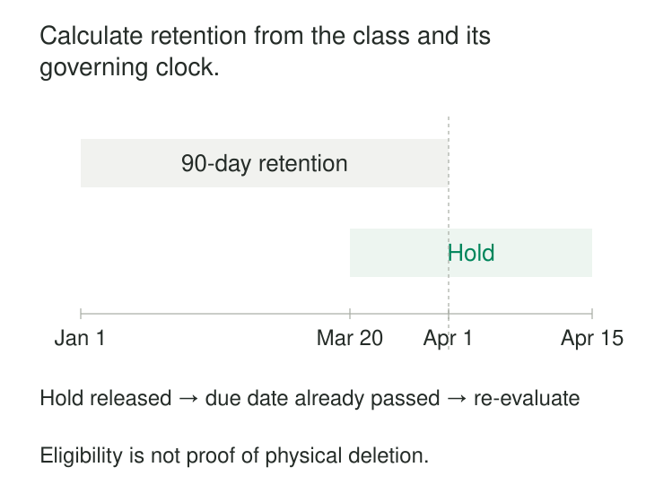

A storage bucket contains temporary extracts, customer correspondence, signed agreements, and investigation evidence. Someone proposes deleting everything older than a year.

The rule would remove some records too early and preserve others far longer than necessary. Moving everything into an archive would postpone the decision while keeping the same exposure.

**Classification-based retention assigns information to defined record classes, then applies the retention trigger, period, and disposal action appropriate to each class.** It makes lifecycle decisions repeatable without pretending that every file or row serves the same purpose.

The central relationship is simple: **the class selects the rule; a documented event starts its clock; current conditions determine whether disposal may proceed.**

## Classify by purpose and obligation

A retention class describes what information represents and why it is kept. Examples include routine diagnostic logs, support case records, executed contracts, and temporary reconciliation extracts.

This differs from a sensitivity classification. “Confidential” describes protection requirements but does not determine whether something should remain for seven days or several years. Two equally sensitive records can have very different useful lifetimes.

A retention schedule connects each class to an explicit rule:

| Illustrative class | Clock starts | Scheduled action |
|---|---|---|
| Routine diagnostic object | Object creation | Delete after 30 days |
| Support ticket record | Ticket closure | Dispose after 90 days, subject to exceptions |
| Executed contract record | Contract termination | Review for disposal after six years |

These periods are illustrative organizational choices, not universal requirements.

The ICO describes retention schedules as recording the types of information held, their purposes, and intended retention periods. Its UK GDPR guidance also explains that the regulation does not prescribe a standard duration for every data type; periods need justification. [ICO guidance on storage limitation](https://ico.org.uk/for-organisations/uk-gdpr-guidance-and-resources/data-protection-principles/a-guide-to-the-data-protection-principles/storage-limitation/)

A usable rule also needs an owner, scope, policy version, exception handling, and a clear endpoint: automatic deletion, anonymization, or a disposal review. Moving information to cheaper storage is a storage transition, not disposal.

*The dates illustrate a policy decision. Eligibility, permission to act, and verified completion are separate states.*

## Example: routine diagnostics and investigation evidence

A platform keeps routine diagnostic objects for 30 days after creation. Most support short-term troubleshooting. A small subset becomes evidence for a specific incident and requires a separately approved lifecycle.

Instead of extending every diagnostic object indefinitely, the platform distinguishes the routine class from the investigation record. It records the relationship between the incident and the evidence, applies the appropriate protection, and tracks the evidence’s eventual disposition.

Amazon S3 Lifecycle provides a concrete implementation mechanism: rules can select objects using tags, prefixes, or combinations of filters. A tag such as `retention_class=routine_diagnostic` can identify the objects governed by a particular rule. [S3 Lifecycle filters](https://docs.aws.amazon.com/AmazonS3/latest/userguide/intro-lifecycle-filters.html)

The tag is only a selector. Its correctness and the permissions to change it remain part of the design. Relabeling an object must not become an informal way to evade deletion or remove protected evidence.

The clock also needs precise interpretation. S3 age-based expiration uses object creation time and rounds the calculated eligibility time to a UTC midnight boundary. It does not interpret an arbitrary business timestamp inside the object. [S3 Lifecycle timing](https://docs.aws.amazon.com/AmazonS3/latest/userguide/intro-lifecycle-rules.html#intro-lifecycle-rules-actions)

A retention schedule must therefore map its intended clock onto the storage mechanism’s actual behavior.

## Example: a contract’s clock starts at termination

A contract is signed in 2022 and terminates in 2027. Under the illustrative schedule, its six-year disposal-review period starts in 2027.

Deleting it six years after signature would use the wrong event. Starting again whenever someone copies the document would create another error: an operational migration could extend retention without any change in business purpose.

The record needs a reliable contract reference, a termination event, the event’s effective date, and the applicable rule version. If termination is corrected or the agreement is extended, the system needs an explicit way to reconsider the calculated date.

Microsoft Purview implements event-based retention through retention labels associated with event types. Asset identifiers or queries connect an event to the relevant content. Microsoft warns that omitting that scope can trigger retention dates across all content carrying labels for the event type. [Purview event-based retention](https://learn.microsoft.com/en-us/purview/event-driven-retention)

This makes event matching a correctness requirement. “Contract terminated” is insufficient without identifying which contract terminated.

Missing events need attention too. A record waiting forever for an event that was never delivered can remain indefinitely, despite having a seemingly complete retention label.

## Example: a ticket reaches its date during a hold

Support ticket T41 closes at the beginning of 1 January 2027. Its illustrative 90-day period reaches its scheduled disposition date on 1 April.

A hold applied on 20 March blocks deletion. The ticket remains protected when April arrives. When an authorized person releases the hold on 15 April, the system reevaluates the overdue record against the remaining requirements.

It does not automatically start another 90-day period. A different policy might require another treatment, but that behavior must be explicit.

S3 Object Lock demonstrates the distinction between a retention period and a legal hold. Legal holds remain until removed and operate independently of retention periods. Protection applies to particular object versions; releasing one protection does not remove another that remains active. [S3 Object Lock](https://docs.aws.amazon.com/AmazonS3/latest/userguide/object-lock.html)

The operational system must coordinate holds with deletion execution. A stale list of deletion candidates should not override a newly applied hold.

Hold records need their own authority, scope, review process, and release evidence. A free-text “keep forever” flag is difficult to govern and easy to forget.

## Match the deletion unit to the classification

A single file may contain temporary debugging payloads alongside a support record that needs longer retention. Applying the longest period to the whole bundle preserves unnecessary detail. Applying the shortest destroys the required record.

Where practical, separate information whose lifecycle differs. Retain the necessary case record while removing temporary attachments according to their own approved rules.

Sometimes the storage unit prevents that separation. An object-store lifecycle rule deletes objects, not selected rows inside a mixed Parquet file. Row-level retention may require rewriting files, reorganizing partitions, or using a table format that supports the necessary operations.

Conflicting requirements need a defined resolution process. “Always choose the longest period” can violate a deletion requirement; “always choose the shortest” can violate a preservation requirement. The policy owner must resolve the conflict before automation acts.

## Follow copies and verify disposition

Deleting the primary record is only part of the lifecycle. Replicas, exports, search indexes, caches, noncurrent versions, and backups may retain representations of it.

S3 illustrates why “deleted” needs precision. In a versioning-enabled bucket, ordinary lifecycle expiration can create a delete marker while preserving the previous object version. Noncurrent versions require separate handling, and expiration is asynchronous. [S3 expiration behavior](https://docs.aws.amazon.com/AmazonS3/latest/userguide/lifecycle-expire-general-considerations.html)

Track scheduled dates, blocked records, attempted actions, failures, and verified outcomes separately. Keep sufficient disposition evidence without copying the deleted sensitive payload into the audit record.

Backup handling also needs a documented recovery approach so restored data does not silently return to ordinary use beyond its permitted lifecycle. Derived summaries need their own classification; removing direct identifiers does not automatically justify permanent retention.

## Costs, controls, and useful situations

This pattern helps when many datasets share a manageable set of lifecycle rules but differ substantially in purpose, starting events, or preservation requirements.

Operating costs include classification, event delivery, policy maintenance, hold administration, storage scans, file rewrites, and evidence reconciliation. Too many classes create complexity; overly broad classes encourage excessive retention.

Unknown classifications should become visible work with an owner and resolution deadline. Silently deleting unknown records risks loss; silently keeping them forever defeats the schedule.

Policy changes require impact assessment before activation. They may affect existing records immediately, producing a large disposal backlog. Verification should cover boundary dates, missing triggers, holds, reclassification, and the storage system’s actual deletion behavior.

## Related patterns

[[data-controlled-vocabularies|Controlled Vocabularies]] keeps retention classes consistent across systems.

[[data-policy-as-code|Policy as Code]] makes approved schedules executable and versioned, while preserving ownership of the underlying decisions.

[[data-sensitive-data-segregation|Sensitive-Data Segregation]] separates information that requires different access controls or lifetimes.

[[data-data-minimization|Data Minimization]] determines what information is necessary. Classification-based retention turns the time dimension of that decision into an operational lifecycle.
